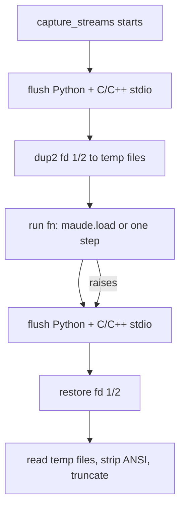
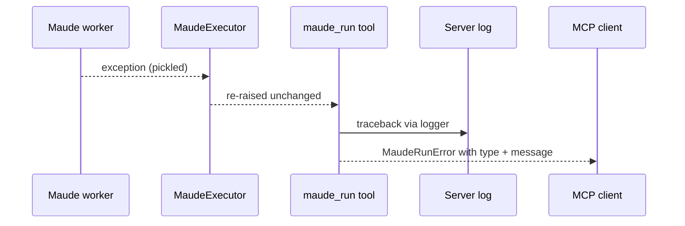

# Detailed Design — Complete Maude output capture and diagnosable `maude_run` failures

## Overview

Two independent defects surfaced from one bug report:

1. **Lost/leaked Maude output.** `capture_streams` redirects fds 1 and 2 to temporary
   files around a load or step, then restores the descriptors and reads the files. It
   never flushes libmaude's C/C++ stdio buffers. When the last command in a loaded file
   does not flush itself — a bounded `search` that reaches its bound is the confirmed
   case — its result block stays buffered after the capture ends. The block is then
   missing from the tool result and is written later to whatever fd 1 points to. In a
   worker, fd 1 is inherited from the MCP server, so the bytes can corrupt the JSON-RPC
   stdio transport. A related consequence is host/timing-dependent client symptoms.

2. **Opaque whole-call failures.** `maude_run` maps expected failures to specific
   messages, but any other exception becomes the fixed text
   `Unexpected failure running the Maude interpreter session`. The cause is chained
   server-side yet never reaches the MCP client, so the reported non-deterministic
   failure cannot be diagnosed from a client transcript.

The design fixes both: flush the stdio buffers inside the capture window, and include
the exception type and message in the wire error while logging the traceback.

## Detailed Requirements

- **R1 — Complete capture.** The output of a load phase must include the result block of
  a bounded search that reaches its bound as the file's last command, and any other
  output that libmaude leaves buffered when the phase returns.
- **R2 — No leak.** No bytes produced during a capture may reach the restored stdout
  after the phase; in a worker, the restored stdout is the MCP stdio transport.
- **R3 — Safe flushing.** Flushing must happen on both the success and exception paths,
  while the capture descriptors are still installed. A flush failure must never replace
  or mask the phase result or exception.
- **R4 — No semantic changes.** Wire models, step outcomes, search paths, caps and
  hermetic per-call behavior stay unchanged. Step stdout remains empty when the bindings
  return results programmatically and print nothing; only phases that actually write
  output gain content.
- **R5 — Diagnosable errors.** A non-`MaudeWorkerError` exception from the executor must
  produce a `MaudeRunError` whose text includes the exception type and message and whose
  `__cause__` is the original exception. The server must log the traceback.
- **R6 — Regression tests.** Unit tests must cover buffered C output and the no-leak
  property; an integration test must cover the bounded-search-at-end-of-load case; the
  error tests must assert the surfaced details.
- **R7 — Compatibility.** Existing diagnostics, session behavior, warnings parsing,
  truncation and the full test suite keep passing. No new dependencies.

## Architecture Overview

Capture is used by the worker for the load phase and each step. The fix inserts flushes
at the boundaries of the fd-redirection window.



The error boundary remains in the server process, outside the worker capture:



## Components and Interfaces

### `harold_mcp.maude.capture`

- New private helper `_flush_stdio()`:
  - flushes `sys.stdout` and `sys.stderr` (Python-level buffers);
  - calls libc `fflush(NULL)` (C stdio; in default configurations this also flushes
    C++ iostreams synchronized with C stdio);
  - suppresses every failure because flushing must not change the phase result.
- `capture_streams` calls `_flush_stdio()` **before** the redirect (so pre-existing
  buffered output goes to the real descriptors) and again in the `finally`, **before**
  restoring the descriptors. The public signature and return shape are unchanged.
- The helper uses only the standard library (`ctypes`, `sys`, `contextlib`), preserving
  the module's rule that importing it in the server process is safe.

### `harold_mcp.server.tools.interpreter`

- New private helper `_exception_detail(exc)`:
  - returns `"TypeName: message"`, or `"TypeName"` when the message is empty.
- The generic `except Exception` branch:
  - logs the exception with traceback via the module logger (`get_logger(__name__)`);
  - raises `MaudeRunError("Unexpected failure running the Maude interpreter session: "
    "<detail>") from exc`;
  - leaves the `MaudeWorkerError` branch (crash/timeout) unchanged.
- No public model or schema changes. The error text is the only wire-visible change.

### Tests and fixtures

- Unit (`tests/unit/test_maude_capture.py`):
  - a C `printf` without a newline is captured (would fail without the flush);
  - the same buffered output does not reach a stdout sink after the capture.
- Integration (`tests/integration/test_maude_session_integration.py` and a fixture):
  - a file whose last command is `search [1] a =>* Z:S .` reports the solution in
    `load_output["stdout"]`;
  - existing load-output and search-path tests continue to pass.
- Unit (`tests/unit/test_interpreter_tool.py`):
  - `ValueError: boom` appears in the `MaudeRunError` text;
  - an empty-message `RuntimeError` surfaces its type;
  - the original exception remains the cause.

## Data Models

No model changes. `SessionResult`, `CapturedOutput`, step outcomes and `MaudeRunError`
keep their shapes. The only observable change is richer `MaudeRunError` text.

## Error Handling

- **Flush failure:** suppressed by design; the phase result or propagating exception is
  unaffected.
- **Phase exception:** flushed partial output is discarded with the temporary files; the
  descriptors are restored; the exception propagates as before.
- **Unexpected session exception:** type and message reach the client; the traceback is
  logged server-side; the cause remains chained for programmatic callers.
- **Expected failures:** load failures, missing modules, theory modules, crashes and
  timeouts keep their existing, more specific messages.

Example client-visible text after the change:

```
Unexpected failure running the Maude interpreter session: TypeError: 'NoneType' object is not subscriptable
```

## Testing Strategy

Test-driven, smallest first:

1. Unit test for buffered C output (fails before `_flush_stdio`, passes after).
2. Unit test for the no-leak property.
3. Integration test for a bounded search at the end of a load (fails before the fix).
4. Unit tests for the error text, including the empty-message case.
5. Full suite (`make test`) plus static checks (`make check`); the research probes under
   the planning record are kept as executable evidence and updated to assert post-fix
   behavior.

Demo: run the bounded-search probe and observe the complete solution block in
`load_output` with nothing on the inherited stdout; unit-test the error text with a fake
executor.

## Appendices

### A. Technology choices

| Option | Assessment |
| --- | --- |
| `ctypes` + libc `fflush(NULL)` | Chosen. Flushes all C streams in one call, covers libmaude's stdout/stderr, no new dependency, empirically recovers the lost block. |
| Flush C++ iostreams directly | Not reachable from Python without a C++ extension; default iostream/C stdio synchronization makes `fflush` sufficient in practice. |
| Make the process stdout unbuffered | Cannot change libmaude's internal buffering portably; unbuffering fd 1 does not flush an existing `FILE*` buffer. |
| Line-buffered capture | Would still lose output without a newline and changes buffering semantics globally. |
| Filter at the MCP transport | Too late: the bytes may already interleave with JSON-RPC, and the worker is a separate process. |
| Capture only around the load | Already done; the missing piece is the flush, not the redirect window. |

### B. Research findings

- A bounded `search` that reaches its bound as the last command in a file loses its
  result block; `reduce` and searches that print `No more solutions.` are captured.
- Calling `fflush(NULL)` inside the capture window recovers the complete block.
- Without the fix, the block is later written to the worker's inherited stdout; with
  fd 1 redirected to a sink, the sink receives the block after the capture ends.
- Step commands use the bindings' APIs, which return results programmatically and print
  nothing; step stdout is normally empty. The observable loss is in the load phase.
- The original `Unexpected failure` is a separate issue. The capture leak is a plausible
  contributor to non-deterministic client symptoms, but it cannot raise inside the
  session engine, so it does not explain that exact server-side message.

### C. Alternative approaches

- **Append a `reduce` / move the bounded search / exhaust the state space.** Valid
  script-level workarounds for users; they do not fix the capture layer.
- **Worker-side exception wrapper with step context.** Useful follow-up (for example
  `step 0 (search) failed: ...`), but more invasive than needed for the first iteration;
  the tool already knows the request and the worker exception propagates with its type
  and message.
- **Log only, keep the generic wire text.** Rejected: remote agents and users only see
  the client transcript, which is exactly the diagnostic gap being closed.
- **MCP transport-level output guard.** Out of scope; the capture-layer flush removes the
  source of the stray bytes.

### D. Constraints and limitations

- The flush relies on POSIX file-descriptor semantics and `ctypes.CDLL(None)`; the
  project's Maude wheels are POSIX/Linux-targeted. Failures are suppressed, so an
  unsupported platform degrades to the previous behavior rather than breaking a call.
- `fflush(NULL)` flushes all C streams, not only the interpreted program's; this is the
  intended effect for a single-threaded worker.
- Python's own stream buffers are flushed too; worker code must still avoid printing
  inside a capture (the module contract is unchanged).
- The original generic failure remains undiagnosed until it is reproduced with the new
  error details; this design makes that reproduction actionable, not unnecessary.
