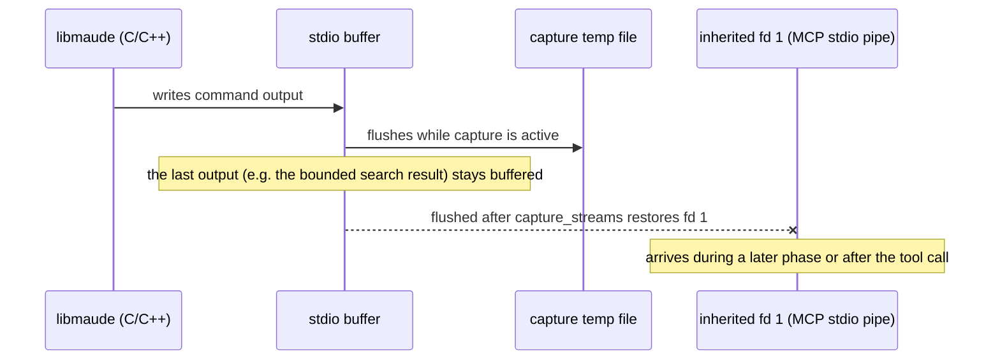

# Load-output truncation and stdout leak

Verification of the analysis recorded in `rough-idea.md` after the failure was reproduced
on the original (less powerful) host. The analysis was supplied by an agent on that host;
this note separates what is confirmed from what is wrong or unproven.

## Verdict in one paragraph

The **observable** is real and reproducible: a bounded `search` that reaches its bound as
the last command in a loaded file loses its result block. But the **mechanism** is not a
missing end-of-block terminator that Harold's load phase uses to frame commands — Harold
does not parse load output at all. The real cause is that `capture_streams` restores file
descriptors 1 and 2 without first flushing libmaude's C/C++ stdio buffer, so the tail of
the output stays buffered and is flushed later — into a later capture or, worse, into the
worker's inherited stdout (the MCP stdio pipe in production). The link to the
`Unexpected failure running the Maude interpreter session` error is **not established**.

## Claims checked

| Claim from the analysis | Verdict |
| --- | --- |
| The bounded search completes in 0 ms CPU / 106 states / 2125 rewrites; it is not slow or killed | **Plausible and consistent** with our measurements |
| A bounded search reaching its bound as the last command loses its result | **Confirmed**, deterministically on this host (5/5 runs) |
| `reduce` at end, unbounded search, and a bound not reached are captured | **Confirmed** for `reduce c .` and `search [5]` (prints `No more solutions.`) |
| The load phase frames each command by a terminator (`result …`, `No more solutions.`); the unclosed block is dropped | **Refuted**: Harold makes one `maude.load` call inside a whole-phase fd capture and reads the whole temp file; there is no per-command framing or parsing |
| Unread bytes "desynchronize the session" | **Refuted** for the session: there is no stream reader to desynchronize |
| The result once surfaced attached to a later step's `stdout` | **Confirmed as a symptom of the same bug**: the leftover buffer is flushed after the capture ends; where it lands depends on timing |
| The same bug explains subsequent "Unexpected failure" errors | **Unproven**: the generic error is raised only when `executor.run_session` raises a non-`MaudeWorkerError`; buffered output cannot raise inside the session engine |
| `maude_run` steps are unaffected | **Partly wrong**: step *results* are fine, but step *stdout* uses the same capture and can lose its tail too (our search step's captured stdout was empty and the block leaked) |
| "Not performance and not a timeout" | **True for the truncation symptom**; not established for the generic error |
| Maude model/solution analysis (7 crossings, mirror optimum, 16-state space, no dangerous state) | **Confirmed** and matches our `maude_run` results |

## Evidence

Probes are in `research/probes/` (outside `tests/`, not collected by the normal suite):

- `test_load_output_truncation.py`
  - `search [1] a =>* Z:S .` as the last command: captured load stdout contains only
    `==========================================\nsearch [1] in PROBE : a =>* Z:S .\n`.
  - `search [5] ...` and `reduce c .`: complete output captured.
  - `search [1]` followed by a `reduce` step: load output still truncated; the step's
    captured stdout is empty, and the search block appears on the inherited stdout.
  - five repetitions: truncation every time on this host.
  - `test_f_leftover_flushes_to_inherited_stdout` redirects fd 1 to a private sink,
    runs the session, and finds
    `Solution 1 (state 0) ... Z:S --> a` **in the sink**, i.e. after the capture restored
    fd 1. In production the sink is the MCP stdio pipe.
- `test_capture_flush.py`
  - Runs `maude.load` under a manual capture and calls
    `ctypes.CDLL(None).fflush(None)` before restoring the fds. The complete search output
    is then captured. This is the decisive proof that the bug is buffering, not framing.

## Mechanism

`capture_streams` (`src/harold_mcp/maude/capture.py`) does:

1. `dup2` fd 1/2 to temp files;
2. call `fn()` (`maude.load`, or one step);
3. restore fd 1/2 in `finally`;
4. read the temp files.

Nothing flushes libmaude's buffers between steps 2 and 3. Whether the tail survives
depends on whether Maude's code path happened to flush before returning. Maude's `reduce`
and `No more solutions.` paths flush; a bounded search that stops at its bound does not.
That correlation produced the "missing terminator" theory, but it is a property of
libmaude's print paths, not of Harold's protocol.

## Impact

- Any phase can lose the tail of its captured stdout (and, in principle, stderr).
- The lost bytes are not discarded: they are written later to whatever fd 1 points to.
  During a later capture that contaminates that phase's output; outside any capture it
  writes into the worker's inherited stdout, which is the MCP stdio transport. That is
  the same class of bug as the diagnostics stdout leak fixed in 0.0.5, and the fix is
  incomplete: capturing around the load does not prevent a later flush.
- Garbage interleaved with JSON-RPC can produce client-visible, timing-dependent
  failures. This is a plausible contributor to the non-determinism on the slower host,
  but it does **not** explain the exact server-side `MaudeRunError` message, which needs
  an exception from `executor.run_session`.
- `maude_program_diagnostics` uses the same capture helper and has the same exposure.

## Fix direction (for the design phase)

- In `capture_streams`, flush the C streams **inside** the capture window, before
  restoring fds, and on the exception path too:
  `ctypes.CDLL(None).fflush(None)` (after setting `argtypes`/`restype`). Consider also
  flushing Python's `sys.stdout`/`sys.stderr` if worker Python code can write there.
- Add regression tests as regular integration tests:
  - bounded search as the last command → its result is in `load_output["stdout"]`;
  - a search step → Maude's textual block is in the step's captured stdout;
  - run a session with fd 1 redirected to a sink and assert no bytes leak.
- Keep parsing warnings from the full stderr (the flush makes the tail available before
  truncation).

The user-facing workarounds in the analysis (append a `reduce`, move the bounded search
before another command, or use a bound that exhausts the state space) are correct for a
script, but they treat the symptom, not the capture bug.

## Still open

- The generic `Unexpected failure` error: surface the chained exception type/message (or
  log it server-side) so the next occurrence on the slower host is diagnosable, as
  recommended in `.agents/summary/review_notes.md` (remaining issue 12).
- Check whether a prior timeout/crash and pool replacement can produce a non-worker error
  in a later call (the generic wrapper would hide it).
