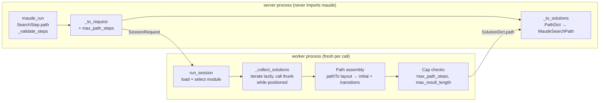
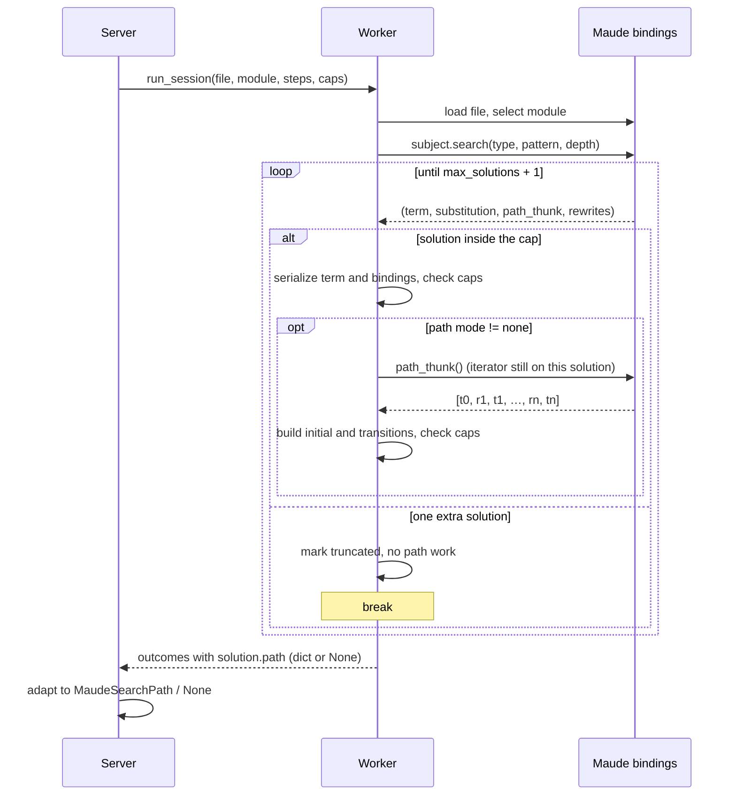

# Detailed design — search paths in `maude_run`

## 1. Overview

`maude_run` executes a bounded, hermetic Maude interpreter session: one file, one
module, and an ordered list of `reduce`/`rewrite`/`frewrite`/`erewrite`/`match`/`search`
steps. Each call runs in a fresh worker process, so nothing survives between calls.

A `search` step returns solutions, but Maude also knows *how* each solution was reached:
the rewrite path — the sequence of rules (and intermediate states) leading from the
search subject to the solution. The Python bindings expose that path with every search
solution, and the current implementation discards it. This feature surfaces the path to
the MCP client so an agent can explain, replay, or repair a plan ("these seven rules
solve the river-crossing puzzle") instead of only seeing the final state.

Because calls are hermetic, Maude's `show path` command is not usable: it needs a state
number from a search that ran earlier in the same interpreter, and the interpreter is
gone after every call. Attaching the path to the solution at search time avoids that
entirely — no cross-call state, no new command, no exposed state numbers.

### Goals

- Every `search` solution can carry its path, by default in a compact labels form.
- The wire contract is explicit, stable, and easy for an agent to consume.
- Payload and work stay bounded by understandable caps.
- The feature does not weaken hermeticity or the two-process architecture.

### Non-goals

- A `show path` step command or any other command that refers to a previous search.
- Exposing search state numbers.
- Paths for `rewrite`/`frewrite`/`erewrite`/`reduce`/`match` (Maude offers no structured
  path for them).
- Strategy search (`srewrite`/`dsrewrite`), narrowing (`vu-narrow`), LTL model-checking
  counterexamples, `show search graph`, or the meta-level `metaSearchPath`. The wire
  model leaves room for them, but none is implemented here.

## 2. Detailed Requirements

Numbered for traceability; the implementation plan and tests refer to these.

- **R1 — Opt-in per search step, cheap by default.** `SearchStep` gains
  `path: "none" | "labels" | "full"`, defaulting to `"labels"`.
  - `"labels"`: the rule sequence is returned (labels only).
  - `"full"`: labels, full rule text, and the intermediate states.
  - `"none"`: no path data; the solution payload is exactly what it is today.
- **R2 — One wire shape for both modes.** A path is
  `{initial: str, transitions: [{rule: {label: str | null, text: str | null},
  state: str | null}]}`.
  - `initial` is always present (the parsed search subject).
  - `"labels"`: `rule.label` is set; `rule.text` and `state` are `null`.
  - `"full"`: `rule.label` (null if unlabeled), `rule.text`, and `state` are set.
  - The last transition's `state` equals the solution's `term` (explicit redundancy is
    intentional, so a reader can verify the path ends at the solution).
  - A zero-transition path (reflexive `=>*`, `=>#`) is `{initial, transitions: []}`.
- **R3 — Bounded paths.** A new configuration entry `interpreter_max_path_steps`
  (env var `HAROLD_INTERPRETER_MAX_PATH_STEPS`, default `100`) bounds the transitions
  per solution path. `interpreter_max_result_length` continues to bound every serialized
  string (solution term, binding value, path `initial`, rule `label`, rule `text`,
  `state`). A path that exceeds either bound makes the whole step `too-large`.
- **R4 — Unlabeled rules.** `rule.label` is `null`; in `"full"` mode `rule.text` still
  carries the full statement. No synthetic labels and no CLI-style
  `(unlabeled rule)` placeholder.
- **R5 — Stable output schema.** `MaudeSearchSolution.path` is always present,
  `null` when the mode is `"none"`. `null` means "not requested"; a path always exists
  for a search solution.
- **R6 — Attach-only scope.** No `show_path` step, no exposed state numbers, no new
  cross-step session state.
- **R7 — Compatibility.** The input change is backward-compatible (a default value);
  the output change is additive. Exact-dict test assertions are updated, not preserved.
- **R8 — Hermetic materialization.** All Maude object access and all string
  materialization happen inside the worker before it returns; the server process never
  imports the bindings.
- **R9 — Lifetime and crash safety.** The implementation uses an explicit, documented
  strategy for the bindings' lazy path thunk (see §6.2) and never walks the search graph
  with `getRule`, which crashes the process on the root state (see §6.3).

## 3. Architecture Overview

The existing split is preserved: the server process validates inputs, builds the flat
worker request, and adapts worker dicts to pydantic wire models; the worker owns the
interpreter, runs the search, reconstructs paths, and enforces caps.



### Search-time sequence



## 4. Components and Interfaces

### 4.1 `settings.py`

New field:

```python
interpreter_max_path_steps: int = Field(default=100, gt=0)
```

- Env var: `HAROLD_INTERPRETER_MAX_PATH_STEPS` (the `HAROLD_` prefix is global).
- Documented in the `Settings` docstring next to the other interpreter caps.
- Meaning: maximum transitions (rule applications) per solution path. `0` is invalid and
  fails fast at startup like the other caps.

### 4.2 `maude/session.py` (worker side)

New TypedDicts:

```python
class PathRuleDict(TypedDict):
    label: str | None
    text: str | None

class PathTransitionDict(TypedDict):
    rule: PathRuleDict
    state: str | None

class PathDict(TypedDict):
    initial: str
    transitions: list[PathTransitionDict]
```

Changed TypedDicts:

```python
class SolutionDict(TypedDict):
    term: str
    rewrites: int
    bindings: list[BindingDict]
    path: PathDict | None

class StepRequest(TypedDict):
    ...
    search_type: str | None
    path: str | None          # "none" | "labels" | "full" | None (non-search)

class SessionRequest(TypedDict):
    ...
    max_result_length: int
    max_path_steps: int
    max_output_length: int
```

`_collect_solutions` gains `path_mode: str` and `max_path_steps: int`, and its result
type carries the exceeded limit so the outcome is actionable:

```python
class _CollectionResult(NamedTuple):
    status: Literal["ok", "too-large"]
    items: list[Any]
    truncated: bool
    limit: int | None
```

`_collect_matches` returns the same shape with `truncated` as before and `limit=None`
on success, `max_result_length` on overflow. `_run_match_or_search` passes the step's
`path` value and the request's `max_path_steps` for `search`, and reports
`limit=result.limit` on a `too-large` outcome.

Path assembly is a small helper, so the collection loop stays readable:

```python
def _serialize_path(
    path_elements: list[Any],
    mode: str,                    # "labels" | "full"
    max_path_steps: int,
    max_result_length: int,
) -> tuple[Literal["ok", "too-large"], PathDict | None, int | None]:
    ...
```

It returns `("too-large", None, cap)` where `cap` is the violated cap, or
`("ok", path, None)`.

### 4.3 `server/tools/interpreter.py`

Input model — `SearchStep` gains:

```python
path: Literal["none", "labels", "full"] = "labels"
"""How much of each solution's rewrite path to return: `"labels"` (the rule
sequence, the default), `"full"` (also the rule text and intermediate states),
or `"none"`."""
```

Output models:

```python
class MaudeRuleRef(_ResultModel):
    label: str | None   # null when the rule has no label
    text: str | None    # null unless path="full"

class MaudePathTransition(_ResultModel):
    rule: MaudeRuleRef
    state: str | None   # null unless path="full"

class MaudeSearchPath(_ResultModel):
    initial: str
    transitions: list[MaudePathTransition]

class MaudeSearchSolution(_ResultModel):
    term: str
    rewrites: int
    bindings: list[MaudeBinding]
    path: MaudeSearchPath | None   # null when path="none"
```

Plumbing:

- `_to_step_request`: add `"path": step.path if isinstance(step, SearchStep) else None`.
- `_to_request`: add `"max_path_steps": settings.interpreter_max_path_steps`.
- `_to_solutions`: adapt `solution["path"]` (dict or `None`) into
  `MaudeSearchPath | None`, including `label=None` and `text`/`state=None`.

### 4.4 Documentation surfaces

- `maude_run` docstring (free-form text above `Args:` is the MCP description): extend the
  `search` bullet with `path` and the three modes; extend "Output and limits" with the
  path shape, the default, the two caps, and the `too-large` rule.
- `README.md`: the `maude_run` bullet and the env-var table entry for
  `HAROLD_INTERPRETER_MAX_PATH_STEPS`.
- The agent knowledge base (interface and data-model notes) and `CHANGELOG.md`, plus the
  next version section and `pyproject.toml` minor bump, per the project's release
  conventions.
- No new module, so the API-reference page needs no new entry.

## 5. Data Models

### 5.1 Wire examples

Default (`path: "labels"`):

```json
{
  "term": "st(r, r, r, r)",
  "rewrites": 427,
  "bindings": [],
  "path": {
    "initial": "st(l, l, l, l)",
    "transitions": [
      {"rule": {"label": "crossWithSheep", "text": null}, "state": null},
      {"rule": {"label": "crossAlone", "text": null}, "state": null},
      {"rule": {"label": "crossWithCabbage", "text": null}, "state": null},
      {"rule": {"label": "crossWithSheep", "text": null}, "state": null},
      {"rule": {"label": "crossWithDog", "text": null}, "state": null},
      {"rule": {"label": "crossAlone", "text": null}, "state": null},
      {"rule": {"label": "crossWithSheep", "text": null}, "state": null}
    ]
  }
}
```

`path: "full"` (abridged):

```json
"path": {
  "initial": "st(l, l, l, l)",
  "transitions": [
    {
      "rule": {
        "label": "crossWithSheep",
        "text": "crl [crossWithSheep] : st(P, C, D, S) => st(other(P), C, D, other(S)) if S == P = true /\\ safe(other(P), C, D, other(S)) = true ."
      },
      "state": "st(r, l, l, r)"
    }
  ]
}
```

Zero transitions (reflexive `=>*` or `=>#`):

```json
"path": {"initial": "n(0)", "transitions": []}
```

`path: "none"`: `"path": null`.

Unlabeled rule in `"full"` mode:
`{"rule": {"label": null, "text": "rl a => b ."}, "state": "b"}`.

### 5.2 Serialization rules

- `initial` = `str` of the first element returned by `pathTo` (the parsed subject in
  Maude's mixfix print form).
- `rule.label` = `rule.getLabel()`; the bindings return `None` for an unlabeled rule.
- `rule.text` = `str(rule)`. It matches the Maude CLI's `show path` rule text, except
  that it is not line-wrapped and conditions are normalized with `= true`.
- `state` = `str` of the transition's resulting term (the next path element).
- Layout assumption: `pathTo` returns `[t0, r1, t1, …, rn, tn]` (odd length; `n`
  transitions). The implementation walks it pairwise and rejects an even-length list as
  an internal error rather than mis-slicing it.
- Rule text and state strings are produced only in `"full"` mode; `"labels"` mode never
  formats them (saves work and payload).

### 5.3 Caps and accounting

| Cap | Default | Applies to |
| --- | --- | --- |
| `interpreter_max_solutions` | 200 | Number of solutions (and therefore paths) per search step |
| `interpreter_max_path_steps` | 100 | Transitions per solution path |
| `interpreter_max_result_length` | 1,000,000 chars | Each serialized string: solution term, binding name/value, path `initial`, rule `label`, rule `text`, `state` |

- Path work is done only for the `max_solutions` solutions that are returned. The extra
  solution consumed to set `truncated` is not path-processed.
- `too-large` is all-or-nothing per step (the step's `solutions` is omitted), matching
  today's behavior for oversized terms and bindings. No partial path is ever returned.
- The outcome's `limit` names the violated cap: `interpreter_max_path_steps` for a
  transition-count overflow, `interpreter_max_result_length` for an oversized element.
  This makes the failure actionable (the client can raise the right setting or request
  `"labels"` instead of `"full"`).
- Memory: `pathTo` materializes the full element list before the transition count can be
  checked. The list is O(depth) with the already-built search graph as the dominant
  structure, so this is acceptable; the per-element string cap bounds each formatted
  string.

## 6. Correctness Constraints (reviewer-mandated)

Two hazards in the bindings must be handled explicitly by the implementation. They are
the main reason this design exists as a separate document.

### 6.1 The path is attached to the iterator's current state

`subject.search(...)` yields `(term, substitution, path_thunk, rewrite_count)`, where
`path_thunk` is a Python function that resolves `getStateNr()` **at call time**:

```python
lambda: self.pathTo(self.getStateNr())
```

If the thunks are collected first (as the current implementation does with
`list(islice(...))`) and called later, every thunk resolves to the *last consumed*
state, so every solution gets the last solution's path. This is silent data corruption,
not a crash.

**Chosen strategy: strategy 1 — call the thunk inside the iteration loop, while the
iterator is positioned on that solution.** The search iterator is consumed lazily; for
each yielded solution the worker validates and serializes the solution, then (when paths
are requested) calls the thunk immediately and assembles the path before advancing.

**Rejected for v1: strategy 2 — record `getStateNr()` per solution and call
`pathTo(state)` after the loop.** It is correct (the search graph outlives the iterator
position) and would defer path work until after size validation, but it adds a second
way to reach the same data and needs the iterator object to stay alive across the
collection loop. If profiling ever shows path reconstruction dominating a step, strategy
2 is the documented fallback: save the state number during iteration and call
`pathTo(state)` afterwards; never call an old thunk.

**Regression test:** on a chain module (`n(N) => n(N+1)`, one labeled rule), run
`n(0) =>+ n(N)` and assert the first solution's path has 1 transition and the second
has 2. The buggy `islice`-then-call version produces 2 and 2, so the test fails loudly.

### 6.2 `getRule(0)` crashes the process

`RewriteSequenceSearch.getRule(0)` on the root state — which has no incoming rule —
hard-crashes the interpreter process (SIGSEGV, no Python traceback). `pathTo` never
calls it: its recursion stops at `parent < 0` and returns `[stateTerm(n)]`.

**Architectural rule: reconstruct paths only through the yielded thunk (or
`pathTo(state)`), never by walking parents with `getStateParent` + `getRule`.** The v1
implementation contains no `getRule` call at all. The code comment at the reconstruction
site states this explicitly, and the module docstring for the path helper repeats the
warning, so a future refactor cannot "simplify" the thunk away.

**Regression test:** a zero-transition path (reflexive `n(0) =>* n(0)`) must return
`{initial: "n(0)", transitions: []}`. A naive parent-walk implementation would request
`getRule(0)` for the root and crash the worker; the test both pins the empty-path shape
and exercises the root state safely.

Both tests run through the real interpreter in the integration suite; the worker being a
fresh process per call means a crash surfaces as a worker failure rather than taking down
the test runner.

## 7. Error Handling

- **Invalid `path` value** — rejected by pydantic at the tool boundary
  (`ValidationError`); no worker call.
- **Path cap exceeded** (transitions > `interpreter_max_path_steps`) — the step outcome
  is `too-large`, `limit = interpreter_max_path_steps`, `solutions` omitted, the run
  stops there (`completed=false`). The same all-or-nothing semantics as an oversized
  term.
- **Path element too long** — `too-large`, `limit = interpreter_max_result_length`.
- **Oversized solution term or binding** — unchanged: `too-large`, `limit =
  interpreter_max_result_length`; checked before path work.
- **`path="none"`** — no path work; `path` is `null`; all other behavior is unchanged.
- **Parse errors, missing module, failed load, theory module, worker crash/timeout** —
  unchanged whole-call vs per-step behavior.
- **Internal layout violation** (even-length `pathTo` list) — treated as a programming
  error (`ValueError` inside the worker), so it fails the call rather than emitting a
  malformed path. This cannot happen with the pinned bindings; it is a defensive check.
- **Timeouts** — path reconstruction is O(depth) per solution and happens inside the
  existing whole-call timeout; no new timeout knob.

## 8. Testing Strategy

Test-driven, split as the project does today: hermetic unit tests with a faked executor
or faked worker values, and integration tests against the real interpreter.

### 8.1 Unit tests (no interpreter)

Tool layer (`tests/unit/test_interpreter_tool.py`):

- `SearchStep.path` defaults to `"labels"` and rejects an unknown value.
- `_to_step_request` forwards `path` for search and `None` for every other command.
- The session request carries `max_path_steps` from settings (including an override).
- `test_search_outcome_is_adapted`: updated exact dump includes `path` with labels-mode
  nulls; a second case covers a full path, a `null` label, and `path: None`.
- A `too-large` outcome with `limit = interpreter_max_path_steps` is adapted unchanged.

Worker layer (new `tests/unit/test_maude_session.py`, entirely fake objects):

- `_serialize_path` on a hand-built interleaved list: labels mode, full mode, unlabeled
  rule, zero transitions, even-length rejection.
- `_collect_solutions` laziness: fake iterator whose thunk reads the current position;
  assert each solution gets its own path (this pins strategy 1 without an interpreter).
- `_collect_solutions` cap accounting: transition overflow reports the path cap,
  element overflow reports the result cap, and paths are not built for the extra
  solution consumed to set `truncated`.

Settings (`tests/unit/test_settings.py`):

- Default `interpreter_max_path_steps == 100`; env override; `0`/negative rejected.

### 8.2 Integration tests (real Maude)

New fixture `search_path.maude` containing `SHEPHERD`, `UNLABELED`, `CHAIN`, and
`BRANCH` (the river-crossing module, two unlabeled rules `a => b`, `b => c`, a
one-rule `n(N) => n(N+1)` chain, and a two-rule branch module), added under the existing
integration fixtures directory.

Session-level (`tests/integration/test_maude_session_integration.py`) and tool-level
(`tests/integration/test_maude_run_integration.py`):

| Test | What it pins |
| --- | --- |
| Shepherd `st(l,l,l,l) =>* st(r,r,r,r)`, default mode | 7 transitions, labels in the documented order, `text`/`state` null, `initial` present |
| Same search, `full` mode | Rule text present; every transition state present; final state equals the solution term; `initial` equals the subject |
| `=>1` search | Exactly one transition |
| Reflexive `=>*` (`n(0) =>* n(0)`) | Zero transitions, not `null` — also the root-state safety test |
| `=>#` on `BRANCH` (`a =># X:S`) | Zero transitions |
| `UNLABELED`, `a =>+ c` | `label` null, `text` present in full mode |
| `CHAIN`, `n(0) =>+ n(N)`, depth 2 | Laziness regression: transition counts 1 and 2 in solution order |
| `max_solutions=1` on a longer search | `truncated=true`, one solution, its path correct |
| `max_path_steps=2` on the 7-step shepherd search | `too-large`, `limit=2`, `solutions` omitted |
| `max_result_length` between label and rule-text lengths, full mode | `too-large`, `limit=max_result_length` |
| `path="none"` | `path` null; solutions otherwise unchanged |
| `CHAIN`, `n(0) =>* n(100)`, depth 100, default cap | 100 transitions accepted; last state equals the solution term |
| Non-search steps | No path data; existing outcome shapes unchanged |

The shepherd labels are taken from the reference session in the requirement:
`crossWithSheep, crossAlone, crossWithCabbage, crossWithSheep, crossWithDog,
crossAlone, crossWithSheep`.

### 8.3 Validation and repo checks

- `make check` (ruff, format, mypy, basedpyright, deptry).
- `make test` (authoritative full suite with coverage); `make test-unit` and
  `make test-integration` during development.
- `make docs-test` if docstrings change the generated reference (they do, so run it).

## 9. Rollout and Compatibility Notes

- Input remains backward-compatible: existing clients that omit `path` now receive the
  labels path. This is the intended default, but it is a behavior change in payload
  size; the change is recorded in the changelog.
- `.agents/summary` data-model notes that literally list `SolutionDict` fields will be
  stale until the knowledge base is refreshed.
- A pathological search can now fail where it previously succeeded (labels mode still
  pays the transition cap). This is accepted: 100 transitions covers hand-written plans,
  and the error names the cap to raise.

## 10. Appendices

### A. Technology choices

| Choice | Why |
| --- | --- |
| Object-level path thunk / `pathTo` | Direct, already attached to each solution; matches `show path` content; no second search, no metarepresentation |
| CLI `show path N` | Rejected: needs a per-search state number and a live interpreter |
| `metaSearchPath` | Rejected: requires metarepresenting module and terms and re-running search logic through `META-LEVEL` |
| Labels by default | Tens of bytes per step; the main reason an agent runs `search` |
| Whole-step `too-large` | Consistent with the existing term/binding cap; no misleading partial paths |

### B. Research findings (inline summary)

Evidence comes from executable probes against the pinned `maude` 1.6.0 bindings and the
Maude 3.5.1 CLI. The probe transcripts are reference artifacts captured on one machine;
they are regenerable, so they can drift with a different Maude version. The durable
guards are the integration tests above, not the transcripts.

Confirmed behavior:

- `EasyTerm.search` yields `(term, substitution, path_thunk, rewrite_count)` for every
  solution, for all five search types.
- `pathTo(n)` returns `[t0, r1, t1, …, rn, tn]` — `2n+1` elements for `n` transitions;
  `pathTo(0)` is `[t0]`.
- `Rule.getLabel()` returns the label or `None`; `str(rule)` is the full statement the
  CLI prints (without line wrapping, conditions normalized with `= true`).
- `getStateNr()` matches the CLI's `Solution N (state M)` numbering, but numbers are
  per-search and die with the interpreter, so they are not exposed.
- The thunk resolves the state at call time (the trap in §6.1).
- `getRule(0)` crashes the process; `pathTo` and `getStateTerm(0)` are safe (§6.2).
- Long-path cost: a 100-transition path is 201 elements and about 3 KB of rule text;
  reconstruction is O(depth) string formatting per solution.
- Zero-transition paths occur for reflexive `=>*` and for `=>#` branching states.

External references: the Maude 3.5.1 manual (`search` and `show path` in §5.4.3,
`show search graph` in Appendix A, narrowing paths in §15.6,
`metaSearch`/`metaSearchPath` in §17.6.6) and the Python bindings documentation
(<https://fadoss.github.io/maude-bindings/>).

### C. Alternative approaches considered

| Alternative | Why rejected |
| --- | --- |
| Always return the full path | Unbounded payload on every search; long paths would flip useful steps to `too-large` |
| Opt-in defaulting to `"none"` | Buries the feature the tool is being extended for |
| A distinct shape per mode (`labels` vs `transitions`) | Clients must branch on the mode; one shape with nullable fields is stable |
| Interleaved `[state, rule, state, …]` wire list | Initial/transition structure implicit; larger JSON for the same content |
| Separate `show_path` step | Needs exposed state numbers, live search state, and duplicates data already attached to solutions |
| Partial paths / `path_truncated` marker | A prefix that does not reach the solution is not a path to it, and a marker complicates `path: null` semantics |
| Per-element cap only | Total path size stays unbounded for many small elements |
| Total serialized-bytes cap | Exact but more bookkeeping; harder to explain than "transitions per path" |

### D. Known limitations

- Rule text is Maude's printed form, so conditions show the interpreter's `= true`
  normalization; it is not the source text.
- Labels mode cannot distinguish two rules that share a label (Maude allows it) or show
  which intermediate state was reached; use `"full"` when that matters.
- A path is only as deep as the bounded `search`; `depth` still controls the search
  itself, and the path cap can be hit before the search cap.
- `pathTo` materializes the whole element list before the transition cap is checked;
  the cap bounds the returned data, not the transient list.
