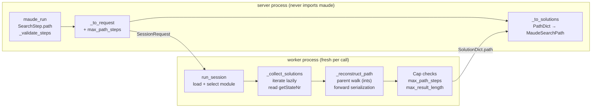
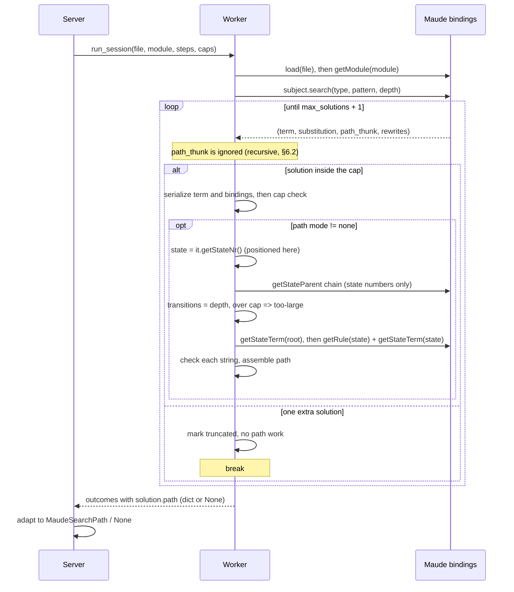

# Detailed design — search paths in `maude_run`

> Revision 4 — incorporates design review v3: the worker key is renamed `path_mode`
> (avoiding the `SessionRequest.path` collision), the invalid-value contract is pinned to
> the `search_type` precedent, the term-cap-before-path work ordering gets a test, and
> the session-engine docstrings join the documentation surfaces.
> Revision 3 incorporated design review v2: explicit `depth` on the
> unbounded-search tests, an early-stop parent walk (O(cap) work), the rewriting
> `too-large` message, the remaining plumbing/test updates, and the `=>!` path test.
> Revision 2 incorporated design review v1: iterative path reconstruction instead of the
> bindings' recursive `pathTo`, explicit `path=None` semantics, named limits on
> `too-large`, package re-exports, and the expanded test inventory.

## 1. Overview

`maude_run` executes a bounded, hermetic Maude interpreter session: one file, one
module, and an ordered list of `reduce`/`rewrite`/`frewrite`/`erewrite`/`match`/`search`
steps. Each call runs in a fresh worker process, so nothing survives between calls.

A `search` step returns solutions, but Maude also knows *how* each solution was reached:
the rewrite path — the sequence of rules (and intermediate states) leading from the
search subject to the solution. The Python bindings expose that path with every search
solution, and the current implementation discards it. This feature surfaces the path to
the MCP client so an agent can explain, replay, or repair a plan ("these seven rules
solve the river-crossing puzzle") instead of only seeing the final state.

Because calls are hermetic, Maude's `show path` command is not usable: it needs a state
number from a search that ran earlier in the same interpreter, and the interpreter is
gone after every call. Attaching the path to the solution at search time avoids that
entirely — no cross-call state, no new command, no exposed state numbers.

The bindings' convenience accessor, `pathTo`, builds the path with Python recursion, so
the worker reconstructs the path iteratively from the search graph's parent links (see
§6.2). This keeps deep searches bounded and reportable instead of crashing the call.

### Goals

- Every `search` solution can carry its path, by default in a compact labels form.
- The wire contract is explicit, stable, and easy for an agent to consume.
- Payload and work stay bounded by understandable caps.
- The feature does not weaken hermeticity or the two-process architecture.
- Path reconstruction is safe at any search depth: an over-cap path is a per-step
  `too-large`, never a whole-call failure.

### Non-goals

- A `show path` step command or any other command that refers to a previous search.
- Exposing search state numbers.
- Paths for `rewrite`/`frewrite`/`erewrite`/`reduce`/`match` (Maude offers no structured
  path for them).
- Strategy search (`srewrite`/`dsrewrite`), narrowing (`vu-narrow`), LTL model-checking
  counterexamples, `show search graph`, or the meta-level `metaSearchPath`. The wire
  model leaves room for them, but none is implemented here.

## 2. Detailed Requirements

Numbered for traceability; the implementation plan and tests refer to these.

- **R1 — Opt-in per search step, cheap by default.** `SearchStep` gains
  `path: "none" | "labels" | "full"`, defaulting to `"labels"`.
  - `"labels"`: the rule sequence is returned (labels only).
  - `"full"`: labels, full rule text, and the intermediate states.
  - `"none"`: no path data; the solution payload is exactly what it is today.
- **R2 — One wire shape for both modes.** A path is
  `{initial: str, transitions: [{rule: {label: str | null, text: str | null},
  state: str | null}]}`.
  - `initial` is always present (the parsed search subject).
  - `"labels"`: `rule.label` is set; `rule.text` and `state` are `null`.
  - `"full"`: `rule.label` (null if unlabeled), `rule.text`, and `state` are set.
  - The last transition's `state` equals the solution's `term` (explicit redundancy is
    intentional, so a reader can verify the path ends at the solution).
  - A zero-transition path (reflexive `=>*`, `=>#`) is `{initial, transitions: []}`.
- **R3 — Bounded paths.** A new configuration entry `interpreter_max_path_steps`
  (env var `HAROLD_INTERPRETER_MAX_PATH_STEPS`, default `100`) bounds the transitions
  per solution path. `interpreter_max_result_length` continues to bound every serialized
  string (solution term, binding value, path `initial`, rule `label`, rule `text`,
  `state`). A path that exceeds either bound makes the whole step `too-large`.
- **R4 — Unlabeled rules.** `rule.label` is `null`; in `"full"` mode `rule.text` still
  carries the full statement. No synthetic labels and no CLI-style
  `(unlabeled rule)` placeholder.
- **R5 — Stable output schema.** `MaudeSearchSolution.path` is always present,
  `null` when the mode is `"none"`. `null` means "not requested"; a path always exists
  for a search solution.
- **R6 — Attach-only scope.** No `show_path` step, no exposed state numbers, no new
  cross-step session state.
- **R7 — Compatibility.** The input change is backward-compatible (a default value);
  the output change is additive. Exact-dict test assertions are updated, not preserved.
- **R8 — Hermetic materialization.** All Maude object access and all string
  materialization happen inside the worker before it returns; the server process never
  imports the bindings.
- **R9 — Reconstruction safety.** The worker reads the solution's state number while the
  search iterator is positioned on that solution (§6.1), reconstructs the path with a
  non-recursive parent walk (the bindings' `pathTo` is recursive and overflows on deep
  paths, §6.2), and calls `getRule` only for states that have a parent — never on the
  root, which crashes the process (§6.3).

## 3. Architecture Overview

The existing split is preserved: the server process validates inputs, builds the flat
worker request, and adapts worker dicts to pydantic wire models; the worker owns the
interpreter, runs the search, reconstructs paths, and enforces caps.



### Search-time sequence



## 4. Components and Interfaces

### 4.1 `settings.py`

New field:

```python
interpreter_max_path_steps: int = Field(default=100, gt=0)
```

- Env var: `HAROLD_INTERPRETER_MAX_PATH_STEPS` (the `HAROLD_` prefix is global).
- Documented in the `Settings` docstring next to the other interpreter caps.
- Meaning: maximum transitions (rule applications) per solution path. `0` is invalid and
  fails fast at startup like the other caps. Any positive value is safe: reconstruction
  does not recurse (§6.2).

### 4.2 `maude/session.py` (worker side)

New TypedDicts:

```python
class PathRuleDict(TypedDict):
    label: str | None
    text: str | None

class PathTransitionDict(TypedDict):
    rule: PathRuleDict
    state: str | None

class PathDict(TypedDict):
    initial: str
    transitions: list[PathTransitionDict]
```

Changed TypedDicts:

```python
class SolutionDict(TypedDict):
    term: str
    rewrites: int
    bindings: list[BindingDict]
    path: PathDict | None

class StepRequest(TypedDict):
    ...
    search_type: str | None
    path_mode: str | None     # "none" | "labels" | "full" | None (non-search)

class SessionRequest(TypedDict):
    ...
    max_result_length: int
    max_path_steps: int
    max_output_length: int
```

The worker key is `path_mode`, not `path`: `SessionRequest.path` is the Maude file and the
step key is the path mode, and both request objects are in scope together in the
`_run_step` family. The user-facing wire name stays `SearchStep.path` (settled in the
requirements).

`_collect_solutions` gains `path_mode: str | None` and `max_path_steps: int`, and its
result type carries the exceeded limit and a short reason so the outcome is actionable:

```python
class _CollectionResult(NamedTuple):
    status: Literal["ok", "too-large"]
    items: list[Any]
    truncated: bool
    limit: int | None
    message: str | None
```

- `_collect_matches` returns the same shape: `limit`/`message` set on overflow and
  `None` on success.
- `_run_rewriting` keeps its `too-large` status and `limit`, and sets `message` naming
  `interpreter_max_result_length` (this is the fourth `too-large` site; see §7).
- `_run_match_or_search` passes the step's `path_mode` value and the request's
  `max_path_steps` for `search`, and reports `limit` and `message` on a `too-large`
  outcome.
- **A search step whose `path_mode` is `None` is treated as `"none"`.** The worker does
  only what the request asks; the tool owns the `"labels"` default. This also keeps the
  direct session-engine callers (integration tests) explicit.
- Any other `path_mode` string is a programming error and raises the same defensive
  `ValueError` as an invalid `search_type` (the tool's pydantic boundary only produces
  `"none"`, `"labels"` or `"full"`), so the worker contract has no silent fallback.

Path reconstruction is a separate helper so the collection loop stays readable:

```python
class _PathResult(NamedTuple):
    status: Literal["ok", "too-large"]
    path: PathDict | None
    limit: int | None
    message: str | None

def _reconstruct_path(
    iterator: Any,
    state_number: int,          # read from iterator.getStateNr() while positioned
    mode: str,                  # "labels" | "full"
    max_path_steps: int,
    max_result_length: int,
) -> _PathResult:
    ...
```

It walks the parent chain (state numbers only), rejects an over-cap depth before
formatting anything, then serializes forward, calling `getRule` only for states after
the root (§5.2, §6).

### 4.3 `server/tools/interpreter.py`

Input model — `SearchStep` gains:

```python
path: Literal["none", "labels", "full"] = "labels"
"""How much of each solution's rewrite path to return: `"labels"` (the rule
sequence, the default), `"full"` (also the rule text and intermediate states),
or `"none"`."""
```

Output models:

```python
class MaudeRuleRef(_ResultModel):
    label: str | None   # null when the rule has no label
    text: str | None    # null unless path="full"

class MaudePathTransition(_ResultModel):
    rule: MaudeRuleRef
    state: str | None   # null unless path="full"

class MaudeSearchPath(_ResultModel):
    initial: str
    transitions: list[MaudePathTransition]

class MaudeSearchSolution(_ResultModel):
    term: str
    rewrites: int
    bindings: list[MaudeBinding]
    path: MaudeSearchPath | None   # null when path="none"
```

Plumbing:

- `_to_step_request`: add
  `"path_mode": step.path if isinstance(step, SearchStep) else None`.
- `_to_request`: add `"max_path_steps": settings.interpreter_max_path_steps`.
- `_to_solutions`: adapt `solution["path"]` (dict or `None`) into
  `MaudeSearchPath | None`, including `label=None` and `text`/`state=None`.
- `MaudeStepOutcome.message` docstring: the interpreter's message (`parse-error`) or
  Harold's reason for exceeding a limit (`too-large`).
- `maude/__init__.py`: re-export `PathDict`, `PathRuleDict` and `PathTransitionDict`
  (the tool layer imports worker types from the package root, like the existing
  TypedDicts), and add them to `__all__`.
- The tool module's `__all__`: add `MaudeRuleRef`, `MaudePathTransition` and
  `MaudeSearchPath` (it conventionally lists every public model; nothing enforces it
  mechanically).

### 4.4 Documentation surfaces

- `maude_run` docstring (free-form text above `Args:` is the MCP description): extend the
  `search` bullet with `path` and the three modes; extend "Output and limits" with the
  path shape, the default, the two caps, and the `too-large` rule.
- Session-engine docstrings (`_collect_solutions`, `_run_match_or_search`,
  `_reconstruct_path`): they are rendered in the API reference (`docs/modules.md` renders
  `harold_mcp.maude.session`), so describe path assembly, the caps and the failure
  ordering there too.
- `README.md`: the `maude_run` bullet and the env-var table entry for
  `HAROLD_INTERPRETER_MAX_PATH_STEPS`.
- The agent knowledge base (interface and data-model notes) and `CHANGELOG.md`, plus the
  next version section and `pyproject.toml` minor bump, per the project's release
  conventions.
- No new module, so the API-reference page needs no new entry.

## 5. Data Models

### 5.1 Wire examples

Default (`path: "labels"`):

```json
{
  "term": "st(r, r, r, r)",
  "rewrites": 427,
  "bindings": [],
  "path": {
    "initial": "st(l, l, l, l)",
    "transitions": [
      {"rule": {"label": "crossWithSheep", "text": null}, "state": null},
      {"rule": {"label": "crossAlone", "text": null}, "state": null},
      {"rule": {"label": "crossWithCabbage", "text": null}, "state": null},
      {"rule": {"label": "crossWithSheep", "text": null}, "state": null},
      {"rule": {"label": "crossWithDog", "text": null}, "state": null},
      {"rule": {"label": "crossAlone", "text": null}, "state": null},
      {"rule": {"label": "crossWithSheep", "text": null}, "state": null}
    ]
  }
}
```

`path: "full"` (abridged):

```json
"path": {
  "initial": "st(l, l, l, l)",
  "transitions": [
    {
      "rule": {
        "label": "crossWithSheep",
        "text": "crl [crossWithSheep] : st(P, C, D, S) => st(other(P), C, D, other(S)) if S == P = true /\\ safe(other(P), C, D, other(S)) = true ."
      },
      "state": "st(r, l, l, r)"
    }
  ]
}
```

Zero transitions (reflexive `=>*` or `=>#`):

```json
"path": {"initial": "n(0)", "transitions": []}
```

`path: "none"`: `"path": null`.

Unlabeled rule in `"full"` mode:
`{"rule": {"label": null, "text": "rl a => b ."}, "state": "b"}`.

### 5.2 Reconstruction and serialization rules

Reconstruction runs in the worker, while the search iterator is still alive:

1. Read `state_number = iterator.getStateNr()` **while the iterator is positioned on this
   solution** (§6.1).
2. Walk the parent chain with `iterator.getStateParent(state)`, collecting state
   numbers, and stop in one of two cases:
   - the parent is negative (the root was reached): reverse the collected states into
     `states = [root, …, solution]` and continue;
   - more than `max_path_steps + 1` states have been collected: the path is over cap
     whatever the remaining distance to the root, so return `too-large`
     (`limit = interpreter_max_path_steps`) immediately. Do not walk to the root just to
     count, and do not format any string (§6.2).

   `getStateParent(0) == -1` and search graphs are acyclic.
3. Serialize forward (`transitions = len(states) - 1 <= max_path_steps`):
   - `initial = str(iterator.getStateTerm(states[0]))` (the root; safe, §6.3).
   - For each state after the root: `rule = iterator.getRule(state)` (**never** for the
     root, §6.3), `label = rule.getLabel()`, and, in `"full"` mode only,
     `text = str(rule)` and `state_text = str(iterator.getStateTerm(state))`.
4. Check every produced string against `max_result_length`; an overflow is `too-large`
   with `limit = interpreter_max_result_length`.

Field semantics:

- `initial` = `str` of the initial state term (the parsed subject in Maude's mixfix print
  form).
- `rule.label` = `rule.getLabel()`; the bindings return `None` for an unlabeled rule.
- `rule.text` = `str(rule)`. It matches the Maude CLI's `show path` rule text, except
  that it is not line-wrapped and conditions are normalized with `= true`.
- `state` = `str` of the transition's resulting term.
- This call pattern (`getStateParent` for every state, `getRule`/`getStateTerm` for every
  non-root state) mirrors the bindings' `pathTo` exactly, but as a loop instead of
  recursion.

### 5.3 Caps and accounting

| Cap | Default | Applies to |
| --- | --- | --- |
| `interpreter_max_solutions` | 200 | Number of solutions (and therefore paths) per search step |
| `interpreter_max_path_steps` | 100 | Transitions per solution path |
| `interpreter_max_result_length` | 1,000,000 chars | Each serialized string: solution term, binding name/value, path `initial`, rule `label`, rule `text`, `state` |

- Path work is done only for the `max_solutions` solutions that are returned. The extra
  solution consumed to set `truncated` is neither path-processed nor state-recorded.
- `too-large` is all-or-nothing per step (the step's `solutions` is omitted), matching
  today's behavior for oversized terms and bindings. No partial path is ever returned.
- The outcome's `limit` is the violated numeric cap and `message` names the setting:
  `path exceeds interpreter_max_path_steps` or, for an oversized string,
  `path element exceeds interpreter_max_result_length`. `message` also names the setting
  for the non-path `too-large` cases, so the two equal-valued caps can always be told
  apart. This makes the failure actionable (raise the right setting, or request
  `"labels"` instead of `"full"`).
- The depth check reads integers only and stops as soon as the chain is over cap, so
  path reconstruction costs at most `max_path_steps + 2` `getStateParent` calls and
  O(`max_path_steps`) transient memory per solution, regardless of the search depth. No
  rule text or term is formatted for an over-cap path, and no recursive call is made.
  Serialization memory is O(returned path size), bounded by the two caps.

## 6. Correctness Constraints

Three hazards in the bindings shape the implementation. They are the main reason this
design exists as a separate document.

### 6.1 The path is attached to the iterator's current state

`subject.search(...)` yields `(term, substitution, path_thunk, rewrite_count)`. Both the
thunk and `iterator.getStateNr()` resolve the **current** state at call time, not at
yield time.

**Chosen strategy: read `iterator.getStateNr()` inside the iteration loop, while the
iterator is positioned on that solution, and reconstruct from that state number
immediately.** This is the "capture the state number" half of the alternative strategy,
with reconstruction done iteratively (the thunk is not used at all, §6.2).

**Do not defer reading the state number** — for example, collect all solutions first and
call `getStateNr()` afterwards. Every solution would then resolve to the last consumed
state, silently attributing the last solution's path to all of them.

**Regression test:** on a chain module (`n(N) => n(N+1)`, one labeled rule), run
`n(0) =>+ n(N)` with depth 2 and assert that the first solution's path has 1 transition
and the second has 2. A deferred state read produces 2 and 2, so the test fails loudly.

### 6.2 `pathTo` is recursive and overflows the Python stack on deep paths

With the pinned bindings, `pathTo` is Python recursion — one frame per transition:

```python
parent = self.getStateParent(stateNr)
if parent < 0:
    path = [self.getStateTerm(stateNr)]
else:
    path = self.pathTo(parent)
    path.append(self.getRule(stateNr))
    path.append(self.getStateTerm(stateNr))
```

Paths deeper than CPython's recursion limit (about 1000 frames) raise `RecursionError`.
Inside the worker this is an ordinary Python exception, not a process crash, so the
executor does not map it; `maude_run` reports a generic whole-call
`MaudeRunError("Unexpected failure running the Maude interpreter session")` that names
no cap. Reproduced against the pinned bindings: `n(0) =>* n(1500)` on the one-rule chain
module finds the solution in milliseconds (3000 rewrites), and calling the path thunk
raises `RecursionError` after ~1000 frames. A design that checks the transition cap only
*after* calling `pathTo` therefore fails the whole call for deep searches instead of
returning the promised `too-large`, and raising the cap makes it worse.

**Fix: iterative reconstruction, not `pathTo`.** Walk `getStateParent` with a plain loop,
count transitions, reject over-cap paths before formatting anything, and build the path
forward with `getRule`/`getStateTerm` (§5.2). This is safe at any depth and any cap.

**Rejected: pre-count with `getStateParent`, then call `pathTo` only when the depth
fits.** It protects the default cap (100) but not a raised one: a user who sets
`HAROLD_INTERPRETER_MAX_PATH_STEPS` above the recursion limit hits `RecursionError` on
paths that are within the cap. The iterative builder is only slightly longer and removes
the interaction entirely.

**Tests:** `n(0) =>* n(1500)` with `depth=1500` and the default cap returns `too-large`,
`limit=100`, `message` naming the path cap, and the run stops at that step (no whole-call
error); the same search with `max_path_steps=2000` and `depth=1500` returns one solution
with 1500 transitions. The explicit depth matters: `CHAIN` is infinite and the engine
consumes one solution beyond the cap to set `truncated`; without a depth the test hangs
instead of reaching the path logic (§8.2).

### 6.3 `getRule(0)` crashes the process

`RewriteSequenceSearch.getRule(0)` on the root state — which has no incoming rule —
hard-crashes the interpreter process (SIGSEGV, no Python traceback). The crash is
specific to a state **with no parent**: `getStateParent(0) == -1`, `getStateTerm(0)` is
safe, and `getRule` on any non-root state is safe. `pathTo` itself calls `getRule` on
every non-root state; it simply never reaches the root because its base case returns
before the call.

**Architectural rule: call `getRule` only for states after the root in the reconstructed
chain; never for the root, and never for an arbitrary state number without knowing its
parent.** The iterative builder in §5.2 enforces this by iterating `states[1:]`; its
comment states the invariant.

**Regression test:** a zero-transition path (reflexive `n(0) =>* n(0)` with `depth=3`,
because `CHAIN` is infinite) must return
`{initial: "n(0)", transitions: []}`. A naive parent-walk implementation would call
`getRule(0)` for the root and crash the worker; the test pins the empty-path shape and
exercises the root state safely.

The tests run through the real interpreter in the integration suite; because each call
uses a fresh worker process, a crash surfaces as a worker failure rather than taking down
the test runner.

## 7. Error Handling

- **Invalid `path` value** — rejected by pydantic at the tool boundary
  (`ValidationError`); no worker call.
- **Path cap exceeded** (transitions > `interpreter_max_path_steps`) — the step outcome
  is `too-large`, `limit = interpreter_max_path_steps`,
  `message` names the setting, `solutions` omitted, and the run stops
  (`completed=false`). The same all-or-nothing semantics as an oversized term.
- **Path element too long** — `too-large`, `limit = interpreter_max_result_length`,
  `message` names the setting.
- **Oversized solution term or binding** — unchanged status/limit, now also with a
  `message` naming `interpreter_max_result_length`; checked before any path work.
- **Oversized rewriting result term** — unchanged status and `limit`; gains the same
  `message` naming `interpreter_max_result_length`, so `reduce`/`rewrite`/`frewrite`/
  `erewrite` outcomes match the documented `message` semantics.
- **`path="none"` or a `None` path on a search step** — no path work; `path` is `null`;
  all other behavior is unchanged.
- **Parse errors, missing module, failed load, theory module, worker crash/timeout** —
  unchanged whole-call vs per-step behavior. `message` remains the interpreter's text for
  `parse-error`.
- **Deep paths** — counted iteratively, and the walk stops as soon as the chain is over
  cap, so the cost is bounded by `max_path_steps` regardless of depth; no `pathTo` call
  exists, so `RecursionError` cannot occur on the path code path.
- **Timeouts** — path reconstruction costs at most `max_path_steps + 2` integer parent
  lookups plus formatting bounded by the two caps, inside the existing whole-call
  timeout; no new timeout knob.

## 8. Testing Strategy

Test-driven, split as the project does today: hermetic unit tests with a faked executor
or faked worker values, and integration tests against the real interpreter.

### 8.1 Unit tests (no interpreter)

Tool layer (`tests/unit/test_interpreter_tool.py`):

- `SearchStep.path` defaults to `"labels"` and rejects an unknown value.
- `_to_step_request` forwards `path` for search and `None` for every other command.
- The session request carries `max_path_steps` from settings (including an override).
- `test_search_outcome_is_adapted`: updated exact dump includes `path` with labels-mode
  nulls; a second case covers a full path, a `null` label, and `path: None`.
- A `too-large` outcome with `limit = interpreter_max_path_steps` and its `message` is
  adapted unchanged.

Worker layer (new `tests/unit/test_maude_session.py`, entirely fake objects):

- `_reconstruct_path` on a fake iterator (`getStateNr`, `getStateParent`, `getRule`,
  `getStateTerm`): labels mode, full mode, unlabeled rule, zero transitions, and the
  exact chain order.
- **Safety pin:** the fake iterator raises if `getRule` is called with the root state
  number, and the test covers a zero-transition path (would crash a naive parent walk)
  plus a multi-transition path.
- **Depth pin:** the fake iterator raises if `getRule`/`getStateTerm` are called when the
  chain is over the cap, proving the count happens before formatting; it also counts
  `getStateParent` calls and proves the walk stops after at most `max_path_steps + 2`
  states instead of reaching a root that is many more states away.
- `_collect_solutions` laziness: a fake iterator that advances a state counter per
  solution and whose path depends on the current state; assert each solution gets its own
  path (pins §6.1 without an interpreter).
- `_collect_solutions` cap accounting: transition overflow reports the path cap,
  element overflow reports the result cap, and paths are not built for the extra solution
  consumed to set `truncated`.
- **Ordering pin:** a solution whose term exceeds `max_result_length` while its path also
  exceeds `max_path_steps` reports the result cap, and the fake iterator raises if any
  path accessor is called (the term/binding check runs before path work).
- A search step with `path=None` produces `path=None` in every solution.

Settings (`tests/unit/test_settings.py`):

- Default `interpreter_max_path_steps == 100`; env override; `0`/negative rejected.

### 8.2 Integration tests (real Maude)

New fixture `search_path.maude` containing `SHEPHERD`, `UNLABELED`, `CHAIN`, and
`BRANCH` (the river-crossing module, two unlabeled rules `a => b`, `b => c`, a
one-rule `n(N) => n(N+1)` chain, and a two-rule branch module), added under the existing
integration fixtures directory.

Session-level (`tests/integration/test_maude_session_integration.py`) and tool-level
(`tests/integration/test_maude_run_integration.py`):

| Test | What it pins |
| --- | --- |
| Shepherd `st(l,l,l,l) =>* st(r,r,r,r)`, default mode | 7 transitions, labels in the documented order, `text`/`state` null, `initial` present |
| Same search, `full` mode | Rule text present; every transition state present; final state equals the solution term; `initial` equals the subject |
| `=>1` search | Exactly one transition |
| Reflexive `=>*` (`n(0) =>* n(0)`, depth 3) | Zero transitions, not `null` — also the root-state safety test |
| `=>!` on `BRANCH` (`a =>! c`) | One transition, label `ac`, final state `c` (pins normal-form paths) |
| `=>#` on `BRANCH` (`a =># X:S`) | Zero transitions |
| `UNLABELED`, `a =>+ c` | `label` null, `text` present in full mode |
| `CHAIN`, `n(0) =>+ n(N)`, depth 2 | Laziness regression: transition counts 1 and 2 in solution order |
| `max_solutions=1` on a longer search | `truncated=true`, one solution, its path correct |
| `max_path_steps=2` on the 7-step shepherd search | `too-large`, `limit=2`, `message` names the path cap, `solutions` omitted |
| `max_result_length` between label and rule-text lengths, full mode | `too-large`, `limit=max_result_length`, `message` names the result cap |
| `CHAIN`, `n(0) =>* n(1500)`, depth 1500, default cap | `too-large`, `limit=100`, path-cap message, run stops; no whole-call error (the design-review regression) |
| `CHAIN`, `n(0) =>* n(1500)`, depth 1500, `max_path_steps=2000` | `ok`; 1500 transitions; first state `n(0)`, last state `n(1500)` |
| `path="none"` | `path` null; solutions otherwise unchanged |
| `CHAIN`, `n(0) =>* n(100)`, depth 100, default cap | 100 transitions accepted; last state equals the solution term |
| Non-search steps | No path data; existing outcome shapes unchanged |

The shepherd labels are taken from the reference session in the requirement:
`crossWithSheep, crossAlone, crossWithCabbage, crossWithSheep, crossWithDog,
crossAlone, crossWithSheep`.

A search over an unbounded state space **must** set `depth`: the engine always consumes
one solution beyond `max_solutions` to compute `truncated`, so a search that yields fewer
solutions than the cap but never exhausts its state space runs until the call timeout.
That is existing `maude_run` behavior, not specific to paths, but it decides whether
these tests terminate.

### 8.3 Existing tests and helpers to update

Because the new keys are required in the worker TypedDicts and the solution shape gains
a field, these break loudly and are updated in the same steps as the code:

- `tests/unit/test_interpreter_tool.py`:
  - the `_outcome`/`_session_result` helpers if a new outcome field is needed (only
    `message` semantics change; the key already exists);
  - the search solution literal in `test_search_outcome_is_adapted` (add `path`);
  - any exact search-solution `model_dump()` assertion;
  - `test_search_step_forwards_pattern_subject_depth_and_type`: the expected
    `StepRequest` gains `"path_mode": "labels"`;
  - `test_request_carries_the_steps_and_configured_caps`: the two expected step dicts
    gain `"path_mode": None`, and the request gains `max_path_steps`.
- `tests/unit/test_maude_executor.py`: the module-level `SESSION_REQUEST` literal gains
  the required `max_path_steps` key (mypy also fails otherwise).
- `tests/integration/test_maude_session_integration.py`:
  - `_step` and `_request` build fully explicit `StepRequest`/`SessionRequest` literals:
    add `path_mode` and `max_path_steps` (mypy also fails otherwise). The helper default
    for `path_mode` is `None` (treated as `"none"` by the worker), so existing tests keep
    their path-free shape; path tests pass `"labels"`/`"full"` explicitly;
  - `test_search_types_and_ground_targets` and its ground/canonical variants compare
    solution dicts exactly (add `path`);
  - `test_match_and_search_result_length_cap` still passes but gains `message`
    assertions for its match and search `too-large` cases;
  - `test_too_large_result_is_an_outcome` gains `message` coverage.
- `tests/integration/test_maude_run_integration.py`:
  - `test_match_and_search_thread_without_changing_the_current_term` asserts solution
    terms only (passes), and gets a path assertion in the new path tests.
- `tests/unit/test_settings.py`: add the new env var to `_ENV_VARS`, `test_defaults`,
  `test_env_overrides`, and the non-positive parametrization.

### 8.4 Validation and repo checks

- `make check` (ruff, format, mypy, basedpyright, deptry).
- `make test` (authoritative full suite with coverage); `make test-unit` and
  `make test-integration` during development.
- `make docs-test` (docstrings change the generated reference).

## 9. Rollout and Compatibility Notes

- Input remains backward-compatible: existing clients that omit `path` now receive the
  labels path. This is the intended default, but it is a behavior change in payload
  size; the change is recorded in the changelog.
- `.agents/summary` data-model notes that literally list `SolutionDict` fields will be
  stale until the knowledge base is refreshed.
- A pathological search can still fail where it previously succeeded (labels mode pays
  the transition cap), but the failure is a per-step `too-large` naming the cap — not a
  whole-call error — at any search depth, because reconstruction is iterative and stops
  at the cap.
- Any positive `interpreter_max_path_steps` is safe: reconstruction is iterative, stops
  at the cap, and has no interaction with the Python recursion limit or the search depth.

## 10. Appendices

### A. Technology choices

| Choice | Why |
| --- | --- |
| Iterative parent walk (`getStateParent` + `getRule`/`getStateTerm`) | Same data as `pathTo`, but safe at any depth and any cap; count before formatting |
| Object-level path data | Direct, already attached to each solution; matches `show path` content; no second search, no metarepresentation |
| CLI `show path N` | Rejected: needs a per-search state number and a live interpreter |
| `metaSearchPath` | Rejected: requires metarepresenting module and terms and re-running search logic through `META-LEVEL` |
| Labels by default | Tens of bytes per step; the main reason an agent runs `search` |
| Whole-step `too-large` | Consistent with the existing term/binding cap; no misleading partial paths |

### B. Research findings (inline summary)

Evidence comes from executable probes against the pinned `maude` 1.6.0 bindings and the
Maude 3.5.1 CLI. The probe transcripts are reference artifacts captured on one machine;
they are regenerable, so they can drift with a different Maude version. The durable
guards are the integration tests above, not the transcripts.

Confirmed behavior:

- `EasyTerm.search` yields `(term, substitution, path_thunk, rewrite_count)` for every
  solution, for all five search types.
- Both the thunk and `getStateNr()` resolve the state at call time, not at yield time
  (§6.1).
- `pathTo(n)` returns `[t0, r1, t1, …, rn, tn]` — `2n+1` elements for `n` transitions;
  `pathTo(0)` is `[t0]`. It is implemented as Python recursion, one frame per
  transition, so it raises `RecursionError` beyond about 1000 transitions (§6.2). The
  original probes topped out at 100 transitions and did not exercise this.
- `Rule.getLabel()` returns the label or `None`; `str(rule)` is the full statement the
  CLI prints (without line wrapping, conditions normalized with `= true`).
- `getStateNr()` matches the CLI's `Solution N (state M)` numbering, but numbers are
  per-search and die with the interpreter, so they are not exposed.
- `getRule(0)` crashes the process; `getStateParent(0) == -1`, `getStateTerm(0)` and
  `getRule`/`getStateTerm` on non-root states are safe (§6.3).
- Long-path cost: a 100-transition path is 201 elements and about 3 KB of rule text;
  reconstruction is O(path length) string formatting per solution, bounded by the path
  cap (and the parent walk stops at the cap, §5.2).
- Zero-transition paths occur for reflexive `=>*` and for `=>#` branching states.

External references: the Maude 3.5.1 manual (`search` and `show path` in §5.4.3,
`show search graph` in Appendix A, narrowing paths in §15.6,
`metaSearch`/`metaSearchPath` in §17.6.6) and the Python bindings documentation
(<https://fadoss.github.io/maude-bindings/>).

### C. Alternative approaches considered

| Alternative | Why rejected |
| --- | --- |
| Always return the full path | Unbounded payload on every search; long paths would flip useful steps to `too-large` |
| Opt-in defaulting to `"none"` | Buries the feature the tool is being extended for |
| A distinct shape per mode (`labels` vs `transitions`) | Clients must branch on the mode; one shape with nullable fields is stable |
| Interleaved `[state, rule, state, …]` wire list | Initial/transition structure implicit; larger JSON for the same content |
| Separate `show_path` step | Needs exposed state numbers, live search state, and duplicates data already attached to solutions |
| Partial paths / `path_truncated` marker | A prefix that does not reach the solution is not a path to it, and a marker complicates `path: null` semantics |
| Per-element cap only | Total path size stays unbounded for many small elements |
| Total serialized-bytes cap | Exact but more bookkeeping; harder to explain than "transitions per path" |
| Pre-count, then call the recursive `pathTo` | Safe only below the recursion limit; a raised cap reintroduces `RecursionError` |

### D. Known limitations

- Rule text is Maude's printed form, so conditions show the interpreter's `= true`
  normalization; it is not the source text.
- Labels mode cannot distinguish two rules that share a label (Maude allows it) or show
  which intermediate state was reached; use `"full"` when that matters.
- A path is only as deep as the bounded `search`; `depth` still controls the search
  itself, and the path cap can be hit before the search cap.
- The iterative builder duplicates `pathTo`'s accessor pattern; if the bindings change
  how paths are exposed, the builder must be kept in sync. It assumes the parent chain is
  acyclic (search graphs are), and does not add a cycle guard.
- A search over an unbounded state space must set `depth`: the session engine consumes
  one solution beyond `max_solutions` to compute `truncated`, so a search that yields
  fewer solutions than the cap but never exhausts its space runs until the call timeout.
  This is existing `maude_run` behavior, not introduced by paths.
