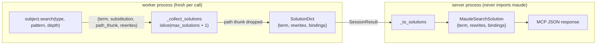

# Research — current implementation of `search` and where paths would enter

> Scope: exactly where `maude_run` drops the path today, how solutions travel from the
> bindings to the wire, what the caps and statuses mean, and what a path field would
> touch. Based on the current source (harold-mcp 0.0.x, no search-path support).

## 1. The path exists and is discarded

`src/harold_mcp/maude/session.py::_collect_solutions` iterates the bindings and unpacks
four values, discarding the third:

```python
found = list(islice(subject.search(search_type, pattern, depth=depth), max_solutions + 1))
solutions: list[SolutionDict] = []
for solution, substitution, _path, rewrites in found[:max_solutions]:
    term_text = str(solution)
    bindings = _bindings(substitution)
    if len(term_text) > max_result_length or _bindings_too_large(bindings, max_result_length):
        return "too-large", [], False
    solutions.append({"term": term_text, "rewrites": int(rewrites), "bindings": bindings})
return "ok", solutions, len(found) > max_solutions
```

`_path` is the thunk described in [`maude-bindings-search-path.md`](maude-bindings-search-path.md):
calling it returns `[term0, rule1, term1, …]` for the current solution. **The current
`islice` + `list` shape is a trap**: if `_path()` were called in the second loop, every
path would point at the last state consumed by `islice`, not at its own solution.

## 2. Data-flow today



- `SolutionDict` (`maude/session.py`): `{term: str, rewrites: int, bindings: list[BindingDict]}`.
- `BindingDict`: `{variable: str, value: str}`.
- `StepOutcomeDict`: flat record with `index, command, status, term, rewrites, matches,
  solutions, truncated, message, limit, output`.
- `SessionResult`: `{load_ok, module_found, module_type, defined_modules, warnings,
  load_output, outcomes}`.
- Wire mirror (`server/tools/interpreter.py`): `MaudeSearchSolution(term, rewrites,
  bindings)`; `MaudeStepOutcome.solutions: list[MaudeSearchSolution] | None`; the
  adaptation is `_to_solutions`.

All Maude object access (and therefore all path reconstruction) must happen in the
worker: the server process never imports `maude`, and the worker serializes terms to
strings before returning.

## 3. Input plumbing

`SearchStep` (`server/tools/interpreter.py`) is:

```python
class SearchStep(_PatternStep):
    command: Literal["search"]
    search_type: Literal["one-step", "at-least-one-step", "any-steps", "normal-form", "branch"]
```

`_to_step_request` flattens every step into a `StepRequest` with **all** fields present
(`None` when not applicable), so a new search option (e.g. `path: bool` or
`path: "none" | "labels" | "full"`) must be added in three places:

1. the `SearchStep` wire model (with a docstring, which becomes the schema description),
2. the `StepRequest` TypedDict in `maude/session.py`,
3. `_to_step_request` (the `... if isinstance(step, SearchStep) else None` branch).

Validation (`_validate_steps`) currently checks step count, term/pattern/subject
lengths, rewrite bounds, and current-term threading. An enum-valued path option would
need no extra validation; a numeric path cap would.

## 4. Caps and per-step statuses

From `settings.py` (all overridable with `HAROLD_INTERPRETER_MAX_*`):

| Setting | Default | Relevance to paths |
| --- | --- | --- |
| `interpreter_max_solutions` | 200 | Number of solutions (and therefore paths) per search step. |
| `interpreter_max_result_length` | 1,000,000 chars | Per returned term or binding value; a longer one makes the whole step `too-large`. Path elements are new candidates for this check. |
| `interpreter_max_output_length` | 1,000,000 chars | Per captured stream, unrelated to paths. |
| `interpreter_max_term_length` | 100,000 chars | Input term/pattern/subject, unrelated. |
| `interpreter_max_steps` | 200 | Steps per call, unrelated. |
| `interpreter_timeout_secs` | 60 | Whole-call timeout; the safety net for pathological searches and path reconstruction. |

Semantics that a path must respect:

- **`ok`** — every requested solution fits the caps; `truncated` is true when one more
  solution existed than the cap allowed.
- **`too-large`** — a returned term or binding value exceeded `max_result_length`; the
  step returns **no** solutions (`solutions=None`, `limit` set). There is no partial
  result. Paths that exceed a cap must decide between this all-or-nothing status and a
  new marker.
- **`parse-error`** — the subject or pattern did not parse; `solutions=None`.
- The run stops at the first non-`ok` outcome; `completed=False`.

The cap check also gates work: solutions beyond `max_solutions` are consumed only to set
`truncated` and should not have paths reconstructed.

## 5. Hermetic semantics

Each `maude_run` call gets a fresh interpreter (`max_tasks_per_child=1`); the file is
loaded again every time. Consequences for paths:

- State numbers (`Solution N (state M)`) are meaningful only within the call that
  produced them. Exposing them would let a *later step in the same call* reference them,
  but not a later call. The bindings make this unnecessary: the path travels with the
  solution.
- A `show_path` step command would therefore be a within-call feature (search step →
  remember state number → `show_path` step), duplicating data the search already has.
- Path strings must be materialized in the worker before the interpreter is recycled.

## 6. Tests that pin the current shape

- `tests/unit/test_interpreter_tool.py::test_search_outcome_is_adapted` compares
  `solution.model_dump()` to an exact dict `{term, rewrites, bindings}`. Any new field
  (even `path: None`) changes this assertion.
- `tests/integration/test_maude_session_integration.py::test_search_types_and_ground_targets`
  compares solution dicts exactly (`{"term": ..., "rewrites": ..., "bindings": ...}`)
  across all five search types and ground targets.
- `test_match_and_search_caps_set_the_truncation_flag` covers `max_solutions` and
  `truncated` (counter, depth 5).
- `test_match_and_search_result_length_cap` covers the `too-large` path for search
  (`max_result_length=1`).
- `_outcome(...)` in both test modules builds flat outcomes; a new field needs a
  default there too.

The integration fixtures are `counter.maude` (one-rule counter) and `assoc_match.maude`;
the shepherd fixture from the probe is not in the repository yet and is a good candidate
for a path-specific integration test.

## 7. Documentation surfaces to update

Per the project conventions, a behavior change touches:

- the `maude_run` docstring (free-form text above `Args:` becomes the MCP description;
  the `Commands` section documents each step type);
- `README.md` (tool bullet and, if a new cap appears, the env-var table);
- `.agents/summary/interfaces.md` and `.agents/summary/data_models.md` (knowledge base);
- `CHANGELOG.md` and a minor `pyproject.toml` version bump (per `AGENTS.md`);
- `docs/modules.md` only if a public module is added (the likely change is internal).

## 8. Open questions for the design

1. Always return paths, or opt in per search step? (See
   [`path-design-options.md`](path-design-options.md).)
2. Labels only, full rule text, or both? State terms included?
3. How to bound path size: reuse `max_result_length` per element, add a path-length cap,
   or both? `too-large` vs a partial/truncated path marker.
4. Should state numbers be exposed for future within-call commands, or kept internal?
5. How to handle unlabeled rules in a labels-only mode (`None` vs
   `"(unlabeled rule)"`)?
