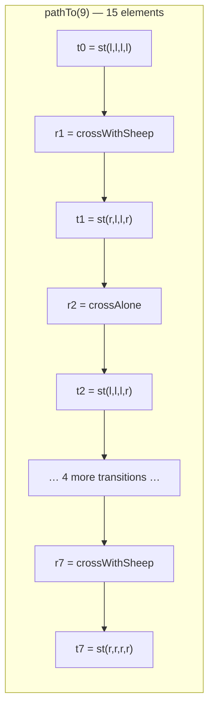

# Research — search paths in the Maude Python bindings

> Question: can `maude_run` obtain the rewrite path to a `search` solution from the
> bindings, without relying on Maude's `show path` commands (which need a state number
> from a previous, now-gone interpreter session)?
>
> **Answer: yes.** `EasyTerm.search` already yields a path thunk for every solution; the
> current session engine discards it. This note records the exact shape and the hazards.
>
> **Version note.** Probed against the `maude` package installed in `harold-mcp/.venv`
> (1.6.0, the pinned dependency). The local `maude-bindings/` source tree is 1.5.0; the
> signatures cited here match. Probes: [`probes/`](probes/).

## 1. What `search` yields

`self._search(...)` (the SWIG shadow in `maude-bindings/swig/specific/python.i`) returns
a `RewriteSequenceSearch`. Iterating it yields a 4-tuple:

```python
(term, substitution, path_thunk, rewrite_count)
```

| Element | Type | Meaning |
| --- | --- | --- |
| `term` | `maude.Term` | The state that matched the search pattern. `str(term)` is the plain term text (e.g. `st(r, r, r, r)`), without the CLI's `state 9, Config:` prefix. |
| `substitution` | `maude.Substitution` | The pattern bindings; `str()` is `empty` for a ground match. Already serialized by `_bindings`. |
| `path_thunk` | Python `function` | A zero-argument callable; calling it returns the path to *the currently selected state*. Not a list. |
| `rewrite_count` | `int` | The interpreter's counter (includes equational rewrites), already returned as `rewrites`. |

SWIG source (`maude-bindings/swig/term.i`, `RewriteSequenceSearch`) also exposes
`getStateNr()`, `getStateParent(n)`, `getRule(n)`, `getStateTerm(n)`, and
`getRewriteCount()`; the Python extension adds `pathTo(n)` and `__next__`:

```python
def __next__(self):
    term = self.__next()
    if term is None:
        raise StopIteration
    return term, self.getSubstitution(), lambda: self.pathTo(self.getStateNr()), self.getRewriteCount()
```

The lambda is the crux of the lifetime hazard in §5.

## 2. Path layout

`pathTo(n)` walks the search graph's parent links and returns a Python list that starts
and ends with a state and interleaves the rule of each transition:

```
[t0, r1, t1, r2, t2, …, rn, tn]        # 2n + 1 elements for n transitions
```

- `pathTo(0)` (the initial state) is `[t0]` — one element.
- The first term `t0` is the parsed subject, in Maude's default (mixfix) print form.
- The last term `tn` is the same text as the solution's `term`.
- Each `ri` is a `maude.Rule` object (module-owned), and `ti` an `maude.Term`.

Observed on the shepherd example (`st(l,l,l,l) =>* st(r,r,r,r)`): 15 elements, 7 rules,
state chain `[0, 1, 2, 3, 5, 7, 8, 9]`, labels exactly
`crossWithSheep, crossAlone, crossWithCabbage, crossWithSheep, crossWithDog, crossAlone, crossWithSheep`.



`pathTo` can be called repeatedly (each call returns a fresh list) and for any state
number, including earlier states after the iterator has advanced — the graph stays in
the `RewriteSequenceSearch` object.

## 3. Rules: labels vs full text

| Accessor | Labeled rule | Unlabeled rule (`rl a => b .`) |
| --- | --- | --- |
| `rule.getLabel()` | `'crossWithSheep'` (the label string) | `None` |
| `str(rule)` | Full statement, e.g. `crl [crossWithSheep] : st(P, C, D, S) => st(other(P), C, D, other(S)) if S == P = true /\ safe(other(P), C, D, other(S)) = true .` | `rl a => b .` |
| CLI `show path` | Prints the full statement (line-wrapped at ~70 columns) | Same |
| CLI `show path labels` | Prints the label alone | Prints `(unlabeled rule)` |

`Rule` is a `%labeledObject`, `%twoSidedObject`, `%streamBasedPrint` class
(`maude-bindings/swig/misc.i`), so `getLhs()`/`getRhs()` are also available if a
structured representation is ever wanted. `str(rule)` is the same text `show path`
prints, except that the CLI wraps lines; conditions are normalized with `= true`.

**Consequence for a labels-only wire option:** labels are the compact, readable form,
but `None` must be handled explicitly (fall back to the rule text or to the CLI's
`(unlabeled rule)` spelling).

## 4. State numbers

`it.getStateNr()` after a `next(it)` matches Maude's `Solution N (state M)` number:
the shepherd solution is `state 9`, and `getStateParent` walks `9 → 8 → 7 → 5 → 3 → 2 →
1 → 0` (`getStateParent(0) == -1`). The search graph numbers are **per search**, not
global, and the interpreter is recycled after every `maude_run` call, so a state number
is only meaningful inside the call that produced it.

## 5. The laziness trap (critical)

The yielded path is `lambda: self.pathTo(self.getStateNr())`; `getStateNr()` is read
**when the thunk is called**, not when it was yielded. Calling an old thunk after the
iterator advanced returns the path to the *new* current state.

Probe, `n(0) =>* n(N)` on `CHAIN`:

| Action | State after `next` | `labels(thunk())` |
| --- | --- | --- |
| first solution (reflexive) | 0 | `[]` |
| second solution | 1 | `['step']` |
| first thunk called after the second `next` | 1 | `['step']` — **wrong for the first solution** |
| second thunk called then | 1 | `['step']` |

This matters because `_collect_solutions` currently materializes all tuples first:

```python
found = list(islice(subject.search(...), max_solutions + 1))
...
for solution, substitution, _path, rewrites in found[:max_solutions]:
```

Adding `_path()` inside that second loop would give every solution the path of the
last-consumed state. Two correct strategies:

1. call the thunk **inside** the iteration loop, while the iterator is positioned on
   that solution; or
2. save `it.getStateNr()` per solution during iteration and call `it.pathTo(state)`
   afterwards (state data outlives the current position).

Strategy 1 is simpler; strategy 2 lets a cap check decide whether a path is needed
before paying for it. Both keep the reconstruction lazy relative to Maude's search.

## 6. Crash hazard: `getRule(0)`

`it.getRule(0)` on the root state — which has no incoming rule — **hard-crashes the
process** (SIGSEGV; observed exit 139 under redirection and 255 in an earlier run; no
Python traceback). `pathTo` never calls it: its recursive base case is
`parent < 0 → [stateTerm(n)]`. `getStateTerm(0)` and `pathTo(0)` are safe, and
`getRule(1)`, `getRule(9)` and `getRule()` (current state) work.

Design consequence: reconstruct paths through `pathTo` (or the `path_thunk`), never by
walking parents with `getRule` and calling it on the root.

## 7. Behavior per search type

Probed on `SHEPHERD`, `BRANCH`, and `CHAIN`:

| Search type | Example | Solution state | Path length | Labels |
| --- | --- | --- | --- | --- |
| `=>1` (`ONE_STEP`) | `st(l,l,l,l) =>1 st(r,l,l,r)` | 1 | 3 | `[crossWithSheep]` |
| `=>+` (`AT_LEAST_ONE_STEP`) | `st(l,l,l,l) =>+ st(r,r,r,r)` | 9 | 15 | the 7-step path |
| `=>*` (`ANY_STEPS`) | same | 9 | 15 | the 7-step path |
| `=>*` reflexive | `n(0) =>* n(0)` | 0 | 1 | `[]` |
| `=>!` (`NORMAL_FORM`) | `a =>! c` on `BRANCH` | 2 | 3 | `[ac]` |
| `=>#` (`BRANCH`) | `a =># X:S` on `BRANCH` | 0 | 1 | `[]` (CLI: `Empty path.`) |

So every search type yields a usable path. The `=>#` case and the reflexive `=>*` case
are "empty paths": one state, no transitions.

## 8. Long-path size

`n(0) =>* n(100)` on `CHAIN`, depth 100:

- 201 path elements: 101 terms + 100 rules;
- max term text 6 chars, max rule text 30 chars;
- total rule text 3,000 chars (≈3 KB for a 100-step path);
- rewrite counter 200, state 100.

Path reconstruction is O(depth) string formatting per solution. With the current
solution cap of 200, a pathological search (200 solutions × depth 1,000) would build up
to 200,000 elements, hence the need for an explicit path cap in the design.

## 9. Mapping to the Maude CLI

| CLI | Bindings equivalent | Notes |
| --- | --- | --- |
| `show path N` | `pathTo(N)` / `path_thunk()` | Same terms and full rule text; no `state N, Sort:` prefixes, no line wrapping. |
| `show path labels N` | `[rule.getLabel() for rule in path if rule]` | `None` for unlabeled rules vs `(unlabeled rule)` in the CLI. |
| `show path states N` | terms interleaved with labels | The bindings' path gives both. |
| `show search graph` | not exposed as a list; the search object holds the graph | Whole-graph view, not per-solution; unbounded size. |
| `show path` needs a state number from a previous search | not needed | The thunk/path travels with the solution, so no cross-command state is required. |

Manual references: search and `show path` in §5.4.3 (`show path N`, `show path labels N`,
`show path states N`, and `show search graph`); Appendix A lists the commands; the
narrowing variant of `path` is documented in §15.6 (the `vu-narrow` `path` option is
required before `show path` is usable).

## 10. References

- Maude 3.5.1 manual (local text extract, `/home/juanrh/systems/maude/manuals-txt/Maude3.5.1-manual.txt`):
  §5.4.3 (search, `show path`, `show path labels`, `show path states`, `show search graph`),
  Appendix A (command list; `vu-narrow` `path` option), §15.6 (narrowing paths).
- Maude manual online: <https://maude.lcc.uma.es/maude-manual/>
- Maude bindings documentation: <https://fadoss.github.io/maude-bindings/>
- Local binding sources: `maude-bindings/swig/specific/python.i` (`search` shadow,
  `RewriteSequenceSearch.pathTo`/`__next__`), `maude-bindings/swig/term.i`
  (`RewriteSequenceSearch`), `maude-bindings/swig/common.i` (`%labeledObject`),
  `maude-bindings/swig/misc.i` (`Rule`).
- Probes and transcripts: [`probes/`](probes/).
