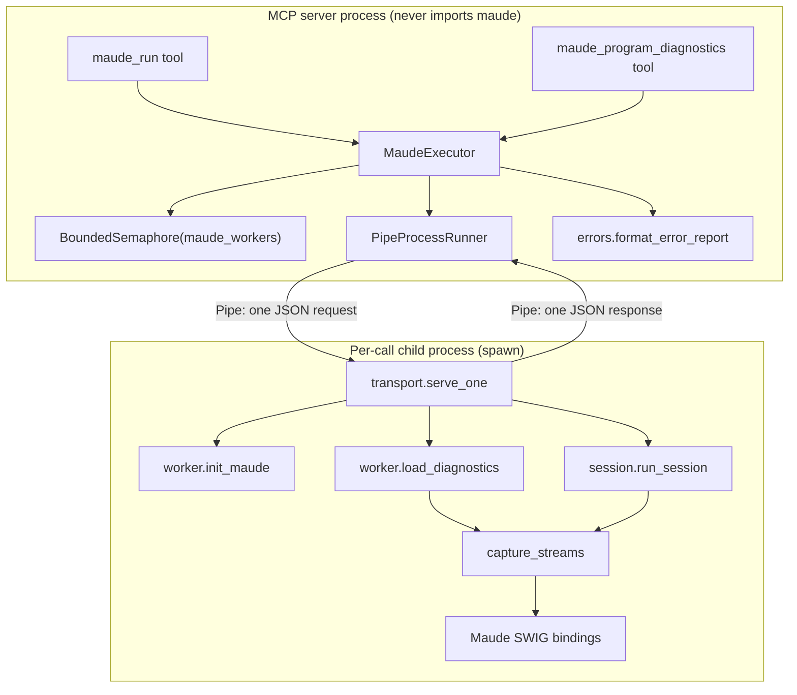
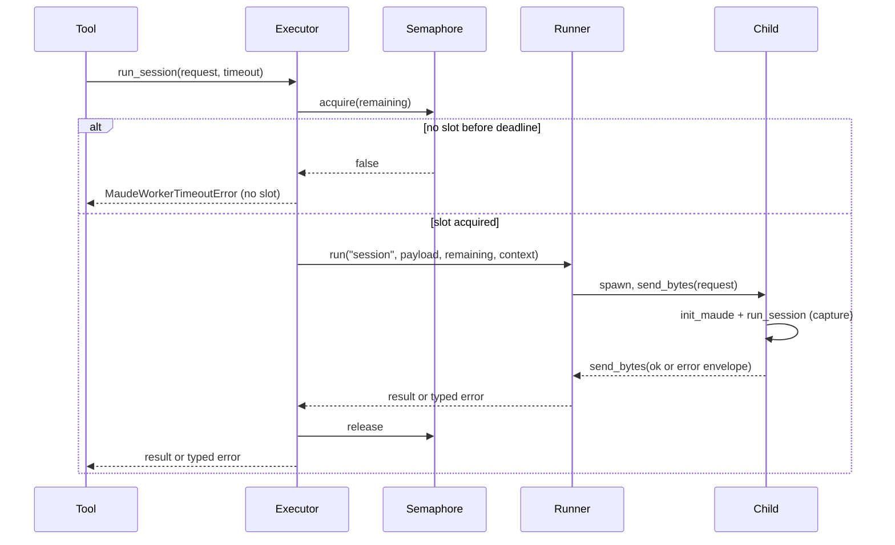
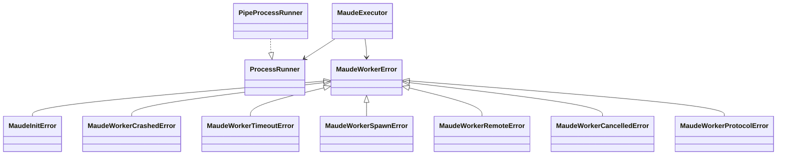

# Detailed Design — Isolated interpreter workers with rich failures

Status: design for review; revised after the first design review (all findings
addressed).

## 1. Overview

### 1.1 Problem

The interpreter tool runs every call in a shared `ProcessPoolExecutor` with
`max_workers = maude_workers`. The pool has whole-pool failure semantics:

- A call that times out calls `_reset_executor` → `kill_workers()`, which kills
  every worker and every in-flight future, not just the timed-out call.
- `kill_workers()` calls `shutdown(wait=False, cancel_futures=True)`. Futures that
  are still pending are cancelled, and `CancelledError` escapes the executor's
  `BrokenProcessPool`/`TimeoutError` mapping. It then reaches the tool's generic
  handler and is reported as `Unexpected failure running the Maude interpreter
  session: CancelledError`.
- The pool's call queue marks a future `RUNNING` when the manager dispatches it,
  not when a worker starts it (`max_workers + EXTRA_QUEUED_CALLS` futures can be in
  this state). `Future.cancel()` returns `False` for all of them, so a timed-out
  call that never started a worker is indistinguishable from one that did.

The reproduced cascade, with three workers, is deterministic: three occupying
calls get `Maude worker crashed`, the queued timed-out call gets
`Maude worker timed out`, and the healthy queued searches get either
`Maude worker crashed` or `CancelledError`. The client-visible result mixes
"Unexpected failure" and "Maude worker crashed" for calls whose only mistake was
running concurrently with a bad one.

A second problem is diagnosability: the MCP client receives only a short wrapper
string. The exception type, the cause chain and the worker-side traceback are
logged server-side but not surfaced, so a non-deterministic failure cannot be
diagnosed from the tool response alone.

### 1.2 Goals

1. Per-call isolation: a crash, timeout or initialization failure affects only the
   call that owns the process.
2. A whole-call timeout that includes admission, spawn, Maude initialization, load
   and steps.
3. A bounded number of concurrent interpreters (`maude_workers`).
4. A fresh interpreter per call (no state leakage, including top-level `q .`).
5. Distinct, actionable failure categories.
6. Rich, bounded error text in the MCP tool response: type, message, cause chain,
   call context and the originating traceback, with the full detail logged.
7. No new runtime dependencies; the server process never imports `maude`.
8. Preserve the public tool contracts and the existing per-step result semantics.

### 1.3 Non-goals

- Changing `maude_run`'s step vocabulary, result models or per-step behavior.
- Changing diagnostics severity, ordering, fix behavior or all-or-nothing
  aggregation.
- Retries, persistent interpreter reuse, warm pools or background tasks.
- Adding pebble, billiard or any third-party process library.
- The RAG/documentation tool.
- Changing the default `maude_workers` value.

### 1.4 How the design fixes the reported bugs

The failures share one root cause: the shared pool. Its `kill_workers()` recovery
kills every worker and cancels pending futures, its call queue marks futures
running before a worker starts them, and its `CancelledError`/`BrokenProcessPool`
vocabulary leaks into unrelated calls. The design removes the shared object: every
call owns one process, and the only cross-call coordination is a semaphore that
admits or rejects a call before any process exists. The table maps each reported
bug to its remedy and to the regression test in §7.5.

| Bug | Symptom | Root cause | Design remedy |
| --- | --- | --- | --- |
| B0 — undiagnosable failure | Client sees `Unexpected failure ...` with no type/cause | The tool's wrapper omitted the cause chain and traceback | Rich formatter: category, type/message, cause chain, context and a bounded originating traceback; full report logged |
| B1 — `CancelledError` | `Unexpected failure ...: CancelledError` in a healthy-looking call | `kill_workers()` cancels pending pool futures; `CancelledError` escapes `_run_task` | No pool and no futures, so cross-call cancellation cannot occur. Shutdown cancellation is `MaudeWorkerCancelledError`; any stray `CancelledError` is mapped defensively |
| B2 — collateral crashes | Healthy concurrent calls fail with `Maude worker crashed` | One call's timeout replaces the shared pool and kills all workers | One process per call; killing a child affects only its own call; the semaphore only gates admission |
| B3 — queued timeout | A timeout that never started a worker kills the pool; queued vs running is undecidable | The call queue marks futures running before execution; `cancel()` is false for the first `max_workers + 1` queued calls | No call queue. A call waits on a semaphore; if admission times out it fails before spawning; a running timeout kills only that child |
| B4 — step output | A search step's structured result is present but `stdout` is empty; a block once appeared in another step | The bindings return values and do not print; the old cross-step leak was libmaude buffering | No transport change; `capture_streams` still flushes per phase; tests pin the expected empty stdout and captured stderr |
| B5 — init mislabel | An init failure would be reported as `Unexpected failure` | `MaudeInitError` was not a `MaudeWorkerError` | `MaudeInitError` becomes a `MaudeWorkerError`; the tool's specific branch reports `init-failure` with details |
| B6 — startup/shutdown escape | A spawn `OSError` or a shutdown `RuntimeError` bypassed the mapping | The pool's `submit()` catches only `BrokenProcessPool` | No `submit()`. `Process.start()` failures become `MaudeWorkerSpawnError`; shutdown races become `MaudeWorkerCancelledError`; both carry the cause |
| B7 — lost load tail | A bounded search at EOF was missing from `load_output` | libmaude's C buffer was not flushed before restoring fds | Already fixed by `capture_streams`; the design keeps it and adds a regression test |

B4 and B7 are not fixes in this project: the research established that B4's empty
step stdout is correct behavior (and the old cross-step leak is already fixed), and
B7's flush fix is already in place. They are listed because the regression suite
must keep them fixed. §7.5 ties each row to a concrete test and a test type.

## 2. Detailed Requirements

### 2.1 Functional requirements

- **FR-1 — Per-call isolation.** A failure in one call must not fail, cancel or
  corrupt any other concurrent call.
- **FR-2 — Hermetic calls.** Every call runs in a fresh interpreter process. No
  loaded modules, parser state, current term or Maude global survives to another
  call.
- **FR-3 — Whole-call timeout.** The timeout budget covers admission (waiting for a
  concurrency slot), process spawn, Maude initialization, file load and every step.
  On expiry the call's process is killed, the call gets a timeout error, and other
  calls are unaffected.
- **FR-4 — Bounded concurrency.** At most `maude_workers` interpreter processes
  exist at once. Waiting for a slot is bounded by the call timeout; there is no
  unbounded queue and no eager pool.
- **FR-5 — Crash containment.** If a child dies abruptly (SIGSEGV, `os._exit`,
  OOM kill), the parent detects it through the connection (EOF or an error while
  reading), maps it to a crash error, and keeps serving other calls.
- **FR-6 — Distinct error categories.** Clients can distinguish: whole-call
  timeout, worker crash, worker spawn failure, Maude initialization failure, remote
  interpreter exception, shutdown cancellation, invalid input (missing/unreadable
  file, missing module, theory module), and protocol failure. Per-step failures
  (`parse-error`, `too-large`) remain data in a successful result.
- **FR-7 — Rich, client-visible details.** Whole-call failures carry a
  self-contained error text with the category, exception type/message, full cause
  chain (including remote causes), call context (resolved path, module, phase,
  step index/command when known, timeout, pid) and a bounded originating
  traceback. The text does not depend on structured content surviving the MCP
  error path.
- **FR-8 — Diagnostics parity.** A diagnostics aggregation failure names every
  failing provider and carries each provider's cause chain and context; the
  all-or-nothing contract is unchanged.
- **FR-9 — Fail-fast initialization.** The lifespan verifies that `maude_workers`
  fresh interpreters can initialize Maude within the diagnostics timeout; failure
  raises `MaudeInitError` and prevents startup.
- **FR-10 — Clean shutdown.** Shutdown kills and reaps in-flight children, is
  idempotent, leaves no orphans or zombies, and never hangs server exit. In-flight
  calls receive a shutdown-cancellation error when a client is still waiting.
- **FR-11 — Wire robustness.** The parent always passes
  `recv_bytes(maxlength=HAROLD_IPC_MAX_RESPONSE_BYTES)`; a malformed or oversized
  response is a protocol error distinct from a crash. The response wait is
  deadline-bounded. The request send has no separate deadline but is bounded by
  child bootstrap (the child reads before importing Maude), and a dead child yields
  `BrokenPipeError`; Appendix D records this bound.
- **FR-12 — No behavioral regression.** Success results, per-step semantics,
  diagnostics ordering/severity/fix behavior and tool schemas are unchanged; only
  failures and worker internals change.
- **FR-13 — Performance.** Per-call cost is no worse than the current
  `max_tasks_per_child=1` behavior (spawn + prelude initialization). No global
  serialization beyond slot admission.
- **FR-14 — Observability.** Every failure logs the call context, exception type,
  cause chain, remote traceback, worker pid, phase and duration. Nothing logs while
  fds 1/2 are captured.
- **FR-15 — Tests.** Unit tests cover the protocol, mapping, formatting,
  truncation, admission and shutdown with fakes; integration tests cover real
  abrupt exit, real timeout, concurrent isolation, large responses, parse errors
  and diagnostics. The historical cascade becomes a regression test.
- **FR-16 — Documentation.** Update the `maude_run` tool description sentence that
  says a non-terminating reduction "replaces the worker pool" (it no longer does),
  the README `HAROLD_*` table for `HAROLD_ERROR_DETAIL_MAX_CHARS` and
  `HAROLD_IPC_MAX_RESPONSE_BYTES`, `docs/modules.md` for the new error formatter and
  transport modules, the CHANGELOG, and the committed agent knowledge base.

### 2.2 Error reporting requirements

- **ER-1 — Self-contained text.** The error text alone identifies what failed,
  where, why and what to inspect next.
- **ER-2 — No hidden cause.** The `__cause__`/`__context__` chain is rendered;
  remote exceptions preserve their type and message across the IPC boundary.
- **ER-3 — Context.** The resolved absolute path, module, phase, step index and
  command (when known), timeout and pid are included.
- **ER-4 — Bounded.** A `HAROLD_ERROR_DETAIL_MAX_CHARS` setting (default 4000)
  caps the text. The first line is always present; if it alone exceeds the cap, its
  message part is truncated while the category and type are kept. The traceback is
  shortened first; a marker points to the server log.
- **ER-5 — No secrets.** No environment variables, unrelated process state or file
  contents. Paths and module names are allowed.
- **ER-6 — Stable shape.** A consistent first line and a
  `Type: message <- Type: message` cause chain. Per-step data is never converted
  into an error.
- **ER-7 — Diagnostics aggregation.** The collection error lists every failing
  provider and its chain; the full traceback is logged.
- **ER-8 — Tests.** Type, message, cause, context, traceback and truncation are
  asserted, including the no-secrets rule.
- **ER-9 — FastMCP channel.** FastMCP 3.4.7 converts a raised exception into
  `ToolError("Error calling tool '<name>': <str(exc)>")`; it does not append the
  cause chain or traceback, and `mask_error_details` is off. The tool must format
  the full detail into the exception message before raising. `ToolResult` does
  support `is_error=True, structured_content=...`, but the tools have inferred
  success output schemas and MCP requires structured results to conform; FastMCP's
  own client also raises on `isError` and drops structured content. Text is the
  reliable channel.

### 2.3 Non-functional requirements

- **NFR-1 — Platform.** Python 3.14.x. Linux and macOS are supported; Windows is
  best-effort. The transport uses portable `multiprocessing` APIs only
  (`get_context("spawn")`, `Pipe`, `Connection.send_bytes`/`recv_bytes`,
  `Process.kill()`/`join()`/`daemon`); no POSIX-only `os.killpg`, `signal.SIGKILL`,
  `resource` or `fork`. Development and CI run on Linux; other platforms must fail
  with a clear diagnostic if the `maude` bindings are unavailable.
- **NFR-2 — Dependencies.** Stdlib only; no new runtime dependency.
- **NFR-3 — Safety.** Maude directory/file/process IO stays disabled; IPC payloads
  are validated; a malformed message cannot crash the server.
- **NFR-4 — Bounded memory.** Existing output/result caps remain. The parent always
  passes `recv_bytes(maxlength=HAROLD_IPC_MAX_RESPONSE_BYTES)`; an oversized message
  is a protocol error naming the setting, never unbounded buffering.
- **NFR-5 — Logging hygiene.** No logging while fds 1/2 are captured; child
  stdout/stderr never contaminate the MCP stdio transport.
- **NFR-6 — Maintainability.** The transport sits behind a small runner seam so
  unit tests do not spawn processes; error mapping and formatting live in one
  place.

### 2.4 Acceptance criteria

1. The historical recipe (three occupiers, a queued 2 s non-terminating call, four
   healthy searches) produces no `CancelledError`; only the timed-out call reports
   timeout; the others complete or fail for their own reasons.
2. A child that segfaults or calls `os._exit` fails only its own call; concurrent
   calls succeed and the server stays up.
3. A non-terminating step times out, its process is killed, no other call is
   affected, and a subsequent call succeeds.
4. A simulated worker exception produces text with type, message, cause chain,
   path/module/step context and a bounded traceback; the full detail is in the
   server log.
5. Diagnostics reports every failing provider with its cause and preserves its
   success/summary behavior.
6. `make check`, `make test` and `make docs-test` pass; the new regression tests
   fail on the old architecture and pass on the new one.
7. No orphan processes remain after normal use, timeouts, crashes or shutdown.

### 2.5 Out of scope

Per-step semantics, diagnostics contracts, retries, persistent/warm interpreters,
third-party process libraries, the RAG tool and the default `maude_workers` value.

## 3. Architecture Overview



The server process contains the tools, the executor, admission control, the
process runner and error formatting. The interpreter, the capture helper and the
session engine live only in the child. A call is a single request/response exchange
over `multiprocessing.connection.Connection`; the child exits afterward.

### 3.1 Why one process per call

The pool abstraction provides worker reuse and queueing, neither of which Harold
needs: every call already requires a fresh interpreter (`max_tasks_per_child=1`).
A dedicated process has the exact desired failure domain. It also removes the
call-queue state that makes "queued versus running" undecidable, the broken-pool
state, and cross-call cancellation. A crash is contained by the OS; the parent
observes EOF and reports it for that call only.

The cost is one `spawn` per call, which the current design already pays. The
transport is a small amount of stdlib code that the project owns and tests, rather
than a pool whose semantics do not match the requirements.

### 3.2 Concurrency and lifecycle



- Admission is a `threading.BoundedSemaphore(maude_workers)`. The acquire timeout
  is the remaining whole-call budget, so waiting for a slot cannot exceed the
  timeout.
- Each call owns exactly one child process. There is no queue inside the runner
  beyond the OS scheduler.
- `start()` runs `maude_workers` short-lived `ping` processes in parallel, each
  bounded by the diagnostics timeout. Any failure kills the rest and raises
  `MaudeInitError`.
- `shutdown()` sets a closed flag, kills and joins every active child, and is
  idempotent. In-flight calls observe EOF and are mapped to
  `MaudeWorkerCancelledError` because the executor is closed. The runner also
  checks its own closed flag after registering a child, so a spawn that races with
  shutdown is killed before it can run (§4.2 step 4).

### 3.3 Stdio isolation

A spawned child inherits the server's file descriptors, including the MCP stdio
transport on fd 0/1. At the very start of the child, before importing `maude` or
initializing it, the child redirects fds 0, 1 and 2 to `os.devnull`. This prevents
Maude initialization output or any stray library output from corrupting the MCP
protocol. The existing `capture_streams` still temporarily redirects fds 1/2 to
temp files around loads and steps, so captured output is unaffected.

Capture remains the only code that touches fds 1/2 during Maude work; nothing logs
or prints while the capture fds are installed.

## 4. Components and Interfaces

### 4.1 `MaudeExecutor`

The tool-facing surface stays the same:

```python
class MaudeExecutor:
    def start(self, timeout: float) -> None: ...
    def shutdown(self) -> None: ...
    def diagnostics(self, path: str) -> worker.LoadDiagnosticsResult: ...
    def run_session(self, request: session.SessionRequest, timeout: float) -> session.SessionResult: ...
```

`submit()` is removed: there is no pool and no arbitrary task submission. The
pool-only helpers `worker.sleep` and `worker.rendezvous_pid` are removed from the
worker module; their behavior is replaced by injectable test targets on the runner
(§4.2, §7.2).

Internals:

- `_settings`, `_semaphore`, `_closed: threading.Event`, `_runner:
  ProcessRunner`.
- `__init__(settings=None, *, runner_factory=None)` keeps a test seam analogous
  to the old `executor_factory`.
- `_run_operation(operation, payload, timeout, context)`:
  1. compute a monotonic deadline;
  2. acquire the semaphore with the remaining timeout (false → timeout error with
     "no interpreter slot available");
  3. return immediately with `MaudeWorkerCancelledError` if `_closed` is set;
  4. call `self._runner.run(operation, payload, remaining, context)`;
  5. release the semaphore in `finally`.
  The runner has its own closed flag, so a call that passes this check just before
  shutdown is still stopped after it registers its child (§4.2 step 4).
- `diagnostics(path)` calls `_run_operation("diagnostics", {"path": path},
  settings.diagnostics_timeout_secs, context)`.
- `run_session(request, timeout)` calls `_run_operation("session", request,
  timeout, context)`.
- `start(timeout)` clears `_closed`, runs `maude_workers` `ping` operations in
  parallel (a `ThreadPoolExecutor` limited to `maude_workers` is sufficient;
  the runner itself is thread-safe), waits for all with the shared deadline, and
  raises `MaudeInitError` with the first failure as its cause. On failure it kills
  the runner's active processes.
- `shutdown()` sets `_closed`, calls `runner.kill_all()` (which sets the runner's
  own closed flag before snapshotting), and clears the active set. It is safe to
  call more than once and is terminal for the instance; the lifespan starts one
  executor. A test that needs a fresh start constructs a new `MaudeExecutor`.

### 4.2 `PipeProcessRunner`

A new stdlib-only module in the Maude package. It owns process creation, the pipe
exchange, deadline enforcement, and the active-process registry.

```python
class ProcessRunner(Protocol):
    def run[T](self, operation: str, payload: Any, timeout: float,
               context: Mapping[str, object]) -> T: ...
    def kill_all(self) -> None: ...
    def active_count(self) -> int: ...
```

`PipeProcessRunner(settings, *, target=transport.serve_one)` owns a `_closed`
event. The `target` parameter is the test seam: production passes
`transport.serve_one`; integration tests inject a top-level target that crashes,
sleeps or rendezvouses to exercise isolation without a special production
operation.

1. `ctx = multiprocessing.get_context("spawn")`; `parent, child = ctx.Pipe()`.
2. `proc = ctx.Process(target=self._target, args=(child,), daemon=True)`.
3. `proc.start()`; close `child` in the parent; register `(proc, parent)` in the
   active map under a lock. If `Process.start()` raises `OSError` or `RuntimeError`,
   close the connection and raise `MaudeWorkerSpawnError` with the cause and
   context; nothing is registered and no child exists to kill.
4. **Close the shutdown window:** the registration and the closed check happen
   under the same lock. If `_closed` is set, unregister, `kill()`/`join()` the
   child, close the pipe and raise `MaudeWorkerCancelledError`. `kill_all()`
   acquires the same lock, sets `_closed`, snapshots the active map, releases it,
   then kills/joins; a run that registers before the snapshot is in the snapshot,
   and a run that registers after it sees `_closed`.
5. `parent.send_bytes(json.dumps(request, ensure_ascii=False).encode())`; a
   `BrokenPipeError`/`OSError` here is a crash. The send has no separate deadline:
   the child's first acts are the devnull redirect and `recv_bytes`, before any
   Maude import, so the send is bounded by child bootstrap and a dead child raises
   `BrokenPipeError`. This bound is recorded in Appendix D.
6. `parent.poll(remaining)`; false → kill, join, `MaudeWorkerTimeoutError`.
7. `parent.recv_bytes(maxlength=settings.ipc_max_response_bytes)`:
   - `EOFError` (peer closed before any response) → crash;
   - `OSError("got end of file during message")` → crash;
   - `OSError("bad message length")` → `MaudeWorkerProtocolError` whose message
     names `HAROLD_IPC_MAX_RESPONSE_BYTES` and suggests reducing the result or
     raising the cap;
   - other `OSError` → crash/protocol error with the message.
8. Decode and validate the envelope (`status`, `result`/`error`,
   `error.category`).
9. `status == "ok"` → return `result`.
10. `status == "error"` → map by `error.category` (`protocol`, `init`, `remote`)
    to a typed exception (see 6.1).
11. `finally`: close `parent`, unregister, `kill()` if still alive, `join()` with a
    short bound, `close()` the process.

The runner is thread-safe: the active map and the closed flag are guarded by one
lock; each call has its own pipe and process. `kill_all()` sets `_closed` and
snapshots the map under the lock, then kills/joins outside it.

### 4.3 `transport.serve_one` (child entry point)

Top-level, picklable, stdlib-only at module level (it imports the worker and
session modules lazily inside the function so the server process importing the
transport never imports Maude).

```python
def serve_one(conn: Connection) -> None:
    _redirect_stdio_to_devnull()
    try:
        raw = conn.recv_bytes()
    except EOFError:
        return
    try:
        request = json.loads(raw)
        if not isinstance(request, dict):
            raise ValueError("request must be a JSON object")
        operation = request.get("operation")
        payload = request.get("payload")
        if not isinstance(operation, str):
            raise ValueError("request.operation must be a string")
        if operation in ("diagnostics", "session") and not isinstance(payload, dict):
            raise ValueError("request.payload must be a JSON object")
    except Exception as exc:
        _send_error(conn, category="protocol", type="ProtocolError",
                    message=str(exc), traceback=_format_exc(exc))
        conn.close()
        return
    try:
        result = _dispatch(operation, payload)
    except BaseException as exc:
        category = (
            "protocol" if isinstance(exc, ChildProtocolError)
            else "init" if isinstance(exc, WorkerInitError)
            else "remote"
        )
        _send_error(conn, category=category, type=type(exc).__name__,
                    message=str(exc), traceback=_format_exc(exc),
                    context=_worker_context(exc))
    else:
        _send_ok(conn, result)
    finally:
        conn.close()
```

`_format_exc(exc)` is
`"".join(traceback.format_exception(type(exc), exc, exc.__traceback__))`; it
renders any exception object, including one outside its handler (the same helper
is used by the parent formatter). `ChildProtocolError` is a private transport
exception used to give an unknown operation the `protocol` category.

`_dispatch`:
- always calls `worker.init_maude()` first (idempotent per process);
- `"ping"` → `None`;
- `"diagnostics"` → `worker.load_diagnostics(payload["path"])`;
- `"session"` → `session.run_session(payload)`;
- unknown → raise `ChildProtocolError`; `serve_one` maps it to the `protocol`
  category, never a remote exception.

The child sends the full error message and traceback; the parent bounds what it
shows to the client. The child never logs to the server's streams.

### 4.4 Worker and session engine

`worker.init_maude`, `worker.load_diagnostics` and `session.run_session` keep their
current behavior: lazy `maude` imports, capture via `capture_streams`, warnings
parsed from the full stderr before truncation, per-step failures as data, and
`setAllowDir/File/Processes(False)` after initialization.

Small addition: `session.run_session` annotates unexpected exceptions with the
phase:

- around the load, `worker_context = {"phase": "load"}`;
- around each step, `{"phase": "step", "step": index, "command": command}`.

Use an exception attribute (for example `exc.worker_context = ...`) or
`exc.add_note(...)`, and read it in `transport.serve_one`. Per-step `parse-error`
and `too-large` outcomes are unchanged.

### 4.5 Error formatting

A new stdlib-only `harold_mcp.errors` module:

```python
def format_error_report(exc: BaseException, *, context: Mapping[str, object],
                        max_chars: int, category: str | None = None) -> str: ...
```

It renders, in order:

1. a stable first line: `<category>: <exception type>: <message>`;
2. `context: key=value, ...` (ordered, only provided keys);
3. the cause chain: `cause: Type: message <- Type: message <- ...` with a cycle
   guard;
4. the originating traceback: the remote traceback for a remote failure, or
   `"".join(traceback.format_exception(type(exc), exc, exc.__traceback__))` for a
   local one. Unlike `format_exc()`, this renders a stored exception outside its
   handler, which the diagnostics aggregation needs;
5. a truncation marker when the cap shortened the report.

The context is the exception's own `context` merged with the caller's context,
with the caller's keys winning on collision
(`{**getattr(exc, "context", {}), **context}`); this keeps worker-specific keys
(step, phase, pid) and lets the tool add the path, module and timeout.

The first line is always present. If the report exceeds `max_chars`, the traceback
is truncated first; if necessary, long cause messages are shortened from the end.
As a last resort, if the first line alone exceeds the cap, its message part is
truncated while the category and exception type are kept, and the marker is
appended. The full untruncated report is logged by the caller.

The `MaudeWorkerError` hierarchy carries `context: Mapping[str, object]` and
`remote_traceback: str | None` so the formatter can use them. A generic
`format_error_report` also works for diagnostics provider errors and for
unexpected non-Maude exceptions.

### 4.6 Tool adapters

`maude_run`:

```python
try:
    result = executor.run_session(request, timeout=timeout)
except MaudeWorkerError as exc:
    detail = format_error_report(exc, context={...}, max_chars=settings.error_detail_max_chars)
    _log.error("maude_run failed: %s", detail, extra={...})
    raise MaudeRunError("Maude interpreter session failed: " + detail) from exc
except Exception as exc:
    detail = format_error_report(exc, context={...}, max_chars=settings.error_detail_max_chars)
    _log.exception("maude_run unexpected failure: %s", detail)
    raise MaudeRunError("Unexpected failure running the Maude interpreter session: " + detail) from exc
```

The context includes the resolved path, module, number of steps, timeout and any
worker-provided phase/step/pid. Input errors (missing file, missing module, theory
module) keep their specific messages and gain the same context line.

`maude_program_diagnostics`: the provider aggregation raises
`DiagnosticCollectionError` with a rich message; the tool logs the full detail
(with path and provider names) and re-raises so FastMCP returns the text. The
`SourceFile` pre-check errors remain as they are.

### 4.7 Settings

Add to the existing settings model:

| Field | Env var | Default | Purpose |
| --- | --- | --- | --- |
| `error_detail_max_chars` | `HAROLD_ERROR_DETAIL_MAX_CHARS` | `4000` (`gt=0`) | Cap for the client-visible error text |
| `ipc_max_response_bytes` | `HAROLD_IPC_MAX_RESPONSE_BYTES` | `2147483648` (2 GiB) | `recv_bytes` hardening cap; oversized → protocol error naming this setting |

The cap is hardening against a buggy child, not a quality-of-service limit. The
existing caps allow 200 search solutions with label paths to approach ~1 GiB; the
default is set safely above that. A `path="full"` result can be larger in theory;
it is bounded in practice by the child's memory (the child builds the JSON string
in-process first) and by this cap, whose error message names the setting and
suggests reducing `interpreter_max_solutions` or using `path="labels"`.

Existing settings (`maude_workers`, `diagnostics_timeout_secs`,
`interpreter_timeout_secs`, the `interpreter_max_*` caps and
`interpreter_max_output_length`) keep their meaning. `maude_workers` is the
semaphore size.

### 4.8 Module dependency rules



- The server imports the executor, runner, transport, error formatter, settings and
  tools. None of these imports `maude` at module level.
- The transport imports the worker/session modules lazily inside `serve_one`.
- The diagnostics seam stays stdlib-only and may import the error formatter (also
  stdlib-only), never the Maude modules.

## 5. Data Models

### 5.1 Request envelope

```json
{
  "operation": "session",
  "payload": { "path": "/abs/program.maude", "module": "M", "steps": [] }
}
```

Operations: `ping` (payload `null`), `diagnostics` (`{"path": "..."}`), `session`
(the existing `SessionRequest` mapping). There is no protocol version field: the
child is spawned from the same package and is one-shot, so a version mismatch
cannot occur.

### 5.2 Response envelope

```json
{"status": "ok", "result": null}
{"status": "error", "error": {
  "category": "remote",
  "type": "ValueError",
  "message": "boom",
  "traceback": "Traceback (most recent call last): ...",
  "context": {"phase": "step", "step": 2, "command": "rewrite"}
}}
```

`category` is `protocol`, `init` or `remote`. `result` is the existing
`LoadDiagnosticsResult` or `SessionResult` mapping, unchanged.

### 5.3 Existing models

`SessionRequest`, `SessionResult`, `StepRequest`, `StepOutcomeDict`,
`SolutionDict`, `PathDict`, `BindingDict` and `LoadDiagnosticsResult` are
unchanged. The wire format is these dicts serialized as JSON; no field is added or
removed.

### 5.4 Exception model

```
MaudeError(RuntimeError)
└── MaudeWorkerError            reason, context, remote_traceback, category
    ├── MaudeInitError          "Failed to initialize the Maude interpreter..."
    ├── MaudeWorkerCrashedError "Maude worker crashed"
    ├── MaudeWorkerTimeoutError "Maude worker timed out"
    ├── MaudeWorkerSpawnError   "failed to start the Maude worker: <cause>"
    ├── MaudeWorkerRemoteError  "<Type>: <message>"
    ├── MaudeWorkerCancelledError "cancelled during shutdown"
    └── MaudeWorkerProtocolError  "invalid worker response: ..."
```

`MaudeInitError` changes base from `MaudeError` to `MaudeWorkerError` so the tool's
specific branch handles it (this removes the old hierarchy trap where an init
failure would be labelled "Unexpected failure"). `reason` remains available.
`MaudeWorkerRemoteError` also exposes `remote_type`, `remote_message` and
`remote_traceback`. `MaudeWorkerError.category` is a class attribute used by the
formatter (`timeout`, `crash`, `spawn-failure`, `init-failure`,
`remote-exception`, `cancelled`, `protocol-error`).

### 5.5 Error envelope to exception mapping

| Envelope `error.category` | Parent exception |
| --- | --- |
| `init` | `MaudeInitError` (with the remote traceback) |
| `remote` | `MaudeWorkerRemoteError(remote_type, message, traceback, context)` |
| `protocol`, missing, or unknown | `MaudeWorkerProtocolError` |
| invalid JSON / missing fields | `MaudeWorkerProtocolError` |
| EOF before response / mid-message | `MaudeWorkerCrashedError` |
| no response before deadline | `MaudeWorkerTimeoutError` |
| response exceeds `ipc_max_response_bytes` | `MaudeWorkerProtocolError` |
| closed executor | `MaudeWorkerCancelledError` |

Local process-creation failures (`OSError` or `RuntimeError` from
`Process.start()`) raise `MaudeWorkerSpawnError`; they never come from an envelope.

## 6. Error Handling

### 6.1 Failure categories and mapping

| Category | Trigger | Exception | Client summary |
| --- | --- | --- | --- |
| timeout | Admission or process deadline expires | `MaudeWorkerTimeoutError` | `Maude interpreter session failed: timeout: Maude worker timed out` |
| crash | Child exits/loses the pipe before a complete response | `MaudeWorkerCrashedError` | `... crash: Maude worker crashed` |
| spawn-failure | `Process.start()` raises `OSError`/`RuntimeError` | `MaudeWorkerSpawnError` | `... spawn-failure: failed to start the Maude worker: ...` |
| init-failure | `init_maude` fails in a ping or a call | `MaudeInitError` | `... init-failure: Failed to initialize ...` |
| remote-exception | Child sends a Python error envelope | `MaudeWorkerRemoteError` | `... remote-exception: ValueError: boom` |
| cancelled | Executor shutdown kills an in-flight call | `MaudeWorkerCancelledError` | `... cancelled: cancelled during shutdown` |
| protocol-error | Malformed or oversized response | `MaudeWorkerProtocolError` | `... protocol-error: invalid worker response: ...` |
| input-error | Missing/unreadable file, missing module, theory module | existing `MaudeRunError` / `SourceFileNotFoundError` | existing specific message + context |
| unexpected | Any other server exception | existing generic branch | `Unexpected failure running ...: <Type>: <message>` + context + traceback |

An oversized response is a `protocol-error` whose message names
`HAROLD_IPC_MAX_RESPONSE_BYTES` and suggests reducing `interpreter_max_solutions`
or using `path="labels"`; it is not reported as a crash or a remote exception.

Per-step failures remain data (`status` `parse-error`/`too-large`); they are never
converted into these errors.

### 6.2 Text shape

Example of a client-visible remote failure:

```
Maude interpreter session failed: remote-exception: ValueError: boom
context: path=/abs/program.maude, module=M, step=2 (rewrite), timeout=60s, pid=12345
cause: MaudeWorkerRemoteError: ValueError: boom <- ValueError: boom
traceback:
Traceback (most recent call last):
  ...
... [error detail truncated; see the server log]
```

The first line is stable and always present. If the first line alone exceeds the
cap, its message part is truncated while the category and type are kept (see
§6.3). The context line is present for every whole-call failure. The cause chain
precedes the traceback. The truncation marker is only present when the cap
shortens the text.

### 6.3 Formatting algorithm

1. Build the first line from the category, exception type and message.
2. Merge the exception's own `context` with the caller's context, caller keys
   winning (`{**getattr(exc, "context", {}), **context}`), and append the ordered
   `key=value` pairs (skip `None` values).
3. Walk `__cause__` then `__context__` with an identity set to avoid cycles;
   render each as `Type: message`.
4. Choose the originating traceback:
   - `remote_traceback` if the exception carries one;
   - otherwise `"".join(traceback.format_exception(type(exc), exc,
     exc.__traceback__))`. `format_exception` renders any exception object,
     including a stored one outside its handler; `format_exc()` would render
     `NoneType: None` there.
5. Join the sections, preserving the first line.
6. If the result exceeds `max_chars`, truncate the traceback (then long cause
   messages from the end) and append the marker. As a last resort, if the first
   line alone exceeds the cap, truncate its message part while keeping the
   category and exception type, and append the marker. The full report is always
   logged by the caller.

The formatter never reads environment variables or file contents.

### 6.4 Logging

- The tool logs one ERROR record per failure with the full (untruncated) report,
  the context fields, the pid/phase and `exc_info=True` for local exceptions.
- For remote exceptions, the record includes the remote traceback in the message;
  the local traceback is only the raise site.
- The child does not log; it sends the error envelope. This keeps the server log
  authoritative and avoids interleaving from multiple processes.
- No logging occurs while fds 1/2 are captured.

### 6.5 Diagnostics aggregation

`collect_diagnostics` remains all-or-nothing. `DiagnosticCollectionError` carries
the list of `(provider_name, exception)` pairs and renders:

```
Diagnostic collection failed: 2 provider(s) failed
- interpreter: Maude interpreter session failed: timeout: ...
  context: ...
  cause: ...
  traceback: ...
- heuristic-linter: ...
```

The per-provider sections use the same formatter and cap. Because provider
exceptions are stored objects rendered outside their `except` block, the formatter
must use `traceback.format_exception(type(exc), exc, exc.__traceback__)` — using
`format_exc()` there would print `NoneType: None`. The tool logs the full report
and re-raises. The provider protocol and the seam's error vocabulary
(`DiagnosticsError`, `SourceFileNotFoundError`, `DiagnosticProviderError`) are
unchanged.

### 6.6 Shutdown and cancellation

`shutdown()` sets `_closed` and calls `runner.kill_all()`. `kill_all()` sets the
runner's own `_closed` flag **before** snapshotting the active map, so a child
whose registration lands after the snapshot is caught by the runner's
post-registration check (§4.2 step 4): it is killed, joined and reported as
`MaudeWorkerCancelledError`. A call blocked in `poll`/`recv_bytes` wakes with EOF;
the executor checks `_closed` and raises `MaudeWorkerCancelledError` instead of
crash. A call that has not yet acquired a slot checks `_closed` after acquiring
and raises the same error before spawning. `shutdown()` is idempotent and
kills/joins with a bounded wait, logging any process that refuses to die. A
`concurrent.futures.CancelledError` from any library path is mapped to
`MaudeWorkerCancelledError`; it never reaches the tool bare.

## 7. Testing Strategy

### 7.1 Unit tests

- **Formatter** (`errors`): type/message/cause/context/traceback rendering; cycle
  guard; remote traceback; a stored exception rendered outside its handler (not
  "NoneType: None"); context-merge precedence (caller wins on collision);
  truncation keeps the first line/category/type, including a message larger than
  the cap; marker; no secrets.
- **Transport protocol**: request/response encoding; non-object JSON and invalid
  payloads produce a protocol-category error; unknown operation; missing fields;
  oversized `maxlength`; child error envelope mapping by `category`; `serve_one`
  dispatch with a fake operation (no Maude import).
- **Runner with fakes**: fake process/connection injects EOF, mid-message
  `OSError`, timeout, oversized response (message names
  `HAROLD_IPC_MAX_RESPONSE_BYTES`), `BrokenPipeError` on send, spawn failure, and
  the shutdown registration race (a child registered after `kill_all()` is killed
  and raises `MaudeWorkerCancelledError`); asserts kill/join and active-set cleanup.
- **Executor with a fake runner**: success; timeout; crash; spawn failure; init
  failure; remote error; protocol error; a stray `CancelledError` mapping; shutdown
  cancellation; semaphore admission (a second call waits); `start()` pings
  `maude_workers` times and fails fast; shutdown idempotence; `_closed` behavior.
- **Session phase annotation**: a fake load/step raising an unexpected exception
  carries `phase="load"` or `phase="step"` plus index/command into the envelope.
- **Tool adapters**: rich text in `MaudeRunError`; per-step data unchanged;
  diagnostics provider details (stored exception traceback, not "NoneType: None");
  context fields present; truncation; the `maude_run` description no longer says a
  non-terminating reduction replaces the worker pool.
- **Settings**: the two new fields and their defaults.

Fakes keep unit tests hermetic: no interpreter, no real processes, no Maude import.

### 7.2 Integration tests (real processes and interpreter)

- **Test seam:** `PipeProcessRunner` accepts an injectable top-level target.
  Production passes `transport.serve_one`; integration tests pass a crash target
  (`os._exit`) or a sleeping/rendezvous target. Tests construct
  `PipeProcessRunner(settings, target=...)` through the executor's `runner_factory`
  and inject it into `MaudeExecutor`. `submit()`, `worker.sleep` and
  `worker.rendezvous_pid` are removed; the tests that used them are rewritten
  around the target seam.
- Normal session and diagnostics results are semantically equal to the old behavior
  for representative fixtures.
- **Abrupt child exit:** the crash target exits without a response; only that call
  reports a crash, a concurrent call succeeds, and the server remains usable.
- **Real timeout:** a non-terminating `rewrite` rule with a short timeout; the
  process is killed, the call reports timeout, a peer call succeeds, and a
  subsequent call succeeds.
- **Concurrent isolation:** the historical recipe (three slow occupiers, a queued
  non-terminating call with a 2 s timeout, four healthy searches) produces no
  `CancelledError`; only the trigger reports timeout, and the others complete.
- **Large request:** a `SessionRequest` larger than the 64 KiB pipe buffer (long
  terms/steps) round-trips; the send path completes and the result is intact.
- **Large response / cap:** with a lowered `ipc_max_response_bytes`, an oversized
  result raises a protocol error whose text names the setting; with the default,
  a large legitimate result round-trips.
- **Step/load capture:** step stdout is empty by design, step stderr carries parse
  warnings, and a bounded search at EOF is present in `load_output` (B4/B7).
- Parse error, `too-large`, diagnostics warnings, missing module and theory module
  keep their existing behavior.
- **Shutdown:** with an in-flight call, the call gets the cancellation error and no
  orphan processes remain (check pids with `os.kill(pid, 0)` / `Process.is_alive`).
- Fixtures: a non-terminating rewrite module (rule self-loop) for timeout tests; a
  module whose last command is a bounded search for B7; a large-result module; the
  historical cascade modules (slow spinner + non-terminating loop + a search
  model); and a crash target that calls `os._exit`.

### 7.3 Regression tests

The cascade, crash, timeout, shutdown-race and rich-error tests are added to the
suite; they must fail on the old shared-pool architecture and pass on the new one.
A regression test for the bounded-search-at-EOF load capture and for step stderr
capture remains.

### 7.4 Determinism

- Crash is simulated by a deterministic `os._exit`, not by a real SIGSEGV.
- Timeout uses a non-terminating rewrite rule; the timeout is short but generous
  enough for spawn/init on CI (the suite already accounts for per-call spawn).
- Concurrency tests use distinct processes and explicit deadlines; they assert
  per-call outcomes, not scheduling order.
- No test depends on the old pool's internal queue behavior.

### 7.5 Bug regression matrix

Every bug in §1.4 has a named regression test. Tests live in the project's unit
or integration suite according to what they must prove; the names are illustrative
and can be adjusted during implementation.

| Bug | Regression test | Type | Why this type |
| --- | --- | --- | --- |
| B0 | `test_remote_error_report_has_type_cause_context_and_traceback`; `test_report_truncates_traceback_and_keeps_first_line` | Unit (formatter + fake runner) | Pure formatting/mapping; deterministic, no interpreter |
| B1 | `test_historical_cascade_has_no_cancelled_error`; `test_cancelled_error_is_mapped_to_cancelled` | Integration (real processes) + unit (fake runner) | The original bug is a real pool race; the integration test reproduces the scheduling, the unit test pins the defensive mapping |
| B2 | `test_concurrent_call_survives_peer_crash`; `test_historical_cascade_has_no_collateral_failures` | Integration (real processes, crash target) | OS-level isolation cannot be proven with fakes; `os._exit` gives a deterministic crash |
| B3 | `test_admission_timeout_does_not_kill_slot_holder`; `test_running_timeout_kills_only_own_process` | Unit (fake runner) + integration (real Maude) | Admission is pure executor logic; the kill behavior needs a real process |
| B4 | `test_step_stdout_is_empty_and_stderr_is_captured`; `test_load_output_does_not_leak_into_step_stdout` | Integration (real Maude) | Requires the real bindings and the per-phase capture |
| B5 | `test_maude_init_error_is_a_worker_error`; `test_init_failure_message_is_specific` | Unit | Pure hierarchy/mapping |
| B6 | `test_spawn_failure_is_mapped_to_spawn_error`; `test_shutdown_inflight_call_is_cancelled` | Unit (fake runner) + integration (shutdown) | Mapping is pure; the shutdown race needs a real process |
| B7 | `test_bounded_search_at_eof_is_in_load_output` | Integration (real Maude) | The bug is libmaude's C buffering; only the real interpreter reproduces it |

The B1/B2/B3 tests must fail on the old shared-pool implementation; B4/B7 are
characterization tests that pin correct behavior, and B5/B6 pin the error mapping.

#### Review finding coverage

The design review's findings are all covered by tests:

| Review finding | Test | Type |
| --- | --- | --- |
| 1. Shutdown registration race | `test_shutdown_after_registration_kills_child`; `test_shutdown_inflight_call_is_cancelled` | Unit (synchronized fake) + integration |
| 2. Stored-exception traceback in diagnostics | `test_diagnostics_provider_traceback_outside_handler` | Unit |
| 3. Crash/concurrency test seam | `test_crash_target_via_injected_target`; `test_slot_holder_via_injected_target` | Integration |
| 4. Response cap below legitimate maximum | `test_oversized_response_names_ipc_setting`; `test_large_response_under_configured_cap` | Unit + integration |
| 5. Huge first line defeats the cap | `test_huge_exception_message_is_truncated_with_marker` | Unit |
| 6. Request send bound | `test_large_request_round_trip`; `test_dead_child_before_read_maps_to_crash` | Integration + unit |
| 7. Child protocol-error mislabel | `test_invalid_json_is_protocol_error`; `test_non_object_request_is_protocol_error` | Unit |
| 8. Non-object request validation | same as finding 7 | Unit |
| 9. Load-phase context | `test_load_failure_has_phase_load` | Unit |
| 10. Stale documentation sentence | `test_maude_run_description_does_not_mention_worker_pool`; `make docs-test` + documentation checklist | Unit + build/review |
| 11. Context merge | `test_context_merge_caller_wins` | Unit |

### 7.6 Test type rationale

- **Unit tests with a fake runner** are the right choice for executor logic:
  admission, deadline arithmetic, error-envelope mapping, shutdown/closed state,
  start pings and the formatter. They are fast, hermetic and deterministic, and
  they can inject `OSError`, `CancelledError`, `EOFError` and oversized messages
  that are hard to trigger reliably with real processes.
- **Integration tests with the real `spawn` context** are required for everything
  that depends on the OS or Maude: abrupt exit (EOF), real timeout and kill,
  concurrent isolation, capture, large responses and orphan checks. Fakes cannot
  prove that one process's death leaves another process running.
- **Deterministic crash target.** A top-level test target that calls `os._exit`;
  do not rely on generating a real SIGSEGV. This keeps the crash test stable
  across platforms.
- **Deterministic timeout.** A non-terminating rewrite rule with a short but
  generous timeout (spawn + prelude initialization included). Assert that the call
  fails with a timeout, the peer call succeeds and a follow-up call succeeds; do
  not assert exact elapsed times.
- **The historical cascade** is an integration test and the authoritative
  regression for B1/B2/B3. It can use the finite spinner or the infinite rewrite
  rule; assert per-call outcomes rather than scheduling order.
- **No sleeps as synchronization.** Use process markers, explicit deadlines or
  the runner's `active_count`; the suite's rendezvous-style helpers are the model.
- **Shutdown registration race.** The unit test synchronizes the fake process
  registration with `kill_all()` so the window is deterministic; the integration
  test uses a real in-flight call and checks the pid is gone. This is the only way
  to prove FR-10's no-orphan guarantee.
- **Stored exception formatting** is purely a formatter concern and is unit-tested;
  the diagnostics aggregation test exercises the real stored-exception path.
- **Large request/response** needs a real pipe. The response-cap test lowers
  `HAROLD_IPC_MAX_RESPONSE_BYTES` in the test configuration so it can assert the
  protocol-error message without allocating gigabytes.
- **Documentation** is checked by the strict docs build (`make docs-test`), a
  docstring assertion for the stale "replaces the worker pool" sentence, and a
  review checklist for the named README/settings entries.

## 8. Appendices

### A. Technology choices

| Choice | Decision | Why |
| --- | --- | --- |
| Isolation unit | One dedicated process per call | Matches fresh-interpreter requirement; removes shared fate |
| IPC | `multiprocessing.connection` over a `Pipe` | Stdlib; 4-byte length framing and partial-write loops handle large messages |
| Serialization | JSON via `send_bytes`/`recv_bytes`, `ensure_ascii=False` | Explicit, testable, safe; results are JSON-safe |
| Protocol version | No version field | One-shot child spawned from the same package; a mismatch cannot occur |
| Start method | `spawn` | Works with SWIG/threads; portable; same as current max-tasks behavior |
| Admission | `threading.BoundedSemaphore(maude_workers)` | Bounds interpreters; waiting counts against the call timeout |
| Kill | `Process.kill()` then bounded `join()` | Portable; SIGTERM may not stop a stuck interpreter |
| Error channel | Text from a raised `MaudeRunError` | FastMCP reliably forwards the exception text; structured error content is dropped by clients |

### B. Research findings (inlined)

**Reproduction.** With `maude_workers = 3`, three 60M-rewrite spinners occupied the
workers; a queued non-terminating `rewrite` with a 2 s timeout timed out; four
healthy searches followed. Observed: the three occupiers and three searches got
`Maude worker crashed`, the trigger got `Maude worker timed out`, and one search
got `CancelledError` (which the tool rendered as "Unexpected failure ...
CancelledError"). The same shape reproduced with three infinite rewrite loops; the
identity of the cancelled search varied, confirming a race.

**Call-queue semantics (CPython 3.14).** `EXTRA_QUEUED_CALLS = 1`; the pool's call
queue size is `max_workers + 1`. `add_call_item_to_queue` calls
`future.set_running_or_notify_cancel()` when it dispatches an item to the queue, so
up to `max_workers + 1` futures are "running" but not started and cannot be
cancelled. `kill_workers()` calls `shutdown(wait=False, cancel_futures=True)` and
kills all workers; truly pending items become `CancelledError`, dispatched items
become `BrokenProcessPool`. This is why the attempt-4 `if future.cancel()` fix
cannot work.

**What did not reproduce.** Step `stdout` is empty by design: the bindings return
values and `search` returns an iterator, they do not print. Step `stderr` captures
parse warnings. A bounded search at the end of a loaded file is captured in
`load_output` thanks to the earlier C stdio flush fix.

**IPC probe.** One-shot `Pipe` with `spawn`: a 1 MB JSON echo round-tripped in
0.03 s; `os._exit(7)` produced EOF in 0.03 s; a 0.5 s deadline killed and joined a
stuck child at 0.50 s; four concurrent calls completed in 0.03 s total.

**Third-party options.** Pebble is LGPL-3.0, incompatible with this GPL-2.0-only
project. Billiard is BSD-3-Clause and provides per-job `WorkerLostError` and
`TimeLimitExceeded`, but its pool threads call `os._exit`/SIGTERM the parent on
internal errors, its per-job timeout requires `enable_timeouts` and `synack`, and a
queued job is not timed out. Neither is adopted.

### C. Alternative approaches

| Option | Summary | Why not chosen |
| --- | --- | --- |
| Shared pool (status quo) | One `ProcessPoolExecutor` of N workers | Shared fate; reproduced cascade; undecidable queue state |
| N single-worker pools | One pool per slot, semaphore admission | Viable stdlib fallback, but keeps a pool manager per slot and the broken-pool vocabulary |
| Pebble | Per-task worker restart and cancellation | LGPL-3.0 / GPL-2.0-only incompatibility |
| Billiard | Per-job `WorkerLostError`/`TimeLimitExceeded` | Parent-process kill risk; timeout flags/quirk; dependency |
| Dedicated process per call | One-shot process + Pipe | Chosen: simplest failure domain, stdlib, matches the fresh-interpreter requirement |

### D. Risks and follow-ups

- **`recv_bytes` after `poll`**: the initial poll bounds the start of the response;
  a child that sends a header and stalls mid-payload can block the parent. The
  child builds the complete payload before sending, and the 1 MB caps make this
  negligible; a watchdog/reader thread is the fallback if a strict bound is needed.
- **Request send**: `send_bytes` has no separate deadline. The child reads the
  request before importing Maude, so the send is bounded by child bootstrap; a dead
  child raises `BrokenPipeError` and is mapped to crash. A bootstrap-level hang is
  the residual case; a watchdog thread is the fallback if a strict bound is ever
  required. A large-request integration test covers the normal path.
- **Response size**: `ipc_max_response_bytes` is a hardening cap, not a
  quality-of-service limit. The default is 2 GiB, safely above the ~1 GiB a
  legitimate result with 200 solutions and label paths can reach; `path="full"`
  can exceed it in theory and is bounded in practice by the child's memory (the
  child builds the JSON string in-process first). Exceeding the cap is a protocol
  error whose text names `HAROLD_IPC_MAX_RESPONSE_BYTES` and suggests reducing the
  result.
- **Cross-platform**: macOS/Windows are not tested in this environment. The
  transport uses portable APIs; the Maude wheel and fd-capture code remain the
  limiting factors.
- **Shutdown races**: the runner's post-registration closed-flag check closes the
  spawn-after-kill window. An in-flight call killed by shutdown is reported as
  cancellation; a call that would have failed for its own reason during the same
  window may be labelled cancelled. This is acceptable and is covered by unit and
  integration tests.
- **`MaudeInitError` base change** is a visible internal API change (still a
  `MaudeError`/`RuntimeError`); document it in the CHANGELOG.
