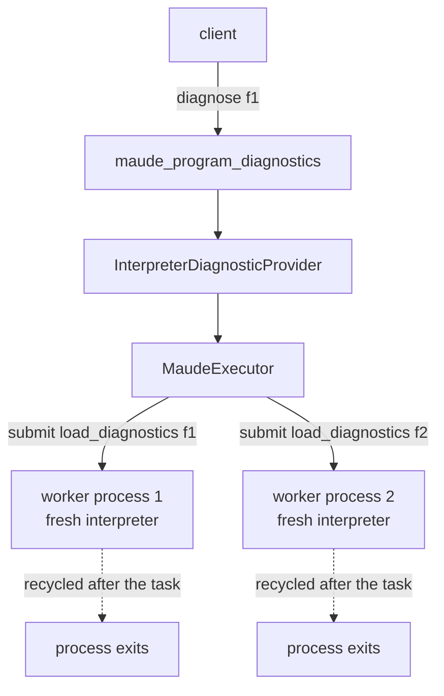

# Detailed design — fixing the deferred `q .` warning quirk via per-call interpreter isolation

Status: design for the implementation phase (harold-mcp `0.0.4.dev0`). Requirements are
consolidated in [`../idea-honing.md`](../idea-honing.md); the research this design rests
on lives in [`../research/`](../research/) (especially `quirk-inventory.md`,
`race-reproduction.md`, `dependencies.md`, `isolation-cost.md`, `misattribution.md`)
and in the original [`../README.md`](../README.md).

## 1. Overview

`maude_program_diagnostics` loads the diagnosed file into a long-lived Maude worker.
Maude 3.5.1 (via the `maude==1.6.0` bindings) leaves its parser **half-parsed** when a
file contains a period-terminated quit command (`q .` / `quit .`): `maude.load` returns
`True` with empty stderr, but the interrupted command — and any remaining commands in
that file — stay pending in the parser. The **next** `maude.load` in the same worker
consumes them: the deferred warning (and any genuinely pending commands) are executed
and captured in the next call's diagnostics, attributed to whatever file that call was
about. The result is silent, misattributed, order-dependent wrong output (see the
planning README and `research/quirk-inventory.md`).

The fix chosen by the user is **option A: `max_tasks_per_child=1`** on the worker
`ProcessPoolExecutor` — every diagnostics call runs on a fresh interpreter process, so
parser residue dies with its worker and can never reach another call. This is a
deliberate semantics change (fresh interpreter per call) and performance trade-off
(≈0.6–1.2 s/call spawn+prelude-init vs ≈1 ms on the warm pool), documented below.

The design also bundles, per the user's decisions:

- a new `HAROLD_MAUDE_WORKERS` default: `max(1, min(3, (os.cpu_count() or 0) // 2))`;
- path absolutization in `SourceFile.from_path` (`Path.resolve()`);
- a minimal, schema-preserving fix for the dependency-warning misattribution (foreign
  files → whole-file diagnostics naming the real file);
- a reworked integration suite (the `heuristic_executor` workaround goes away) with new
  red-green regression tests for the isolation bugs, the race, and file dependencies;
- a ready-to-send GitHub issue proposal for maude-bindings.

Explicitly **out of scope** (user decisions): options B/C/D/E from the planning README;
multiple-file input for the diagnostics tool (one file at a time works — Maude resolves
`load`/`in` inside a file against that file's directory); any change to the Maude
bindings themselves.

## 2. Detailed requirements

Consolidated from `idea-honing.md` (R1–R7). The user's follow-up decisions refine them:

- **R1 (isolation).** `ProcessPoolExecutor(max_tasks_per_child=1, ...)` in
  `MaudeExecutor._default_executor`; accept the per-call cost; document the fresh-per-call
  semantics in the tool description.
- **R2 (workers default).** `maude_workers` default =
  `max(1, min(3, (os.cpu_count() or 0) // 2))` — half the cores, capped at 3 (user's
  formula; rationale: 3 suffices for single-agent IDE use and spares low-core machines).
- **R3 (tests).** Remove the `heuristic_executor` fixture; `no_new_module.maude` must
  diagnose clean (`success=true`, no diagnostics); no new diagnostic for `q .` itself.
- **R4 (isolation tests).** Red-green tests for: q-file→clean-file contamination;
  `quit .`; content after `q .`; a dependency containing `q .`. Each fails on the
  current code, passes after R1.
- **R5 (race).** A concurrent-diagnostics test reproducing opencode's spurious
  interpreter error (deterministic red today; green after R1). No pytest-repeat
  dependency needed: the red is deterministic per schedule (see `race-reproduction.md`).
- **R6 (dependencies).** One-file-at-a-time is final. Tests: clean sibling dependency
  (documents expected behavior); missing dependency (warnings attributed to the
  diagnosed file at the `load` line); dependency with warnings (misattribution fix —
  whole-file diagnostic naming the dependency).
- **R6b (misattribution fix + tool documentation).** Fix attribution in the worker +
  provider (not an internal Maude issue — Maude reports the right filename; our parser
  drops it); document whole-load semantics in the tool description.
- **R7 (bug report).** GitHub issue proposal for maude-bindings with a minimal Python
  reproduction (trigger class: period-terminated `q .`/`quit .`; documented `eof` as
  the clean reference behavior).

## 3. Architecture overview

No structural change. The two-process architecture stays: MCP server (heuristic linter,
aggregation) + worker pool (Maude interpreter). The pool just becomes per-task-disposable:



Every `load_diagnostics` task runs on a process that was spawned for that task and is
recycled (`max_tasks_per_child=1`) when it finishes — parser residue cannot survive
into the next call. Crash/timeout recovery (`_run_task` → pool replacement) is
unchanged; the initializer (`init_maude`) simply runs in every replacement process.

## 4. Components and interfaces

### 4.1 `src/harold_mcp/maude/executor.py`

- `_default_executor`: add `max_tasks_per_child=1` to the `ProcessPoolExecutor(...)`
  call. Update the class docstring: workers are recycled after each task; `start()`'s
  pings no longer warm anything (they keep their fail-fast role); the "last load wins"
  session semantics are gone.
- No signature or error-vocabulary changes. `start`/`shutdown`/`submit`/`_run_task`
  unchanged.

### 4.2 `src/harold_mcp/settings.py`

- `maude_workers: int = Field(default_factory=_default_maude_workers, gt=0)` with

  ```python
  def _default_maude_workers() -> int:
      return max(1, min(3, (os.cpu_count() or 0) // 2))
  ```

- Update the class docstring (default formula, transient workers, memory note
  ≈100 MB/process during bursts).

### 4.3 `src/harold_mcp/diagnostics/provider.py`

- `SourceFile.from_path`: after the existing checks, store
  `source_path = source_path.resolve()` (absolutizes; the heuristic provider and the
  worker both get an absolute path; relative `path` inputs can no longer break on the
  worker's fresh-process path resolution — see `research/quirk-inventory.md` §4).
  Update the `path` field docstring ("as given, made absolute").
- No other seam changes.

### 4.4 `src/harold_mcp/maude/worker.py`

- `WarningDict` gains `file: str` (the filename Maude printed — a basename, or
  `<standard input>`).
- `_WARNING_RE` gains a capture group for the filename (drop the current `\S[^:]*`
  match-and-discard); `_parse_warnings` fills `file`.
- `load_diagnostics` unchanged otherwise (the comparison belongs to the provider,
  which knows the diagnosed file's basename).

### 4.5 `src/harold_mcp/maude/provider.py`

- Attribution rule in `InterpreterDiagnosticProvider.diagnose`:
  - `file == source.path.name` or `file == "<standard input>"` → diagnostic as today
    (line + message, attributed to the diagnosed file);
  - any other `file` → whole-file diagnostic (`line=None`) on the diagnosed file with
    message `In "{file}", line {line}: {message}`.
- Rationale and limits: see `research/misattribution.md` (basename comparison; same-
  basename collisions keep today's behavior).

### 4.6 `src/harold_mcp/server/tools/diagnostics.py`

Tool description rewrite (the free-form text above `Args:`):

- semantics change: **each call loads the file in a fresh Maude interpreter** — no
  session state persists across calls (replaces the "last load wins" sentence);
- whole-load semantics: the interpreter checks the file **and everything it
  `load`s/`in`s**; problems found in a dependency are reported as whole-file
  diagnostics whose message names the dependency file and line;
- keep the existing source/severity/fix/ordering explanation.

`MaudeProgramDiagnosticsResult.path` docstring: "The input path, made absolute."

### 4.7 Documentation and knowledge base

- `README.md`: env-var table default (`HAROLD_MAUDE_WORKERS` → the formula) + any
  tool-description duplication.
- `CHANGELOG.md`: entries under a new version (per the project's Custom Instructions,
  suggest `0.0.5` after implementation).
- `.agents/summary/` and the auto-generated part of `AGENTS.md`: refresh via the
  codebase-summary skill **after** implementation (suggest to the user; not done here).
- This planning directory: update `README.md`'s status line (fix implemented) and
  record the decision.

## 5. Data models

- `WarningDict`: `{line: int | None, message: str, file: str}` (worker-internal; the
  executor's typed-dict result grows the `file` field).
- `ProviderDiagnostic`: unchanged. Foreign-file warnings use `line=None` +
  `message` carrying the file/line text.
- Wire models: unchanged (no schema change — `message` carries the attribution).

## 6. Error handling

No new error paths. Existing behavior to preserve:

- `MaudeWorkerCrashedError`/`MaudeWorkerTimeoutError` → pool replacement + client
  retry (unchanged; recycling adds no failure modes).
- `DiagnosticCollectionError` all-or-nothing aggregation (unchanged).
- `SourceFileNotFoundError`: `resolve()` must come after the `is_file()` check so
  missing files still raise the same error (resolving a missing path would otherwise
  silently produce a non-existent absolute path).

## 7. Testing strategy

Red-green-refactor: write the tests below first, observe them fail on the current
code, apply §4, observe them pass. All interpreter-dependent tests live in
`tests/integration/`; new fixtures go in `tests/integration/fixtures/`.

### 7.1 Rework of the existing suite (R3)

- Delete the `heuristic_executor` fixture and its comment; every test uses the shared
  module-scoped `executor` fixture.
- `test_program_without_modules` keeps asserting `success=true`, `diagnostics == []`
  on `no_new_module.maude` (the file is a correct program; no new lint rule).

### 7.2 Isolation regression tests (R4) — red today, green after R1

New fixtures:

- `quit_command.maude` — `red in NAT : 1 + 2 .` + `quit .`;
- `q_with_trailing_text.maude` — `red in NAT : 1 + 2 .`, `q .  foo bar`, plus a
  trailing `fmod` (its remainder must never be parsed);
- `dep_q.maude` — `red in NAT : 1 + 2 .` + `q .`; `loads_dependency_q.maude` —
  `load dep_q.maude .` + a small fmod.

Tests (all on the shared executor, deterministic):

1. `test_no_new_module_does_not_contaminate_next_diagnosis` — diagnose
   `no_new_module.maude`, then `hello.maude`; both clean.
2. `test_quit_command_does_not_contaminate_next_diagnosis` — `quit_command.maude`,
   then `hello.maude`; both clean.
3. `test_content_after_q_is_not_reported` — `q_with_trailing_text.maude`, then
   `hello.maude`; both clean (and the trailing fmod's commands never surface anywhere).
4. `test_dependency_with_q_does_not_contaminate_next_diagnosis` —
   `loads_dependency_q.maude`, then `hello.maude`; both clean.

### 7.3 Race test (R5) — deterministic red today, green after R1

- `test_parallel_diagnostics_do_not_share_interpreter_state`: with a recycled
  executor (default factory, `maude_workers=2`), submit diagnostics for **all**
  fixtures concurrently (one thread per worker); assert that fixtures in the
  interpreter-clean set (`hello`, `hello2`, `no_new_module`, `nonascii_apostrophe`,
  `string_with_specials`, `quoted_id_when_dash`, `declarations_when_dash`,
  `non_linear_pattern`, `capitalized_identifiers_ok`, `redeclare_prelude`,
  `elt_sort_declaration`, `quit_command`, `q_with_trailing_text`,
  `loads_dependency_q`, `loads_dependency`) produce **no** `source == "interpreter"`
  diagnostics. Verbatim harness from `scratch_race.py` (21/21 red before the fix,
  9/9 green after).

### 7.4 Dependency tests (R6/R6b)

New fixtures:

- `dep_clean.maude` + `loads_dependency.maude` (sibling `load`, uses the module);
- `dep_bad.maude` (module with a syntax problem) + `loads_bad_dependency.maude`;
- `loads_missing_dependency.maude` (`load missing.maude .` + `including NOPE`).

Tests:

5. `test_load_dependency_is_resolved_against_the_file_directory` — `loads_dependency.maude`:
   `success=true`, no diagnostics (green before and after; pins the semantics).
6. `test_missing_dependency_reports_warnings_at_the_load_line` —
   `loads_missing_dependency.maude`: `success=false`, interpreter warnings attributed
   to the diagnosed file at the `load` line (`unable to locate file`), no error
   (Maude recovers) (green before and after; pins current behavior).
7. `test_dependency_warnings_are_attributed_to_the_dependency` —
   `loads_bad_dependency.maude`: red today (warning misattributed to the main file at
   the dep's line); green after §4.4–4.5: whole-file diagnostic(s) whose message names
   `dep_bad.maude` and its line.

### 7.5 Unit tests

- `tests/unit/test_settings.py::test_defaults` — assert the formula
  (`max(1, min(3, (os.cpu_count() or 0) // 2))`); add a monkeypatched
  `os.cpu_count()` case (e.g. 12 → 3, 4 → 2, None → 1).
- `tests/unit/test_maude_executor.py` — new test that `_default_executor` passes
  `max_tasks_per_child=1` (monkeypatch `ProcessPoolExecutor` in the module).
- `tests/unit/test_maude_worker.py` — `_parse_warnings` keeps the filename
  (including `<standard input>`).
- `tests/unit/test_maude_provider.py` — foreign-file warnings become whole-file
  diagnostics with the `In "…", line N:` message; own-file and `<standard input>`
  warnings stay as today.
- `tests/unit/test_diagnostics_seam.py` — `SourceFile.from_path` resolves relative
  paths to absolute.
- `tests/integration/test_maude_executor_integration.py` —
  `test_two_workers_are_used_for_parallel_diagnostics`: the 1.8 s budget no longer
  holds (each task now pays spawn+init ≈1 s before its 1 s sleep); rework to assert
  two distinct pids and parallel wall time against a budget measured from the
  per-task init cost (≈ 2 × (init + sleep) with generous slack, or drop the tight
  bound and keep the pid assertion + a documented loose bound).

### 7.6 Artifacts

- `.agents/planning/no_new_module_quirk/maude-bindings-issue.md` — the GitHub issue
  proposal (title, environment, steps, minimal reproduction, expected/actual, impact,
  workaround, pointer to `eof` as the clean reference).
- `.agents/planning/no_new_module_quirk/repro_minimal.py` — standalone minimal
  reproduction (two temp files + fd-2 capture around two `maude.load` calls).

## 8. Appendix A — technology choices

- `max_tasks_per_child=1` (stdlib, Python 3.14 `ProcessPoolExecutor`): the only
  option that isolates *unknown* future state leaks, chosen by the user despite the
  per-call spawn+init cost. Data: `research/isolation-cost.md`.
- No new dependencies (no pytest-repeat: the race red is deterministic per schedule).

## 9. Appendix B — research findings (summary)

See `../research/`:

- `quirk-inventory.md` — trigger class is exactly `q .`/`quit .` (undocumented
  period-terminated quits; the documented `quit` is not period-terminated and does not
  even stop file parsing; the documented `eof` stops cleanly with no residue); the
  residue is **executable commands** from the interrupted file, run during the next
  load; relative `maude.load` paths are order-dependent.
- `race-reproduction.md` — opencode's claim reproduced (21/21 spurious) and corrected
  (not a race: serialized execution still fails); fix verified (9/9 clean).
- `dependencies.md` — `load`/`in` inside a file resolve against the file's own
  directory (cwd-independent), so one-file-at-a-time diagnostics is final.
- `misattribution.md` — Maude attributes correctly; our parser drops the filename;
  minimal fix proposed (§4.4–4.5).
- `isolation-cost.md` — timing/RSS tables and the workers-default decision.

## 10. Appendix C — alternative approaches considered

From the planning README (options B–E) plus the user's own candidates:

- **B (dummy-load flush)** — rejected: research shows the residue is *executable
  commands*; a flush would execute them (defining modules, running reductions) and
  discard only the warnings.
- **C (filename-aware filtering)** — rejected as the fix for the quirk (hides symptoms;
  leaks file context); a *minimal attribution variant* is adopted for dependency
  warnings (§4.5), which is the honest part of C.
- **D (linter rule for REPL-only commands)** — rejected: `q .` is a legitimate script
  idiom; the file must stay clean.
- **E (status quo + test workaround)** — rejected; the workaround is removed (§7.1).
- **Truncating the input at the first `q .`** (user's idea) — rejected as flaky (temp
  copies, wrong diagnostic paths); isolation supersedes it.
- **Fixing maude-bindings** — good upstream (R7 artifact), but it does not give the
  per-call isolation the tool needs.
