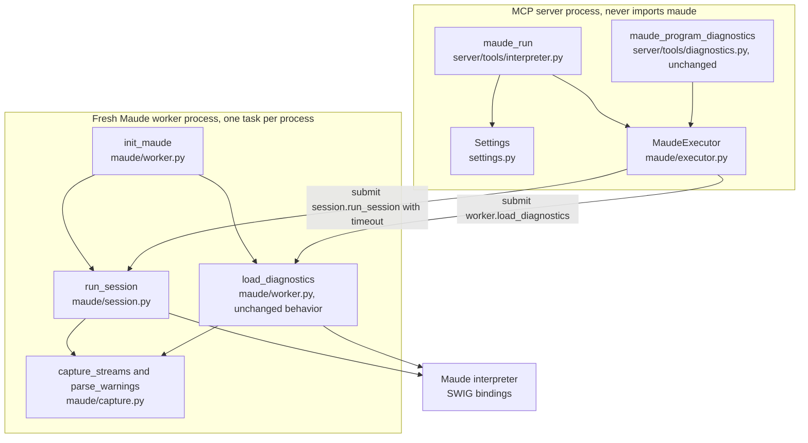
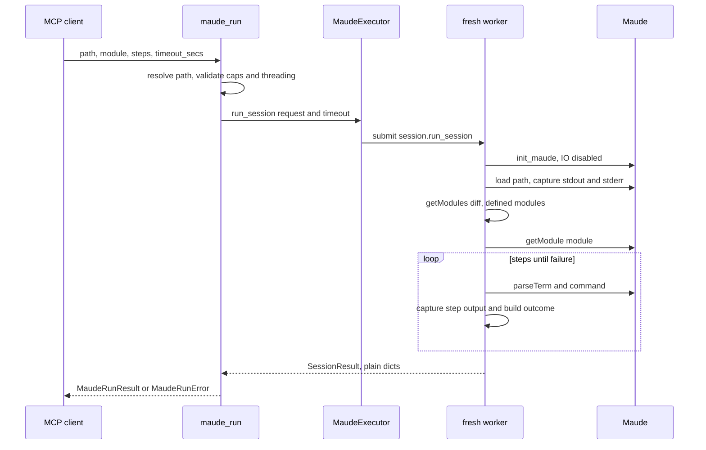

# Detailed design — `maude_run`: bounded Maude interpreter sessions

> PDD phase 6 for the `port-maude_eval.py` project. Requirements: [`../idea-honing.md`](../idea-honing.md)
> Q1–Q11. Research: [`../term-api.md`](../research/term-api.md),
> [`../worker-behavior.md`](../research/worker-behavior.md), [`../research/placement.md`](../research/placement.md).
> This document is standalone: it states the requirements, the architecture, the interfaces,
> the data models, the error semantics and the testing plan.

## 1. Overview

`maude_run` is a new MCP tool that runs a **bounded Maude interpreter session**. In one call it:

1. loads one Maude source file into a **fresh interpreter process** (its `load`/`in` dependencies
   are pulled in automatically);
2. selects an explicit **module**;
3. executes an ordered list of **steps** (`reduce`, `rewrite`, `frewrite`, `erewrite`, `match`,
   `search`) with REPL-style **current-term threading**; and
4. returns every intermediate result, the load warnings, and the interpreter output captured
   per phase.

The tool is the semantic half of Harold's feedback loop: diagnostics says whether a program is
well formed; `maude_run` says what it computes. It does not touch the diagnostics seam
(`harold_mcp.diagnostics`) — the two tools share only the worker/executor subsystem.

### 1.1 Goals

- Evaluate terms against a real module and return values, rewrite counts, matches and search
  solutions.
- Emulate a bounded Maude interpreter session (the Maude manual's rewriting/matching/search
  commands) with one fresh interpreter per call.
- Make multi-step work cheap and unambiguous for a coding agent: one tool, one call, all
  intermediate results.
- Report load warnings and interpreter output so the agent can distinguish "the module is
  broken" from "the term is wrong".

### 1.2 Non-goals (v1)

- Strategy commands (`srewrite`, `dsrewrite`), `parseStrategy`, and module-level strategy work.
- `unify`, `variant_unify`, `variant_match`, `vu_narrow`, model checking.
- Cross-call interpreter state (impossible by design; see §3).
- Editing files or applying fixes (the tool is read-only).
- Multi-file input: Maude resolves `load`/`in` itself (§4.1).

## 2. Detailed requirements

Consolidated from [`../idea-honing.md`](../idea-honing.md) (the Q references are preserved).

| ID | Requirement |
| --- | --- |
| R1 | **Separate tool.** A new MCP tool `maude_run`, independent of `maude_program_diagnostics`; tag `interpreter`; annotation profile `readOnlyHint=true`, `destructiveHint=false`, `idempotentHint=true`, `openWorldHint=false` (Q1, Q8). |
| R2 | **Input.** `path` (one Maude file), `module` (name), `steps` (ordered list), optional `timeout_secs` (Q2, Q4, rough idea). |
| R3 | **Hermetic calls.** Every call spawns a fresh interpreter process, loads the file, and runs the steps; no state survives across calls. The description documents how callers carry state (re-submit a saved result term, or write a wrapper module) (Q2, rough idea). |
| R4 | **Commands.** `reduce`, `rewrite`, `frewrite`, `erewrite`, `match`, `search` in v1 (Q3). |
| R5 | **Threading.** REPL-style current term: a step's subject defaults to the previous result; steps may carry an explicit term/subject; `reduce`/`rewrite`/`frewrite`/`erewrite` update the current term, `match`/`search` do not. The first step must provide a term/subject (Q4). |
| R6 | **All binding bounds are exposed**, optional when optional in the bindings: `bound` (`rewrite`, `frewrite`, `erewrite`), `gas` (`frewrite`, `erewrite`), `depth` (`match` → `maxDepth`, `search`). No deprecated parameters: `withExtension` is not exposed; extension matching uses `depth=0` (Q3, user comments 2026-10-17). |
| R7 | **Caps are settings**, with the ×10 defaults: steps per call 200, rewrite bound ≤ 1000, solutions/matches per step 200, term/pattern length 100,000 chars, result term length 1,000,000 chars, captured output length 1,000,000 chars per stream per phase (Q6; the output cap was added during design review). |
| R8 | **Load policy.** Evaluate even when the load produced warnings; report the warnings (file, line, message) in the result (Q5). |
| R9 | **Per-step outcomes** with command-specific payloads (`ok`), plus `parse-error` and `too-large`; every step also reports its captured `stdout`/`stderr` (Q9, Q10). |
| R10 | **Stop at the first failed step**; the result keeps the outcomes of all executed steps and the call itself succeeds (Q10). |
| R11 | **Whole-call failures:** missing path, `maude.load` returning false, requested module not defined, worker crash/timeout (Q11). |
| R12 | **Timeouts.** Rename `HAROLD_MAUDE_WORKER_TIMEOUT_SECS` → `HAROLD_DIAGNOSTICS_TIMEOUT_SECS`; add `HAROLD_INTERPRETER_TIMEOUT_SECS`; per-call `timeout_secs` override (`gt=0`, no cap). Both timeouts cover the whole worker call (spawn + prelude init + work) and are best effort (Q7). |
| R13 | **Output capture.** Both stdout and stderr, per phase (load + each executed step), ANSI stripped (rough idea, user comment). |
| R14 | **Safety.** The worker keeps `maude.setAllowDir(False)`, `setAllowFiles(False)`, `setAllowProcesses(False)` after init (user comment 2026-10-17). |
| R15 | **Description.** The tool description explains the bounded-session semantics, statelessness, threading, commands, stop-at-first-failure, caps and timeouts (Q2, Q10, rough idea). |
| R16 | **Release bookkeeping.** README (tool list + env table), `docs/modules.md`, `CHANGELOG.md`, version bump, knowledge-base refresh. |

## 3. Architecture overview



Key architectural decisions:

1. **One worker op per call, not one per step.** `max_tasks_per_child=1` recycles the process
   after every task, so a session cannot be split across tasks: the load, the module selection
   and all steps must run inside **one** worker op. This is also why the executable unit is the
   step *list* (Q2).
2. **The executor is reused as is** (plus a per-call timeout argument): crash/timeout mapping,
   pool replacement and the fresh-process policy already match the tool's needs
   (`worker-behavior.md` §4).
3. **Plain data at the process boundary.** The worker returns TypedDicts of Python scalars;
   SWIG objects (`Term`, `Substitution`, iterators) never leave the worker.
4. **The diagnostics seam is untouched.** The tool imports only `harold_mcp.maude` (executor)
   and `harold_mcp.settings`; no imports into or out of `harold_mcp.diagnostics` or
   `harold_mcp.heuristic`.

### 3.1 Call flow



## 4. Components and interfaces

### 4.1 Settings (`src/harold_mcp/settings.py`)

| Field | Env var | Default | Purpose |
| --- | --- | --- | --- |
| `maude_workers` | `HAROLD_MAUDE_WORKERS` | half the CPUs, capped at 3 | Concurrent interpreter processes (unchanged). |
| `diagnostics_timeout_secs` | `HAROLD_DIAGNOSTICS_TIMEOUT_SECS` | `60` | Diagnostics per-call timeout; also the worker subsystem default (init pings). **Renamed** from `maude_worker_timeout_secs` / `HAROLD_MAUDE_WORKER_TIMEOUT_SECS`. |
| `interpreter_timeout_secs` | `HAROLD_INTERPRETER_TIMEOUT_SECS` | `60` | Default timeout for `maude_run` calls. |
| `interpreter_max_steps` | `HAROLD_INTERPRETER_MAX_STEPS` | `200` | Maximum steps per call. |
| `interpreter_max_rewrite_bound` | `HAROLD_INTERPRETER_MAX_REWRITE_BOUND` | `1000` | Maximum accepted `bound` per rewrite step. |
| `interpreter_max_solutions` | `HAROLD_INTERPRETER_MAX_SOLUTIONS` | `200` | Maximum `search` solutions / `match` substitutions returned per step. |
| `interpreter_max_term_length` | `HAROLD_INTERPRETER_MAX_TERM_LENGTH` | `100000` | Maximum characters of a term/pattern/subject input. |
| `interpreter_max_result_length` | `HAROLD_INTERPRETER_MAX_RESULT_LENGTH` | `1000000` | Maximum characters of any returned term. |
| `interpreter_max_output_length` | `HAROLD_INTERPRETER_MAX_OUTPUT_LENGTH` | `1000000` | Maximum characters of each captured stream (stdout and stderr separately) returned per phase; longer captures are truncated with a marker. |

All are `Field(..., gt=0)`. The rename is breaking for the env var only (pre-1.0); the README
and CHANGELOG call it out. The `start()` init pings keep using `diagnostics_timeout_secs` as the
subsystem default.

### 4.2 Capture helper (`src/harold_mcp/maude/capture.py`, new)

Extracted from `worker.py` so both `load_diagnostics` and the session engine share it:

```python
class WarningDict(TypedDict):
    file: str
    line: int | None
    message: str

class CapturedOutput(TypedDict):
    stdout: str
    stderr: str

T = TypeVar("T")

def capture_streams(fn: Callable[[], T]) -> tuple[T, CapturedOutput]:
    """Run ``fn`` with fd 1 and fd 2 redirected to temp files; return the result and the
    decoded, ANSI-stripped output of both streams. The fd swap is restored in ``finally``."""

def strip_ansi(text: str) -> str: ...
def parse_warnings(text: str) -> list[WarningDict]: ...
def truncate_output(text: str, max_length: int) -> str:
    """Truncate ``text`` to ``max_length`` characters, appending ``... [output truncated]``."""
```

- Temp **files**, not pipes (no pipe-buffer blocking; the worker is single-threaded).
- Decode both streams with `errors="replace"` (Maude emits raw C++ bytes).
- Strip ANSI escapes from both streams before returning them (Maude colorizes even when the
  destination is a file — `worker-behavior.md` §1). `parse_warnings` strips again defensively.
- **No explicit flush is needed.** `probe_stdout_flush.py` shows that `maude.load`'s stdout (the
  output of embedded `red` commands) lands inside the fd-1 capture, before the restore; adding
  `fflush` changes nothing. The helper does not need platform-specific flushing.
- Capturing stdout also **fixes a latent diagnostics bug**: today a diagnosed file with embedded
  REPL commands prints from the worker onto the server's stdout, i.e. into the MCP stdio
  transport. `load_diagnostics` keeps returning only `ok`/`warnings`, but stdout no longer
  escapes. The worker docstring's warning extends to both fds: nothing may be logged or printed
  while they are redirected.
- `worker.py` keeps `init_maude` (including the IO lockdown, R14) and `load_diagnostics`; the
  latter is rewritten on top of `capture_streams` with identical observable behavior. The warning
  regex and its format variants move unchanged. `WarningDict` moves to `capture.py`;
  `worker.LoadDiagnosticsResult` imports it. The unit tests move their `_parse_warnings` import
  to `capture.parse_warnings`.

### 4.3 Session engine (`src/harold_mcp/maude/session.py`, new)

Runs only in the worker; imports `maude` lazily inside `run_session` (the server imports the
module for the function reference the pool pickles, and must never load the bindings).

```python
def run_session(request: SessionRequest) -> SessionResult: ...
```

Algorithm:

1. `modules_before = {header.name for header in maude.getModules()}`.
2. `load_ok, load_output = capture_streams(lambda: bool(maude.load(path)))`.
3. `defined_modules = sorted({h.name for h in maude.getModules()} - modules_before)`.
4. `warnings = parse_warnings(load_output["stderr"])`.
5. If `not load_ok`: return `load_ok=False` (the tool raises, §6).
6. `module = maude.getModule(module_name)`; if `None`: return `module_found=False` with the
   defined modules and warnings (the tool raises, §6). Otherwise report `module_type =
   module.getModuleType()` so the tool can reject theories.
7. `current = None`; for each step, **one capture** around parsing + the operation:
   - Resolve the subject: explicit `term`/`subject`, else `current` (a missing both is
     prevented by server validation; the worker raises `ValueError` — programming error).
   - `parseTerm` returns `None` → outcome `parse-error`; `message` is the joined
     `parse_warnings(stderr)` messages; stop.
   - Execute the command (§5.2), serialize terms with `str(term)`, check lengths (R7);
     exceeding → outcome `too-large` with `limit`; stop.
   - Append the outcome (with its `CapturedOutput`); on `ok` update `current` for the
     rewriting commands.
8. Return the `SessionResult`.

**Output truncation.** When building each phase's `CapturedOutput`, truncate each stream to
`max_output_length` characters and append `... [output truncated]`. Parsing always uses the
**full** stderr (`parse_warnings` for load warnings, the parse-error message extraction), and
`load_diagnostics` never truncates because it parses the full stderr and returns no output. The
temp files themselves are bounded only by the call timeout (diagnostics discards stdout).

Details that encode research findings:

- `rewrite`/`frewrite`: call the mutating method and use the **subject** as the result term;
  `erewrite`: use the **returned** term (the original stays intact — `term-api.md` §3).
- `steps` in an outcome is the interpreter's rewrite counter (includes equational rewrites);
  it is named `rewrites` in the wire model and documented as such.
- `match`: `subject.match(pattern, maxDepth=depth if depth is not None else -1)`; iterate
  `(Substitution, context)` pairs, keep the substitutions; cap with `islice(cap + 1)` to detect
  truncation.
- `search`: map `search_type` to `maude.ONE_STEP`/`AT_LEAST_ONE_STEP`/`ANY_STEPS`/
  `NORMAL_FORM`/`BRANCH`; `subject.search(constant, target, depth=depth if depth is not None else -1)`;
  iterate `(Term, Substitution, path, rewrites)` tuples, keep term/bindings/rewrites; same cap.
- The `path` function and `Rule` objects from `search` are discarded.

### 4.4 Executor changes (`src/harold_mcp/maude/executor.py`)

```python
def _run_task(self, fn: Callable[..., T], *args: Any, timeout: float) -> T:
    # The timeout is always chosen by the caller; the executor is not tied to a
    # tool's setting.
    ...
    return cast(T, future.result(timeout=timeout))

def diagnostics(self, path: str) -> LoadDiagnosticsResult:
    return self._run_task(worker.load_diagnostics, path,
                          timeout=self._settings.diagnostics_timeout_secs)

def run_session(self, request: SessionRequest, timeout: float) -> SessionResult:
    return self._run_task(session.run_session, request, timeout=timeout)
```

- **No implicit timeout in `_run_task`.** `diagnostics()` passes the diagnostics setting
explicitly; the lifespan calls `start(settings.diagnostics_timeout_secs)` for the init
pings; `run_session` requires the interpreter timeout (or the per-call override) from the
tool. This keeps the executor decoupled from any one tool's timeout policy (user review
2026-10-22).
- The timeout covers submission to completion, i.e. spawn + `init_maude` + work. On expiry the
  pool is replaced (existing `_reset_executor`); the failed call is never retried (R11/Q11).
- The executor remains the only component that knows about pools, crashes and timeouts.

### 4.5 Worker (`src/harold_mcp/maude/worker.py`)

- `init_maude`: unchanged, including `setAllowDir/False`, `setAllowFiles(False)`,
  `setAllowProcesses(False)` after a successful init (R14).
- `load_diagnostics`: behavior unchanged, implemented with `capture_streams`.
- No `run_session` wrapper: the executor references `session.run_session` directly (both are
  module-level worker-side functions; documented in both modules).

### 4.6 Tool module (`src/harold_mcp/server/tools/interpreter.py`, new)

```python
class MaudeRunError(RuntimeError):
    """Whole-call failure of maude_run (missing path, load failure, module not found,
    worker crash/timeout). MaudeError causes are chained."""

@mcp.tool(annotations=ToolAnnotations(readOnlyHint=True, destructiveHint=False,
                                      idempotentHint=True, openWorldHint=False),
          tags=harold_tags(INTERPRETER))
def maude_run(
    path: str,
    module: str,
    steps: list[MaudeStep],
    timeout_secs: int | None = None,
    executor: MaudeExecutor = Depends(get_maude_executor),
    settings: Settings = Depends(get_settings),
) -> MaudeRunResult: ...
```

Flow:

1. `_resolve_path(path)`: expand/resolve, require an existing regular file (`MaudeRunError`
   otherwise). Implemented locally: importing `diagnostics.SourceFile` would couple the new tool
   to the diagnostics seam (placement research §2–§3).
2. `_validate_steps(steps, settings)`:
   - length ≤ `interpreter_max_steps`;
   - term/pattern/subject length ≤ `interpreter_max_term_length`;
   - `bound ≤ interpreter_max_rewrite_bound` (pydantic enforces `ge=0`);
   - threading feasibility: track `has_current`; a step that needs a subject but has no explicit
     term/subject and no current term is an error naming the step index; commands that produce a
     term set `has_current = True`, `match`/`search` leave it unchanged.
3. Build the worker request (plain dicts).
4. `timeout = timeout_secs if timeout_secs is not None else settings.interpreter_timeout_secs`;
   call `executor.run_session(request, timeout=timeout)`; map `MaudeWorkerError` (and any
   unexpected exception) to `MaudeRunError` with the cause chained.
5. Adapt `SessionResult` to the wire model (§5.3): raise for `load_ok=False` / `module_found=False`;
   otherwise build `MaudeRunResult` (absolute path, requested module, load info, outcomes,
   `completed`).

Registration: `server/tools/__init__.py` imports `maude_run` next to
`maude_program_diagnostics` (import side effect registers the tool).

### 4.7 Tags and annotations

- `harold_tags(INTERPRETER)`; update the `server/tags.py` comment: `interpreter` is now
  implemented (remove "planned").
- Annotations: the diagnostics read-only profile (R1). The tool does not mutate files; it does
  spawn interpreter processes and consume CPU, but that is not an `openWorldHint` concern.

### 4.8 Tool description (draft, to be used verbatim)

The docstring's free-form text above `Args:` becomes the MCP description (FastMCP excludes
`Returns`/`Raises`/`Example`):

```text
Run a bounded Maude interpreter session: load one Maude file into a fresh interpreter,
select a module, and execute an ordered list of interpreter commands, returning every
intermediate result.

Each call is hermetic. A new interpreter process loads the file from scratch, so nothing
(loaded modules, the current term, parser state) survives from one call to the next. To
carry state across calls, save a term from a result and pass it as the term or subject of
a later call, or write a wrapper module whose equations and rules compute everything in one
load.

The file's load/in commands pull in its dependencies automatically (they resolve against
the file's own directory), so pass only the main file.

Steps and the current term
--------------------------
Commands run as in the Maude interpreter on a current term that threads through the
pipeline: when a step omits its term or subject, it uses the previous step's result.
reduce, rewrite, frewrite and erewrite replace the current term with their result; match
and search inspect the current term and leave it unchanged. The first step must provide an
explicit term (or subject), because the session starts with no current term.

Commands
--------
- reduce: reduce the term to normal form with the module's equations.
- rewrite: apply rewrite rules with the default strategy, up to `bound` rule rewrites
  (unbounded when omitted).
- frewrite: the same with the fair strategy; `gas` bounds rewrites per position.
- erewrite: the same as frewrite with external-object support; the original term is kept.
- match: match `pattern` against the current term (or `subject`) and return the
  substitutions; `depth` is Maude's matching depth (-1 = on top without extension, 0 = on
  top with extension, 2147483647 = anywhere in the term).
- search: search from the current term (or `subject`) for states matching `pattern` using
  `search_type` (one-step, at-least-one-step, any-steps, normal-form, branch) and an
  optional `depth`.

Load problems and step failures
-------------------------------
Warnings produced while loading the file (and its dependencies) are reported in `load`, but
evaluation still proceeds; use maude_program_diagnostics for a full diagnosis.

Steps stop at the first failure: `parse-error` when a term or pattern does not parse in the
module, `too-large` when a result exceeds the configured length limit. The result keeps the
outcomes of every executed step and sets `completed` to false; the remaining steps are not
run. A missing path, a load that fails outright, a module that is not defined after the
load, or a worker crash/timeout fails the whole call.

Output and limits
-----------------
The load phase and every step report the interpreter's captured stdout and stderr (color
codes stripped; a stream longer than the configured output limit is truncated and marked).
A search step returns at most the configured number of solutions and a
match step at most the configured number of substitutions; `truncated` is true when the cap
was reached. The whole call is bounded by timeout_secs (default: the server's interpreter
timeout). The timeout covers interpreter startup and is best effort: a non-terminating
reduction fails the call and replaces the worker pool, so allow more time for long
evaluations.

Args:
    path: Path to the Maude source file to load (typically .maude); relative paths are
        resolved against the server's working directory.
    module: Name of the module to evaluate in; it must be defined by the file or one of its
        dependencies. Case-sensitive; a theory cannot be used because terms are parsed in
        modules.
    steps: Ordered commands to execute; each is a tagged object with `command` plus its
        payload (see Commands).
    timeout_secs: Optional per-call timeout in seconds, overriding the server setting.
```

## 5. Data models

### 5.1 Input (wire, pydantic, discriminated union on `command`)

```python
class _StepBase(_ResultModel):
    term: str | None = None
    """Term text; omitted means the current term (invalid for the first step)."""

class ReduceStep(_StepBase):
    command: Literal["reduce"]

class RewriteStep(_StepBase):
    command: Literal["rewrite"]
    bound: int | None = None          # ge=0, <= interpreter_max_rewrite_bound
    """Maximum rule rewrites; omitted means unbounded (the interpreter default)."""

class FrewriteStep(RewriteStep):
    command: Literal["frewrite"]
    gas: int | None = None            # ge=0
    """Maximum rule rewrites per position; omitted means the bindings' default."""

class ErewriteStep(FrewriteStep):
    command: Literal["erewrite"]

class MatchStep(_ResultModel):
    command: Literal["match"]
    pattern: str
    subject: str | None = None        # omitted means the current term
    depth: int | None = None          # maxDepth: -1 top/no extension, 0 top/extension,
                                      # 2**31-1 anywhere
class SearchStep(MatchStep):
    command: Literal["search"]
    search_type: Literal["one-step", "at-least-one-step", "any-steps", "normal-form", "branch"]

MaudeStep = Annotated[
    ReduceStep | RewriteStep | FrewriteStep | ErewriteStep | MatchStep | SearchStep,
    Field(discriminator="command"),
]
```

The MCP input schema therefore shows one `steps` array whose items are tagged by `command` —
directly mirroring the Maude commands (R4/R6). The array has `min_length=1`; `bound`, `gas` and
`depth` stay `None` when the client omits them, and the worker passes the binding defaults
(`-1`).

### 5.2 Step execution semantics

| Command | Subject | Binding call | Result payload | Updates current term |
| --- | --- | --- | --- | --- |
| `reduce` | `term` or current | `subject.reduce()` | `term`, `rewrites` | yes (the subject) |
| `rewrite` | `term` or current | `subject.rewrite(bound if bound is not None else -1)` | `term`, `rewrites` | yes (the subject) |
| `frewrite` | `term` or current | `subject.frewrite(bound if bound is not None else -1, gas if gas is not None else -1)` | `term`, `rewrites` | yes (the subject) |
| `erewrite` | `term` or current | `result, rewrites = subject.erewrite(bound if bound is not None else -1, gas if gas is not None else -1)` | `term` (from `result`), `rewrites` | yes (the returned term) |
| `match` | `subject` or current | `subject.match(pattern, maxDepth=depth if depth is not None else -1)` | `matches`, `truncated` | no |
| `search` | `subject` or current | `subject.search(type, pattern, depth=depth if depth is not None else -1)` | `solutions`, `truncated` | no |

Explicit `if ... is not None` checks are required: `0` is a meaningful value for `bound` (apply no
rule) and for `depth` (match on top with extension), so `or -1` would be wrong.

`rewrites` is the interpreter's counter and includes equational rewrites (e.g. a one-rule-step
rewrite that evaluates an argument reports more than one). Documented in the field description.

### 5.3 Result (wire)

```python
class MaudeCapturedOutput(_ResultModel):
    stdout: str
    stderr: str

class MaudeLoadWarning(_ResultModel):
    file: str
    line: int
    message: str

class MaudeLoadInfo(_ResultModel):
    warnings: list[MaudeLoadWarning]
    output: MaudeCapturedOutput

class MaudeBinding(_ResultModel):
    variable: str
    value: str

class MaudeMatch(_ResultModel):
    bindings: list[MaudeBinding]

class MaudeSearchSolution(_ResultModel):
    term: str
    rewrites: int
    bindings: list[MaudeBinding]

class MaudeStepOutcome(_ResultModel):
    index: int                         # 0-based position in the input list
    command: Literal["reduce", "rewrite", "frewrite", "erewrite", "match", "search"]
    status: Literal["ok", "parse-error", "too-large"]
    term: str | None                   # ok: reduce/rewrite/frewrite/erewrite result
    rewrites: int | None               # ok: reduce/rewrite/frewrite/erewrite counter
    matches: list[MaudeMatch] | None   # ok: match
    solutions: list[MaudeSearchSolution] | None  # ok: search
    truncated: bool | None             # ok: match/search hit the cap
    message: str | None                # parse-error
    limit: int | None                  # too-large
    output: MaudeCapturedOutput        # always: this step's capture

class MaudeRunResult(_ResultModel):
    path: str                          # absolute
    module: str                        # requested module
    load: MaudeLoadInfo
    completed: bool                    # every requested step produced "ok"
    steps: list[MaudeStepOutcome]      # one entry per executed step (R10)
```

A **flat** outcome model was chosen over a discriminated union: the diagnostics tool already
uses flat models with nullable fields, the schema stays stable as commands are added, and an
LLM reads "status + the relevant field" without resolving `oneOf`. The alternative is recorded
in Appendix C.

`truncated` is `true` when the iteration reached the configured cap (there may be more
solutions/matches). Match bindings are a list of `{variable, value}` pairs rather than a dict:
Maude variables are name+sort, and two variables can share a base name.

### 5.4 Worker-side types (picklable TypedDicts)

```python
class StepRequest(TypedDict):
    command: str
    term: str | None          # reduce/rewrite/frewrite/erewrite payload
    pattern: str | None       # match/search pattern
    subject: str | None       # match/search explicit subject
    bound: int | None
    gas: int | None
    depth: int | None
    search_type: str | None

class SessionRequest(TypedDict):
    path: str
    module: str
    steps: list[StepRequest]
    max_solutions: int
    max_result_length: int
    max_output_length: int

class SessionResult(TypedDict):
    load_ok: bool
    module_found: bool
    module_type: int
    defined_modules: list[str]
    warnings: list[WarningDict]
    load_output: CapturedOutput
    outcomes: list[StepOutcomeDict]

class StepOutcomeDict(TypedDict):
    index: int
    command: str
    status: str
    term: str | None
    rewrites: int | None
    matches: list[list[BindingDict]] | None
    solutions: list[SolutionDict] | None
    truncated: bool | None
    message: str | None
    limit: int | None
    output: CapturedOutput
```

The server maps pydantic steps to `StepRequest` and `StepOutcomeDict` to wire models; the schema
of the two sides is intentionally parallel but independent (worker types never leak into the MCP
schema).

## 6. Error handling

### 6.1 Layer split

- **Tool layer:** `MaudeRunError` in `server/tools/interpreter.py` for the four whole-call
  failures; `MaudeError` types stay in the Maude subsystem and appear only as chained causes
  (repo convention).
- **Per-step failures** are not exceptions: `parse-error` and `too-large` outcomes.
- **Worker boundary:** no custom exceptions cross the process boundary; load/module failures are
  reported in `SessionResult` flags so the server can build precise messages.

### 6.2 Conditions

| Condition | Detection | Behavior |
| --- | --- | --- |
| Path missing / not a file | `_resolve_path` | `MaudeRunError` before spawning a worker. |
| `maude.load` returns false | `SessionResult.load_ok` | `MaudeRunError` carrying the stripped load stderr (rare; `load` returns true for most garbage). |
| Requested module is not defined | `getModule(module) is None` | `MaudeRunError` naming the module and the file, listing the modules the load defined (`defined_modules`), suggesting `maude_program_diagnostics`. |
| Requested name is a theory | `module.getModuleType()` is a theory type (`FUNCTIONAL_THEORY=2`, `SYSTEM_THEORY=3`, `STRATEGY_THEORY=7`, `OBJECT_ORIENTED_THEORY=11`) | `MaudeRunError` explaining that terms cannot be parsed in a theory. |
| Input cap exceeded / no current term for a step | `_validate_steps` | `MaudeRunError` naming the step index and the limit. |
| Worker crash / timeout | `MaudeWorkerError` from the executor | `MaudeRunError` with the cause chained; the executor already replaced the pool. |
| Unexpected worker exception | any other exception from `run_session` | `MaudeRunError` with the cause chained (safety net). |

### 6.3 Timeout semantics

Both timeout knobs and the per-call override are **best effort** and cover the whole worker call
(spawn + prelude init + work). On expiry the executor kills the pool, so any concurrent in-flight
call on the same pool fails; the failed call is never retried. This is documented in the README
and the tool description (R12, `worker-behavior.md` §2).

## 7. Testing strategy

Follows the repo split: unit tests are hermetic (no interpreter), integration tests use the real
interpreter. Test file basenames must be distinct across the two trees.

### 7.1 Unit tests (`tests/unit/`)

- `test_settings.py` (extend): defaults for the new/renamed fields; env overrides; validation
  (`gt=0`).
- `test_maude_capture.py` (new): `capture_streams` captures fd 1 and fd 2 **separately** (a
  callable writing different text to each yields each text in its own field), restores both,
  strips ANSI, and decodes lossily; `truncate_output` appends the marker only when the limit is
exceeded; `parse_warnings` cases move here (existing fixtures preserved).
- `test_maude_worker.py` (extend): `load_diagnostics` parses warnings from the **stderr** capture
  only. Monkeypatch `sys.modules["maude"]` with a stub whose `load` writes a `Warning:` line to
  fd 2 and warning-looking text (e.g. `Warning: "x", line 1: from stdout`) to fd 1; assert the
  result contains only the stderr warning. This pins the stream separation without an interpreter.
- `test_maude_executor.py` (extend): `_run_task(timeout=...)` passes the effective timeout to
  `future.result`; `run_session` delegates to `session.run_session` with the request.
- `test_interpreter_tool.py` (new): 
  - path resolution errors;
  - input validation (step count, term length, bound cap, threading feasibility with a
    first step lacking a term, `match` after a term-producing step);
  - adapter from `SessionResult` to `MaudeRunResult` (all statuses, `completed`, warnings,
    output, empty outcomes);
  - whole-call error mapping (load false, module not found, `MaudeWorkerTimeoutError` chained,
    unexpected exception) using a fake executor;
  - timeout selection (setting vs `timeout_secs`) and that the request carries
    `max_solutions`/`max_result_length` from settings.
- Keep `maude` import-free: the tool module imports only the maude subsystem client.

### 7.2 Integration tests (`tests/integration/`, real interpreter)

`test_maude_run_integration.py` (new; distinct basename) with fixtures reusing
`tests/integration/fixtures/` plus new ones (`rules.maude`, `loop.maude`, `prints.maude`):

1. `reduce` on `hello.maude`'s `HELLO-WORLD` (`f` → `2`, rewrites > 0).
2. `rewrite`/`frewrite`/`erewrite` with and without `bound`, verifying values and the
   non-destructive `erewrite`; `bound=0` leaves the term unchanged.
3. `match` hit/miss and `depth` variants (`-1`, `0`, anywhere) on an assoc module.
4. `search` for the five types (including `=>*` including the initial state and `=>1` ground
   target); `truncated=true` with a small `interpreter_max_solutions`.
5. Pipeline threading (reduce then rewrite the result), stop-at-first-failure with 3 steps
   where the 2nd fails → 2 outcomes and `completed=false`, and `parse-error` messages.
6. **stdout does not affect diagnostics parsing:** a fixture (`warns_and_prints.maude`) with both a
   load warning (stderr) and an embedded `red` command (stdout) is diagnosed through
   `load_diagnostics`; warnings must be exactly the stderr ones, `ok=true`, and no warning
   message may contain the stdout text (`reduce in`, `result NzNat`).
7. **No stdout leak into the parent process:** capture the parent's fd 1 around a pooled
   `load_diagnostics` call and assert the fixture's `red` output does not appear there (regression
   for the MCP stdio transport). If pytest's own fd capture makes this fragile, run the call in a
   child process and assert its stdout is empty apart from an explicit marker.
8. `too-large` with a tiny `interpreter_max_result_length`; capture truncation with a tiny
   `interpreter_max_output_length` and the `... [output truncated]` marker.
9. Load warnings reported (broken-recoverable) and evaluation still proceeds; broken file →
   `MaudeRunError` naming the module; missing module error lists the defined modules.
10. Dependency file (`loads_dependency.maude`) loads and evaluates `dep-value`.
11. stdout capture: a fixture with an embedded `red` command produces `load.output.stdout`.
12. Hermeticity: a module defined in call 1 is absent in call 2 (fresh process).
13. Timeout: `loop.maude` reducing a non-terminating term with `timeout_secs=1` raises
    `MaudeRunError` (cause `MaudeWorkerTimeoutError`), and the next call succeeds.
14. IO lockdown: a fixture attempting file IO does not read the file (R14) — assert the
    warning/evaluation outcome rather than executing IO.

## 8. Documentation and release

- `README.md`: add `maude_run` to the tool list with a short example; update the env-var table
  (renamed diagnostics timeout + five new interpreter settings).
- `docs/modules.md`: add `harold_mcp.maude.capture`, `harold_mcp.maude.session`,
  `harold_mcp.server.tools.interpreter`.
- `CHANGELOG.md`: new version section; note the env-var rename.
- `pyproject.toml`: version bump (proposal: `0.1.0`, from `0.0.5.dev0`) — the first new tool
  since the diagnostics tool.
- `server/tools/__init__.py`: import `maude_run` so registration happens on package import.
- After implementation, refresh `.agents/summary/` (codebase-summary) and update `AGENTS.md`
  conventions (timeout rename, the new modules, the worker-op split).

## 9. Appendices

### Appendix A — Design decisions and rationale

| Decision | Rationale |
| --- | --- |
| One tool with a step list (Q2) | Subsumes a single-command tool; one description; one fresh interpreter for a whole session; matches the REPL. |
| REPL-style threading (Q4) | Matches the Maude manual; avoids re-sending long intermediate terms. |
| Input as a discriminated union of steps | The MCP schema mirrors the six commands; per-command fields (`bound`, `gas`, `depth`, `pattern`) are explicit and validated. |
| Flat step-outcome model | Stable schema as commands grow; consistent with the diagnostics models; easier for an LLM than resolving `oneOf`. |
| `str(term)` serialization | User-facing mixfix + number printing (`6`, not `s_^6(0)`); round-trips through `parseTerm`. |
| Separate `capture.py` | One tested fd-level capture shared by diagnostics and the session; the ANSI/decoding details live in one place. |
| Separate `session.py` | Keeps `worker.py` (init + diagnostics) focused; the session engine is a cohesive unit with its own TypedDicts. |
| Structured worker results, not exceptions | Plain picklable data; precise server-side messages; no custom exceptions across the process boundary. |
| Module diff for the error | `getModules()` before/after gives the modules the file actually defined, without prelude noise. |
| Keep IO disabled (R14) | Safety: an evaluated program cannot read/write files or spawn processes in the worker. |
| No deprecated parameters (R6) | `withExtension` is deprecated in the bindings; extension matching uses `maxDepth=0` via `depth`. |

### Appendix B — Research findings that shaped the design

Summarized from [`../term-api.md`](../research/term-api.md) and
[`../worker-behavior.md`](../research/worker-behavior.md):

- `maude.load` returns true even for broken files; `getModule(name)` (case-sensitive) is the
  reliable module check, and a `getModules()` diff isolates the file's modules.
- `reduce`/`rewrite`/`frewrite` mutate in place and return the rewrite counter (which includes
  equational rewrites); `erewrite` returns `(Term, count)` and leaves the original untouched.
- `str(term)` is the user-facing serialization; `prettyPrint(0)` is the internal form.
- `match` yields `(Substitution, context)` pairs; `search` yields
  `(Term, Substitution, path, rewrites)` tuples and is lazy (caps can stop it).
- Only parse failures and load warnings write to stderr (ANSI-colorized regardless of TTY);
  files with embedded REPL commands print to stdout, and the capture sees that stdout before the
  fd restore (no explicit flush needed).
- A hung `reduce` is contained by `future.result(timeout)` + `kill_workers()`; the pool is
  replaced, a fresh pool works, and killing the pool breaks concurrent in-flight calls.
- `MaudeExecutor` needs only a per-call timeout argument; `max_tasks_per_child=1` already
  provides the fresh interpreter.

### Appendix C — Alternatives considered

| Alternative | Why not |
| --- | --- |
| Multiple tools, one per command | N descriptions for the LLM; one fresh interpreter + round-trip per step; growing surface (rejected in Q2). |
| One tool with a single `command` parameter | Multi-step work still costs a call per step; the step list subsumes it (rejected in Q2). |
| Fully explicit subjects (no threading) | The client would paste intermediate terms back; defeats the pipeline (rejected in Q4). |
| Discriminated-union outcome models | Cleaner types, but a more complex MCP output schema and a different style from the diagnostics tool; the flat model keeps the schema stable and LLM-friendly. |
| `prettyPrint(0)` serialization | Internal form (`s_^6(0)`), not user-facing; `str()` also round-trips. |
| Hardcoded caps | The user rejected them: Maude model checking runs on very different machines; caps are settings. |
| Refusing to evaluate when the load warns | Wastes the hermetic call and duplicates diagnostics (rejected in Q5). |
| `withExtension=True` for extension matching | Deprecated in the bindings; `maxDepth=0` is the supported equivalent. |
| One worker op per step | Impossible with `max_tasks_per_child=1`: state cannot cross tasks. |
| Two worker ops (load, then steps) | Same reason: the module/current term would not survive between tasks. |
| Importing `diagnostics.SourceFile` for path checks | Couples the new tool to the diagnostics seam; a few lines of local validation keep the tools independent. |

### Appendix D — Known limitations

- **Unbounded defaults.** `rewrite`/`frewrite`/`erewrite` without `bound` follow Maude and run
  until termination; a non-terminating rewrite consumes the whole call timeout. The tool
  description recommends supplying a bound for exploratory work.
- **Timeouts are pool-wide.** A timed-out or crashed call kills every worker in the pool;
  concurrent calls fail. This is existing executor behavior and is documented.
- **`BRANCH` search** is exposed because Maude defines it, but the probe only verified that it
  iterates (and can yield no solutions); its semantics are not further interpreted by Harold.
- **`match` depth** is exposed as Maude's raw `maxDepth` integer (`-1`, `0`, `INT_MAX`,
  intermediate values); Harold does not add a friendlier vocabulary in v1. `minDepth` stays at
  the binding default (`0`): it is a lower matching bound, not a bound on the work performed.
- **No structural equality promise.** Result terms round-trip textually; `Term.equal()` was
  false for a reparsed associative term in the probe.
- **No strategy commands, unification, variants or model checking** (non-goals, §1.2).
- **Capture sizes.** Captured streams are truncated to `interpreter_max_output_length` per stream
  per phase in the result; the temp files themselves are bounded only by the call timeout
  (diagnostics discards stdout but parses the full stderr, never truncated). The total response
  size is bounded by `max_solutions × max_result_length` per step, by `max_steps` per call, and by
  the output cap per phase, not by a single total cap.

### Appendix E — References

- Requirements: [`../idea-honing.md`](../idea-honing.md).
- Research: [`../term-api.md`](../research/term-api.md),
  [`../worker-behavior.md`](../research/worker-behavior.md),
  [`../research/placement.md`](../research/placement.md),
  [`../research/contribution.md`](../research/contribution.md).
- Probes: [`../research/probes/`](../research/probes/).
- Code: `src/harold_mcp/maude/{executor,worker,provider}.py`,
  `src/harold_mcp/server/tools/diagnostics.py`, `src/harold_mcp/settings.py`,
  `src/harold_mcp/server/tags.py`.
- Bindings docs: [fadoss.github.io/maude-bindings](https://fadoss.github.io/maude-bindings/).
- Maude manual Appendix A (rewriting/matching/search commands), text extract in
  `.agents/planning/no_new_module_quirk/research/manual-commands-appendix.txt`.
