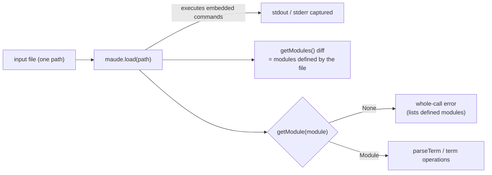

# Research — `maude.Term` API inventory for `maude_run`

> Phase 2 research for the `maude_run` tool (requirements in
> [`../idea-honing.md`](../idea-honing.md) Q2–Q11). Answers the API questions that block the
> design: module selection, parsing, the rewriting family, `match`, `search`, and term
> serialization.
>
> **Version note.** The `maude` package installed in `harold-mcp/.venv` is **1.6.0** (the pinned
> dependency); the local `maude-bindings/` source tree is **1.5.0**. All behavior below was
> probed on 1.6.0; signatures were cross-checked against [`swig/term.i`](../../../../../maude-bindings/swig/term.i)
> and the official docs ([fadoss.github.io/maude-bindings](https://fadoss.github.io/maude-bindings/)).
> Probe scripts and transcripts: [`probes/`](probes/).

## 1. Modules: selection and enumeration

| Operation | Observed behavior |
| --- | --- |
| `maude.init(loadPrelude=True, advise=False)` | 48 modules loaded (the prelude). `getCurrentModule()` is `CONVERSION` (the last prelude module). |
| `maude.getModule(name)` | Returns the `Module` or `None`; **case-sensitive** (`getModule('nat')` → `None`). A module whose load failed recoverably-but-unusably is listed by `getModules()` yet `getModule(name)` returns `None` (missing-dependency scenario). |
| `maude.getCurrentModule()` | Last module *inserted or explicitly selected*: after a one-module file → that module; after a two-module file → the last one; after a file executing `red in NAT : ...` → `NAT`; after a load with unrecoverable errors → `None`. |
| `maude.getModules()` | `list[ModuleHeader]` with `.name` and `.type` (`FUNCTIONAL_MODULE = 0`, `SYSTEM_MODULE = 1`, ...). A **before/after diff** isolates exactly the modules a file defined: `hello.maude` → `[HELLO-WORLD]`; a two-module file → `[FIRST, SECOND]`; `loads_dependency.maude` → `[DEP-CLEAN, LOADS-DEPENDENCY]` (the dependency included); a broken file → `[]`; `loads_missing_dependency.maude` → `[LOADS-MISSING-DEP]` (listed, but not retrievable). |
| `maude.load(path)` | Returns `True` in **every** probed case, including broken files and missing dependencies. It executes embedded REPL commands (`red in NAT : 1 + 2 .` printed its result to **stdout**). It is not an error signal; `getModule()` is. |

**Implications.** The tool takes one input file and an explicit `module` name, resolves it with
`getModule(module)`, and treats `None` as a whole-call error (Q11). The error can list the
modules the load *defined* using a `getModules()` snapshot diff, without prelude noise. Sibling
`load`/`in` dependencies need no extra input: Maude resolves them against the containing file's
directory (`.agents/planning/no_new_module_quirk/research/dependencies.md`).

## 2. Parsing terms

`Module.parseTerm(text)` returns a `Term`, or **`None`** on failure (no exception). Failures write
ANSI-colorized `Warning:` lines to **stderr**; nothing goes to stdout. Observed messages:

| Input | stderr |
| --- | --- |
| `2 +` | `<standard input>, line 0 : unexpected end of tokens.` + `no parse for term.` |
| `nope(3)` | `bad token nope.` + `no parse for term.` |
| `c(M)` (undeclared variable) | `bad token M.` + `no parse for term.` |

Variables declared in the module parse fine and print back (`counter.parseTerm('c(N)')` →
`c(N)`), which is what `match`/`search` patterns need. Terms are module-scoped: a term must be
parsed in (and belong to) the module that owns its symbols.

**Implications.** A failed parse is a per-step `parse-error` outcome carrying the captured
stderr message (Q10), not a whole-call failure.

## 3. The rewriting family

| Command | Binding call | Returns | Mutates the subject? | Default bound |
| --- | --- | --- | --- | --- |
| `reduce` | `Term.reduce()` | `int` (rewrite count) | **yes**, in place | — (normal form) |
| `rewrite` | `Term.rewrite(bound=-1)` | `int` | **yes**, in place | unbounded |
| `frewrite` | `Term.frewrite(bound=-1, gas=-1)` | `int` | **yes**, in place | unbounded (`gas` default 1 per position in the REPL) |
| `erewrite` | `Term.erewrite(bound=-1, gas=-1)` | **`(Term, int)`** | **no** (original untouched) | unbounded |

Probe evidence (`probes/probe_term_ops.out.txt`):

- `2 * 3` → `reduce()` returns `1`, the term becomes `6`.
- `6` → `reduce()` returns `0` (already normal).
- On a one-rule counter module (`c(N) => c(N + 1)`): `rewrite(1)` reports **2**, `rewrite(5)`
  reports **10**, `frewrite(3)` reports **6**, `erewrite(3)` reports **6**.
- `rewrite(0)` reports `0` and leaves the term unchanged.
- `erewrite(3)` leaves the original at `c(0)` and returns a **new** term `c(3)`.

The reported count is the interpreter's **rewrite counter**, which includes equational rewrites
used to evaluate rule conditions/arguments — it is not the number of rule applications. The
Maude manual's command semantics confirm the unbounded defaults ("If the upper bound clause is
omitted, infinity is assumed") and the `gas` default of 1 for `frewrite`/`erewrite`.

**Implications.** A step outcome for these commands is `term` (serialized with `str()`, §6) plus
`steps` (the counter, documented as such). For `erewrite` the *returned* term becomes the
current term; for the other three the mutated subject does. `bound` defaults to unbounded,
mirroring the REPL; the configured cap applies when the client supplies one, and the call
timeout is the safety net for a non-terminating rewrite (§`worker-behavior.md`). Exposing
`gas` is deferred: v1 exposes only `bound`.

## 4. `match`

`subject.match(pattern, condition=NO_CONDITION, withExtension=False, minDepth=0, maxDepth=-1)`
returns a `MatchSearchState`, iterated as `(Substitution, context_function)` pairs. The
substitution iterates `(variable Term, value Term)`; `str(substitution)` renders `N=5` (or
`empty`). `context_function(term)` rebuilds the whole subject with the matched subterm replaced.

`maxDepth` selects the matching mode: `-1` = on top without extension (the default, plain
`match`), `0` = on top with extension (`xmatch`), `maude.UNBOUNDED` (= `INT_MAX`) = anywhere in
the term. Probe: `c(c(5))` matched against `c(N)` with `UNBOUNDED` yields two matches —
`N=c(5)` at the top and `N=5` in the subterm — with corresponding contexts `c(99)` and
`c(c(99))`.

**Implications.** The step outcome is `{matched: bool, matches: [{variable: termString, ...}],
truncated: bool}`; iteration stops at the configured solutions cap. Default: plain on-top
matching (`maxDepth=-1`); v1 also offers an optional `with_extension` flag mapping to
`maxDepth=0`. Arbitrary depth matching (`UNBOUNDED`) is deferred.

## 5. `search`

`subject.search(type, target, condition=NO_CONDITION, depth=-1)` returns a
`RewriteSequenceSearch`, iterated as `(Term, Substitution, path_function, rewrite_count)` tuples.
`type` is one of the Maude search types:

| Constant | Value | REPL |
| --- | --- | --- |
| `maude.ONE_STEP` | 0 | `=>1` |
| `maude.AT_LEAST_ONE_STEP` | 1 | `=>+` |
| `maude.ANY_STEPS` | 2 | `=>*` |
| `maude.NORMAL_FORM` | 3 | `=>!` |
| `maude.BRANCH` | 4 | `=>#` |

Probe on the counter module with `target = c(N)`, `depth=2`: `=>1` → `c(1)`; `=>+` → `c(1)`,
`c(2)`; `=>*` → `c(0)` (rewrite count 0), `c(1)`, `c(2)`; `=>!` → no solutions (the rule never
reaches a normal form); `=>#` → no solutions in this example. Ground targets work (`c(2) =>1
c(3)` → one solution; `c(0) =>1 c(3)` → none). The iterator is **lazy**: a client-side cap can
stop it after N solutions.

**Implications.** The step input is `pattern` + `search_type` (one of the five) + optional
`depth` (default `-1` = unbounded). The outcome is `{solutions: [{term, bindings, rewrites}],
truncated: bool}`. An unbounded search in an infinite space with no solutions runs until the
call timeout (best effort); the tool description must say so. `BRANCH` is exposed as Maude
defines it, but the probe only verified that it iterates and can be empty.

## 6. Printing and serialization

| Expression | Result for the reduced term of `2 * 3` | Result for `2 * 3` |
| --- | --- | --- |
| `str(term)` | `6` | `2 * 3` |
| `term.prettyPrint(0)` | `s_^6(0)` | `_*_(s_^2(0), s_^3(0))` |
| `term.prettyPrint(maude.PRINT_MIXFIX)` | `s_^6(0)` | `s_^2(0) * s_^3(0)` |

`str()` is SWIG's stream-based `__repr__` using Maude's default print flags (mixfix notation and
number printing), which is the user-facing form. `prettyPrint(0)` is the internal/prefix form.
Round-tripping `str()` through `parseTerm` works for NAT arithmetic and assoc/`id:` sequences;
note that `Term.equal()` was `False` for a reparsed associative term even though the text was
identical (`'1 ; 2 ; 3'`), so the tool promises **textual** reproducibility, not structural
equality.

**Implications.** Serialize every result term with `str(term)`, not `prettyPrint(0)` (a
deliberate deviation from `improve-rag/maude_eval.py`, which used `prettyPrint(0)`).

## 7. Design implications (summary)

1. **Module resolution**: `getModule(module)`; `None` → whole-call error; the error lists the
   modules the load defined (snapshot diff), and suggests `maude_program_diagnostics`.
2. **Load policy**: warnings do not block evaluation (Q5); the load's warnings and captured
   streams travel in the result.
3. **Parse failures** are per-step `parse-error` outcomes with the interpreter's message.
4. **Rewrite family**: outcome = `{term: str, steps: int}`; `steps` is the interpreter counter
   (includes equational rewrites). `erewrite`'s returned term is used.
5. **Match**: `{matched, matches, truncated}`; default on top without extension.
6. **Search**: `{solutions, truncated}` with a lazily enforced cap; optional `depth`.
7. **Serialization**: `str(term)`; result terms re-parse textually.
8. **Unbounded defaults** mirror the REPL; the per-call timeout is the containment mechanism for
   non-terminating work.

## References

- [Maude bindings documentation](https://fadoss.github.io/maude-bindings/) — `Term`, `Module`,
  `Substitution`, search iterators, search types, print flags.
- `maude-bindings/swig/term.i`, `swig/common.i`, `src/easyTerm.hh` (local 1.5.0 source;
  signatures match 1.6.0).
- Maude manual Appendix A (`A.2 Rewriting commands`, `A.3 Matching commands`,
  `A.4 Searching commands`), text extract in
  `.agents/planning/no_new_module_quirk/research/manual-commands-appendix.txt`.
- Probe transcripts: [`probes/probe_term_ops.out.txt`](probes/probe_term_ops.out.txt),
  [`probes/probe_modules.out.txt`](probes/probe_modules.out.txt).
