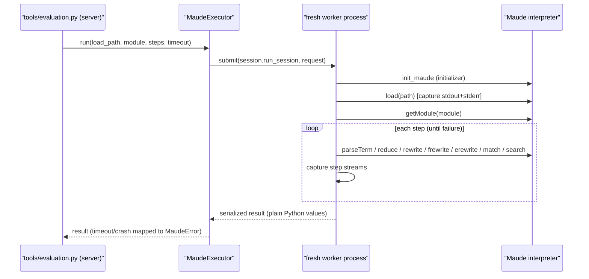

# Research — worker behavior for `maude_run`

> Phase 2 research for the `maude_run` tool (requirements in
> [`../idea-honing.md`](../idea-honing.md) Q5–Q11). Covers what the interpreter writes to
> stdout/stderr, what happens on a non-terminating evaluation, the real per-call cost, and how
> `MaudeExecutor` is reused.
>
> Probes: [`probes/probe_streams.py`](probes/probe_streams.py),
> [`probes/probe_timeout.py`](probes/probe_timeout.py),
> [`probes/probe_call_cost.py`](probes/probe_call_cost.py); transcripts are next to each script.

## 1. Streams: what each operation writes

Captured with fd 1 and fd 2 redirected to temp files (the same mechanism as
`worker.load_diagnostics`), in `probes/probe_streams.out.txt`:

| Operation | stdout | stderr |
| --- | --- | --- |
| `parseTerm` success | — | — |
| `parseTerm` failure (syntax, undeclared operator/variable) | — | ANSI-colorized `Warning:` lines (`bad token ...`, `no parse for term.`, ...) |
| `reduce` (success, warning-free) | — | — |
| `rewrite` / `frewrite` / `erewrite` | — | — |
| `match` (hit or miss) | — | — |
| `search` (hit or miss) | — | — |
| `maude.load` clean | — | — |
| `maude.load` with warnings | — | `Warning: "file", line N (fmod M): ...` |
| `maude.load` of a file with an embedded `red` command | `reduce in NAT : 1 + 2 .` / `rewrites: 1 ...` / `result NzNat: 3` | — |

Two findings matter:

1. **stdout is real.** A file may contain REPL commands (`red`, `rew`, ...); `maude.load`
   executes them and their output goes to **stdout**, buffered independently of stderr. The tool
   must capture both streams (the user's request in `rough-idea.md`), not only the fd-2 capture
   that diagnostics uses.
2. **ANSI colorization is not TTY-gated in practice.** Warnings contain `\x1b[31m` /
   `\x1b[35m`/ `\x1b[0m` even when fd 2 is redirected to a file. The existing `_strip_ansi`
   hardening is therefore required for term-phase messages too.

**Implication.** Generalize the capture into a helper around a callable: duplicate fd 1 and fd 2,
point them at two temp files, run the callable, restore, read and lossily decode both, and strip
ANSI before parsing. Return `{stdout, stderr}` per phase: once around the load, once per step
(Q9). The worker stays single-threaded, so no locking is needed.

A follow-up probe (`probes/probe_stdout_flush.py`) checked whether Maude's stdout survives the
fd restore: with and without an explicit `fflush(NULL)`, `maude.load`'s output of an embedded
`red` command was captured inside the redirect window, so no flush is required.

**Why this also matters for diagnostics.** `load_diagnostics` currently redirects only fd 2. A
diagnosed file with embedded REPL commands prints to the worker's stdout, which it inherits from
the server process — and in production that is the MCP stdio transport. Capturing fd 1 as well
(and discarding it for diagnostics) closes that latent protocol-corruption path without changing
the diagnostics result.

## 2. Non-terminating evaluation, timeouts and pool recovery

`probes/probe_timeout.out.txt` reproduces the executor's pool configuration (spawn context,
`initializer=init_maude`, `max_tasks_per_child=1`) and reduces a non-terminating equation
(`f(N) => f(s N)`):

| Scenario | Result |
| --- | --- |
| One worker, hung `reduce()`, `future.result(timeout=5)` | `TimeoutError` after exactly 5.00 s |
| `kill_workers()` on the hung pool | returns immediately (0.00 s) |
| Fresh pool after the kill | works (normal task completes) |
| One worker, hung task, second task queued behind it | queued call times out (the worker is stuck) |
| Two workers, hung task on one, healthy task on the other | healthy task completes concurrently |
| `kill_workers()` while a healthy task is in flight | the in-flight healthy task raises `BrokenProcessPool` |

**Implications.**

- The existing `MaudeExecutor._run_task` mechanics work unchanged for term evaluation: the
  timeout is enforced by `future.result(timeout=...)`, and a hung native call can only be
  stopped by killing the process — which is exactly what `_reset_executor` + `kill_workers()` do.
- A timeout is **best effort and pool-wide**: recovery kills every worker in the pool, so
  in-flight calls from other clients on that pool fail. This is existing executor semantics
  (`executor.py` `_reset_executor`), documented in the tool description (Q7/Q11).
- On a pool with one free slot, one hung evaluation blocks queued calls until the timeout. The
  default `HAROLD_MAUDE_WORKERS` (3 on most machines) leaves room for concurrency.
- A non-terminating evaluation therefore surfaces as a whole-call `MaudeWorkerTimeoutError`
  (wrapped by the tool's error), never as a per-step outcome; the client retries.

## 3. Per-call cost

Measured through the real `MaudeExecutor` on the development machine
(`probes/probe_call_cost.out.txt`): `start()` (pool + one init ping per worker) ≈ 0.50 s; a
hermetic `diagnostics()` call ≈ 0.09–0.35 s; a `ping` task ≈ 0.11–0.17 s. The earlier
`no_new_module_quirk` measurements (~0.6–1.2 s/call) were taken on a different machine; the
order of magnitude confirms that every tool call pays a process spawn plus prelude init.

**Implication.** The step-list shape (Q2) is well founded: one call runs up to 200 steps on a
single fresh interpreter, instead of a fresh interpreter plus client round-trip per command.

## 4. Reusing `MaudeExecutor`

`MaudeExecutor` (`src/harold_mcp/maude/executor.py`) is already generic:

- `_run_task(fn, *args)` submits any worker function and maps `BrokenProcessPool`/`TimeoutError`
  to `MaudeWorkerCrashedError`/`MaudeWorkerTimeoutError`, replacing the pool exactly once.
- `_default_executor()` already sets `max_tasks_per_child=1`, so each call gets a fresh Maude
  process — the post-`no_new_module_quirk` architecture the tool needs.
- The only change required is a per-call timeout (Q7): add `timeout: float | None = None` to
  `_run_task` (default: the diagnostics setting) and pass the interpreter tool's timeout.

A new thin method is enough:

The worker returns only picklable plain Python values (strings, ints, lists, dicts) — SWIG
objects (`Term`, `Substitution`, iterators) never cross the process boundary.

## 5. Design implications (summary)

1. Capture **both** fd 1 and fd 2 around the load and around every step; strip ANSI before
   reporting; decode lossily.
2. Timeouts are per call, cover process spawn + prelude init + work, and are best effort
   (pool-wide kill, no retry). The interpreter tool gets its own setting and a per-call override.
3. A hung/non-terminating evaluation is a whole-call failure, not a step outcome.
4. Reuse `MaudeExecutor` unchanged except for the per-call timeout argument; add one executor
   method and one worker op.
5. Serialize all worker results to plain Python types.

## References

- `src/harold_mcp/maude/worker.py` (`init_maude`, `load_diagnostics`, capture/parse helpers),
  `src/harold_mcp/maude/executor.py` (`_run_task`, `_reset_executor`).
- `.agents/planning/no_new_module_quirk/design/detailed-design.md` (hermetic per-call
  interpreter, pool-wide recovery), `research/isolation-cost.md` (earlier timings).
- Probe transcripts: [`probes/probe_streams.out.txt`](probes/probe_streams.out.txt),
  [`probes/probe_timeout.out.txt`](probes/probe_timeout.out.txt),
  [`probes/probe_call_cost.out.txt`](probes/probe_call_cost.out.txt).
