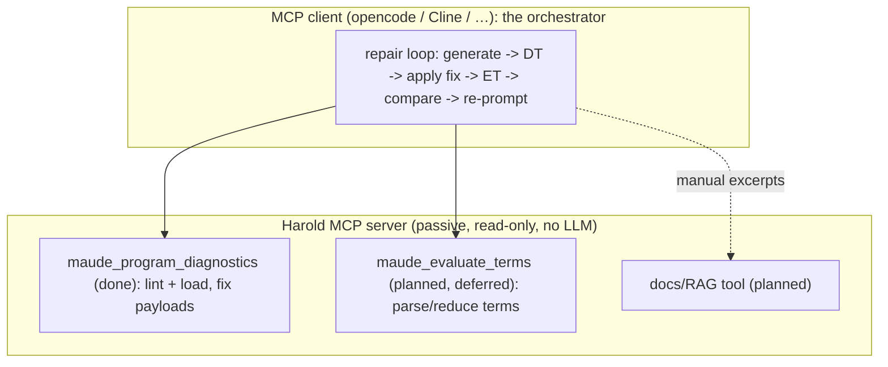

# Research — where (if anywhere) repair-loop pieces belong in Harold

> Phase 1 (decision-oriented) research for the rough idea in [`../rough-idea.md`](../rough-idea.md).
> Questions answered here: *"Does it fit in the extensible design for
> `maude_program_diagnostics`? Or should we add a different tool?"* and *"Can we just take some
> ideas and add that to `MaudeDiagnostic.fix`?"* — under the constraint of keeping the code
> cohesive, simple and extensible, with low coupling. Companion documents:
> [`repair-py-analysis.md`](repair-py-analysis.md) (the artifact),
> [`contribution.md`](contribution.md) (capability inventory). Written 2026-10-17. No code changed.

## 1. Fit test against `maude_program_diagnostics`

The diagnostics tool's contract is the same one `port-maude_eval.py/research/placement.md` §2
tested term evaluation against: **`{path}` in, positioned problems with that file out**, every
provider attempted, all-or-nothing, `success` = no `warning`/`error`. A repair capability fails
the same test, more severely, because it is not even a *producer of diagnostics*:

| Constraint | Where | Conflict |
| --- | --- | --- |
| Input schema is exactly `{path: str}` | v1 R2 | A repair call needs `{path, spec/model, iterations, …}` — a second and third input mode. |
| One composite tool, **all** providers attempted; any failure fails the call | v2 LP4, LP8 | A repair is not a provider: a `DiagnosticProvider` returns findings about a file; repair returns *a new program* (and a trace, and a comment). There is nothing to merge, attribute, or order. |
| `success`/`summary`/`severity`/`code`/`range`/`fix` are shaped like problems | v2 LP3–LP6, §5.1 wire models | Repair's product is code; every wire-model field would be meaningless for it. |
| Deterministic, read-only, idempotent annotation profile | tool docstring, tags vocabulary | An LLM repair is non-deterministic, writes a new file, costs tokens and minutes; `readOnlyHint=True` and `idempotentHint=True` would be lies. |
| Provider seam is stdlib-only, no framework, no IO beyond the file | v2 LP10, design §4 | A repair provider would import an HTTP client and read API keys — a dependency and a concern no other provider has. |

**Verdict on Q2a: no.** Extending `maude_program_diagnostics` is rejected outright, for stronger
reasons than the term-evaluation case: repair is a *different kind of product* (a transformed
program), not a different kind of finding.

## 2. Options for the rest of the artifact

| Option | Shape | Assessment |
| --- | --- | --- |
| **A. Extend `maude_program_diagnostics`** | repair provider / extra args | **Rejected** (§1). |
| **B. New MCP tool** `maude_repair_program` (LLM in the server) | tool calls an LLM API, loops, writes a file | **Rejected** (see [`contribution.md`](contribution.md) §3): API keys and network in the server, statefulness, non-determinism, destructive first tool, duplicated orchestration, no roadmap goal, no tag category. The `Scripted` connector pattern would also have to be re-invented server-side for tests. |
| **C. New MCP tool, verifier-only** (`maude_verify_program`: lint + load + evaluate + compare against a spec) | no LLM: takes `{path, terms}` (or spec), returns per-term verdicts | This is **not repair**; it is the deferred `maude_evaluate_terms` tool (`port-maude_eval.py` decision) plus a client-side diff. If a *verifier* convenience tool is ever wanted, it is that project's scope decision, not this one. |
| **D. Port nothing; keep the loop in improve-rag** | — | **Recommended.** The loop is a research harness for comparing models/RAGs; it keeps working unchanged there, and an MCP client can re-implement the same loop with Harold's tools (diagnose today; evaluate when C lands). |
| **E. Extract the loop as an MCP-*client* recipe/script** (e.g., an opencode skill) | a documented client-side workflow: diagnose → apply `fix` → re-diagnose → (future) evaluate → compare | Cheap, coherent with the architecture (orchestration lives on the client side), and usable by any client. Candidate follow-up, not Harold server code. |

## 3. Q3 — what repair.py could give to `MaudeDiagnostic.fix`

`fix` is defined as "a deterministic correction … the tool never applies" (`diagnostics.py`).
Only deterministic-edit ideas qualify. What repair.py actually contains:

| Idea in repair.py | Deterministic edit? | Status in `fix` today |
| --- | --- | --- |
| `autofix`: 8 Unicode → ASCII substitutions (`linter.py` L34-41) | yes | **Already ported** (`rules.py` `UNICODE_FIXES` + `_unicode_fix`), in better form: exact per-character spans on code lines only, while repair.py's version is a global `str.replace` that rewrites comments and strings too |
| "restore the original signatures" / "equation does not match" feedback | no — semantic, needs a model | Not fix material; it is *message* material, and the ported rules' messages are already written to be model-facing |
| REPAIR prompt phrasing | no — prompt engineering | Client-side concern |
| The loop, RAG injection, exemplar, connectors | no | §2 |

So the honest answer to Q3: **the only deterministic-edit idea repair.py had is already in
`MaudeDiagnostic.fix`, ported more precisely than the original.** Nothing else in repair.py is a
candidate for `fix`, by the fix payload's own definition.

Two *adjacent* opportunities exist, but they come from the linter rules, not from repair.py, and
are independent of this port decision:

| Rule | Candidate fix | Safety | Notes |
| --- | --- | --- | --- |
| `dash-comment` | `--` → `***` | High: the rule fires only on whitespace-delimited `--` on non-declaration code lines; Maude's block comment is `***`…`***` (single-line `***` to EOL is legal) | Would make the fix table 2 rules instead of 1 |
| `eq-in-term` | lone `=` → `==` | High: a lone `=` is never legal Maude inside an `if…then` span (the regex already excludes `==`, `=/=`, `<=`, `>=`, `/\`, `\/`) | Same spirit as repair.py's autofix (safe substitution before re-verification) |

Both are cheap rule refinements if the user wants richer fix coverage; neither requires nor
justifies porting repair.py.

## 4. Decision

- **Q1 (contribution):** the *loop* contributes nothing Harold should accept; its *verification
  ingredients* are already ported (lint, fixes, load) or already decided as a separate deferred
  tool (term evaluation). See [`contribution.md`](contribution.md) §4.
- **Q2 (placement):** no to extending `maude_program_diagnostics`; no to a server-side repair
  tool; **the loop stays in improve-rag (option D)** and, if desired, becomes a client-side
  recipe over Harold's tools (option E). The one Harold-shaped piece — a verifier — is the paused
  `port-maude_eval.py` project (option C), not this one.
- **Q3 (fix):** already answered by the port — repair.py's only deterministic-edit idea is
  `MaudeDiagnostic.fix` today. Optional rule-driven fix extensions (`dash-comment`,
  `eq-in-term`) are independent follow-ups.

## Sources

- `harold-mcp/src/harold_mcp/server/tools/diagnostics.py` (tool contract, annotations, `MaudeFix`
  docstring), `harold_mcp/heuristic/rules.py` (L22-32, L80-88, L120-123, L185-201),
  `harold_mcp/server/tags.py`.
- `harold-mcp/.agents/planning/port-maude_eval.py/research/placement.md` §2 (the reusable fit
  test), §3 (options A–D).
- `harold-mcp/.agents/planning/port-linter.py/summary.md` (report-only fix decision, host-side
  autofix deliberately left in improve-rag).
- `improve-rag/improvement/linter.py` (L21-41), `repair.py` (L107-198, L266-307).
