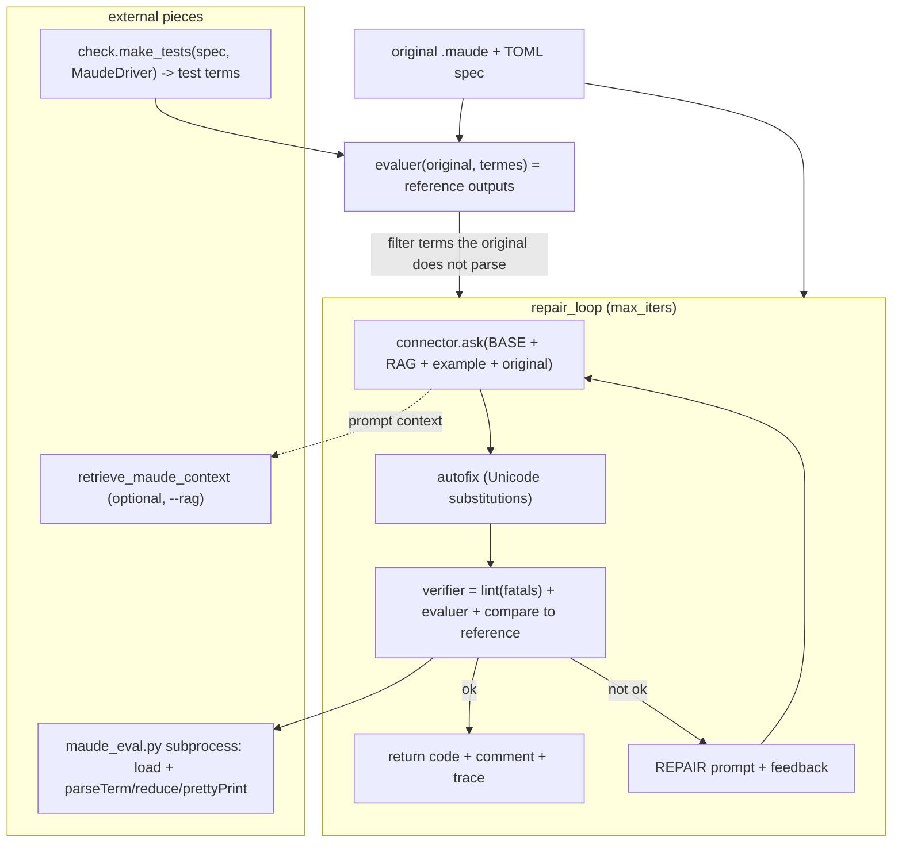

# Research — what `repair.py` is and how it is built

> Phase 1 (decision-oriented) research for the rough idea in [`../rough-idea.md`](../rough-idea.md).
> Question this document feeds: *"What would `repair.py` contribute to our diagnostics tool?"*
> Companion documents: [`contribution.md`](contribution.md) (capability inventory and worth),
> [`placement.md`](placement.md) (fit test and options). Written 2026-10-17. No code was changed.

## 1. The artifact

`improve-rag/improvement/repair.py` (~427 lines) is the **compile-and-repair loop** of the
`improve-rag` optimization harness: an LLM is asked to optimize a Maude program, the candidate is
checked locally (linter → interpreter load → differential tests against the original's outputs),
and the diagnostic is fed back to the model for a correction, at most `--max-iters` times
(default 3).

Its own docstring states the motivation: of 19 real failures in `rag-gemini-2.5-flash` output,
4 were parse errors (`when`, Unicode, `--`, `=` vs `==`) and 2 compiled but were semantically
wrong (non-linear pattern, `Nat` matching) — all detectable locally without calling a model.



## 2. Component inventory

| Component (location) | Function | Notes |
| --- | --- | --- |
| `evaluer(code, termes)` (L55-88) | Writes candidate + terms to a temp dir, spawns `maude_eval.py`, parses stdout JSON | Any `Warning`/`Error` in the **load phase** of stderr ⇒ `loaded=False` ("comme check.py : des warnings au CHARGEMENT = build error"). Timeout (60 s) ⇒ "reduction does not terminate". |
| `Gemini` (L107-126) | Google `generateContent` REST call with a JSON response schema (`{comment, code}`) | `GEMINI_API_KEY`; same API as `rag-gemini.py`. |
| `Scripted` (L129-142) | Replays canned `{comment, code}` responses from a JSON file, in order | The offline-test connector; raises when exhausted. This is what makes the loop testable without spending tokens. |
| `EdenAI` (L145-188) | OpenAI-compatible chat-completions connector; extracts code from ``` fences when no JSON mode | `EDENAI_API_KEY`; `temperature=0.3`, 180 s timeout. |
| `get_connector` (L191-198) | Routes `gemini-*` / `edenai:*` / `scripted:file.json` | |
| `charger_rag` (L205-215) | `sys.path`-imports `retrieve_maude_context` from the requested RAG dir (`../rag-system`, `../maude-rag-hybrid`, `../maude-rag-sections`, `none`) | A harness *switch*, not an API: the loop doubles as a RAG-comparison experiment. |
| `exemplaire_similaire` (L218-235) | Jaccard token similarity over `tests/original/maudec/maude/*.maude` for a few-shot exemplar | Deliberately simple ("an embedding would do better"). |
| Prompts (L242-263) | `BASE` (optimize, keep signatures), `RAG_BLOCK` (manual excerpts), `EXAMPLE_BLOCK` (similar program), `REPAIR` (fix the rejected code) | |
| `verifier` (L266-307) | lint (fatal issues reject) → load → per-term compare against reference; composes feedback messages | The per-term tri-state (`None` = "does NOT PARSE … RESTORE the original signatures", value mismatch = "did not reduce — an equation probably does not match") is the worked example of model-facing feedback. |
| `repair_loop` (L314-389) | The orchestration: reference extraction, term filtering, initial prompt, iterate autofix→verify→repair | Returns `(code, comment, trace)`; trace JSON records per-iteration ok/fixes/feedback. |
| `main` (L392-427) | argparse CLI; writes the repaired program with a `*** <comment from="model" via="repair-loop">` header | |

## 3. Inputs the loop needs

The differential-testing half cannot run without harness inputs that are **not derivable from the
program file**:

1. **A test spec** (`inputs/spec/maudec/maude/*.toml`): `check.make_tests` (L640-690) turns a TOML
   spec into terms — explicit `examples` plus randomized cases driven by a `signature` with types
   `nat`/`int`/`bool`/`float` (default 25 per function), translated by `MaudeDriver.translate_input`.
2. **A reference oracle**: the original program's own outputs for those terms, computed by running
   the original through the same evaluator (`repair_loop` L327-341). Terms the original itself
   does not parse are dropped (real case: `collatz.toml` references `rlapp_Nat`/`arlapp_Nat`).
3. **An LLM endpoint + API key** (`GEMINI_API_KEY` / `EDENAI_API_KEY`, loaded from `.env`).
4. Optionally, **a retrieval backend** and an **exemplar corpus**.

## 4. What kind of artifact this is

- It is a **research harness**, not a service: its docstring advertises the loop as a way to
  *compare RAG backends inside the loop*; the README groups it with `best_of.py`, `props.py` and
  the evaluators as *comparison tooling* ("Compare repair.py vs best_of.py at equal token
  budget").
- It is **stateful and multi-step**: one invocation = one LLM generation + up to 3 verify/repair
  rounds, minutes of wall time, and it **writes** a new file.
- It is **non-deterministic by design** (LLM), with the `Scripted` connector bolted on precisely
  to restore determinism for tests.
- Interesting consistency check: `improve-rag/.agents/summary/` does **not** document `repair.py`
  at all (its components.md stops at `make_test.py`); the README is the only KB source.

## 5. The two precedents and their decision patterns

`harold-mcp/.agents/planning/` already contains two completed go/no-go cycles for the *same kind*
of question, and their decision pattern applies here:

| Precedent | Subject | Decision | Pattern |
| --- | --- | --- | --- |
| `port-linter.py` (implemented, see `summary.md`) | `linter.py` | **Port the rules** as a diagnostics provider; **do not port host-side autofix** (fixes are report-only) | Split the artifact into *checker* (Harold's business) and *actor* (the client's business). |
| `port-maude_eval.py` (paused at decision point, see `summary.md`) | `maude_eval.py` | **Yes to the capability** (evaluate terms), **no** to extending the diagnostics tool, home is a **new tool**; deferred | Split the artifact into *capability* (worth having) and *harness scaffolding* (stays in improve-rag); the fit test in `research/placement.md` §2 is reusable. |

Both cycles converged on the same architecture of division: **Harold provides the verification
primitives; the orchestrating agent (MCP client, or the improve-rag harness) composes them.**
`repair.py` is, in this framing, the third and largest artifact on the *orchestrator* side: it
assembles the linter (ported), the evaluator (decision recorded: new tool, deferred) and the
differential oracle (never proposed for porting) into a loop around an LLM call.

## Sources

- `improve-rag/improvement/repair.py` (whole file), `linter.py` (L34-41), `maude_eval.py` (whole
  file), `check.py` (L385-490 `MaudeRunner`/`MaudeDriver`, L640-690 `make_tests`).
- `improve-rag/improvement/README.md` → *Compile-and-repair loop* and *Comparison tooling*.
- `improve-rag/.agents/summary/index.md` (and grep across `*.md`: `repair.py` is undocumented).
- `harold-mcp/.agents/planning/port-linter.py/summary.md` (decision: report-only fixes).
- `harold-mcp/.agents/planning/port-maude_eval.py/summary.md`, `research/contribution.md`,
  `research/placement.md` (decision: new tool, deferred; fit-test framework).
