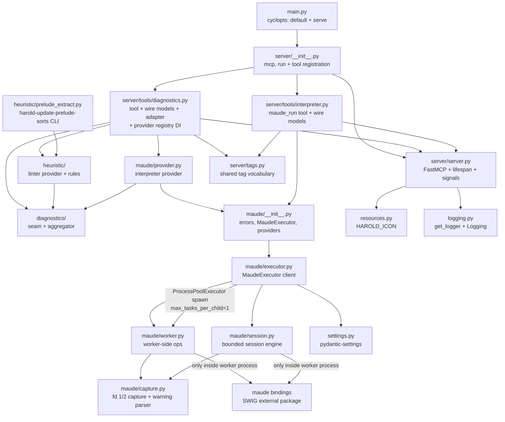
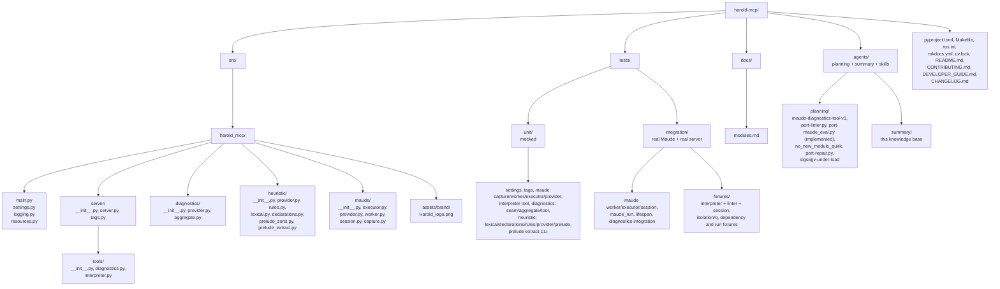

# Architecture

<!-- tags: architecture, structure, mermaid -->

## Overview

`harold-mcp` is a small Python application with a two-process architecture, an in-process
provider seam, and a heuristic linter that runs in the server process:

- **MCP server process** (FastMCP, multithreaded): the two tools
  (`maude_program_diagnostics`, `maude_run`), the diagnostics provider seam and
  aggregation, the heuristic linter, the wire models, and the `MaudeExecutor` client
  wrapper. It **never imports the `maude` SWIG bindings**.
- **Maude worker process** (spawned, single-threaded, **fresh per call**): owns the
  interpreter, captures stdout/stderr, parses warnings, and runs bounded interpreter
  sessions. Managed through a `ProcessPoolExecutor` (`spawn` context,
  `initializer=init_maude`, `max_tasks_per_child=1`), so every call gets a fresh
  interpreter.

The process split exists for two reasons plus one consequence (design rationale in
`.agents/planning/maude-diagnostics-tool-v1/design/detailed-design.md` §1):
(1) **stderr isolation/capture** — the `maude` package writes `Warning:` lines to fd 2 from
C++, capturable only via OS-level redirection, which the worker scopes to its own process
(shared by `load_diagnostics` and `run_session` through `maude/capture.py`);
(2) **crash containment** — the bindings have a SIGSEGV history, so a worker death kills
only the worker and the pool is replaced; and (3) **hermetic calls** — the one-task-per-
process recycling (`max_tasks_per_child=1`, `.agents/planning/no_new_module_quirk/`) means
parser residue (a top-level `q .` leaves executable commands pending) cannot leak from one
diagnosed file into the next.

The heuristic linter (`.agents/planning/port-linter.py/`) deliberately did **not** need the
worker: it is pure text processing, so it runs in the server process next to the tool, and
its findings are merged with the interpreter's by the diagnostics aggregator. The
interpreter-session tool (`maude_run`, `.agents/planning/port-maude_eval.py/`) reuses the
same worker: its engine lives in `maude/session.py` and returns data (terms, bindings,
solutions, per-step outcomes), not diagnostics.

## Module dependency diagram

## Key architectural decisions

1. **Interpreter only lives in the worker.** The server process never imports `maude`
   (R17): `worker.py` and `session.py` import it lazily inside functions, so importing
   those modules in the server process is side-effect-free. `worker.init_maude` runs
   `maude.init(loadPrelude=True, advise=False)` and then **disables Maude IO**
   (`setAllowDir/File/Processes(False)`), so programs loaded by either tool cannot
   read/write files or spawn processes. The worker inherits the server's stdout (the MCP
   transport) and must never write to it; `capture_streams` redirects both fds around the
   interpreter work.
2. **`ProcessPoolExecutor`, spawn context, one task per process.** `max_workers` from
   `HAROLD_MAUDE_WORKERS` (default: half the logical CPUs, capped at 3) bounds how many
   fresh interpreters may run concurrently; `max_tasks_per_child=1` recycles each worker
   after a single task, so every call runs on a fresh interpreter and nothing (loaded
   modules, parser state) survives across calls. `spawn` (not `fork`/`forkserver`): the
   server process is threaded, and `forkserver` needs an AF_UNIX socket. The executor
   spawns workers on demand — a worker is only started when none is idle. The same pool
   serves both tools (`diagnostics` and `run_session`).
3. **Crash/timeout recovery.** `MaudeExecutor._run_task` maps result-time
   `BrokenProcessPool`/`TimeoutError` to `MaudeWorkerCrashedError`/`MaudeWorkerTimeoutError`
   and swaps the pool (`_reset_executor`, CQS command, identity-checked under an RLock);
   the old pool is killed with `kill_workers()` (Python 3.14). A timed-out worker is
   killed because a hung `maude.load` or reduction cannot be interrupted otherwise. The
   failed call is never auto-retried — diagnostics is idempotent and sessions are
   client-driven, so the MCP client retries.
4. **Fail-fast startup (no warm-up).** The FastMCP lifespan (`@lifespan`-decorated
   `app_lifespan`) starts the pool and pings every worker at startup; a broken
   `init_maude` surfaces as `MaudeInitError` and aborts startup. With one task per
   process, the pinged processes are recycled immediately: this is a fail-fast
   initialization check, not a warm-up. Teardown always runs.
5. **Graceful SIGTERM.** FastMCP's `mcp.run()` installs no signal handling, so `run()`
   registers a SIGTERM handler that raises `KeyboardInterrupt`; the asyncio runner cancels
   the server task (running the lifespan `finally`), and `run()` then calls `os._exit(0)`
   because FastMCP's stdio transport leaves a non-daemon stdin-reader thread that would
   hang interpreter shutdown.
6. **Tool registration as a package side effect.** `server/__init__.py` imports
   `harold_mcp.server.tools`; the tool module imports `mcp` from the concrete
   `harold_mcp.server.server` module, making any import order cycle-proof. `main.py` needs
   no wiring.
7. **Configuration via `pydantic-settings`.** `harold_mcp.settings.Settings`
   (`HAROLD_` prefix): `maude_workers` (default `max(1, min(3, cpu_count // 2))` via
   `default_factory`), `diagnostics_timeout_secs` (default 60), `interpreter_timeout_secs`
   (default 60), and the interpreter caps `interpreter_max_steps` (200),
   `interpreter_max_rewrite_bound` (1000), `interpreter_max_solutions` (200),
   `interpreter_max_term_length` (100000), `interpreter_max_result_length` (1000000) and
   `interpreter_max_output_length` (1000000).
   `get_maude_executor(settings=Depends(get_settings))` is a lazy, lock-guarded
   singleton — FastMCP nested dependency injection; the diagnostics tool module's
   `get_diagnostic_providers` nests one level deeper (providers → executor → settings),
   while `maude_run` receives the executor and settings directly.
8. **CLI via cyclopts, two console scripts.** `harold_mcp.main` builds a cyclopts `App`
   whose default command and `serve` subcommand both call `server.run`;
   `harold_mcp.heuristic.prelude_extract` builds the maintenance CLI for the prelude sort
   snapshot. `main.py` keeps the `if __name__ == "__main__"` guard because the
   `spawn`-context worker re-imports the main module.
9. **Shared tool metadata: tags in one place, annotations for the client.** The tag
   vocabulary is centralized in `server/tags.py` (`harold_tags(*tags)` always adds the two
   domain tags `maude` + `programming`; each tool adds one functional-category tag).
   Effect/safety metadata is deliberately **not** duplicated as tags: it lives in
   `ToolAnnotations` (the full read-only profile on both tools). Empirical: with
   mcp SDK 1.29 (spec 2025-06-18) tags are **not serialized to clients** — they are
   server-side categorization for visibility control (`mcp.enable`/`mcp.disable` by tag);
   annotations do reach clients.
10. **Diagnostics provider seam and all-or-nothing aggregation.** `harold_mcp.diagnostics`
    defines what a diagnostic is (`DiagnosticSource`, `Severity`, `ProviderDiagnostic`
    with native 1-based positions and a report-only `FixSuggestion`), the
    `DiagnosticProvider` protocol, and `collect_diagnostics`. The seam is
    provider-agnostic, stdlib-only and free of framework types; concrete providers live
    with the capability they belong to (`maude/provider.py`, `heuristic/provider.py`), and
    the diagnostics tool module is the only place that wires providers — the
    `get_diagnostic_providers` FastMCP dependency builds the registry (with
    `get_maude_executor` nested inside it) — and adapts seam values to the wire models.
    Providers run **in order** (interpreter first — the order is also the tie-break for
    findings on the same line) and a failure of any provider fails the whole call with
    `DiagnosticCollectionError`, which names every failing provider (no partial results:
    MCP cannot express "error + content"). The merge order is file position, provider
    registry order, column, with whole-file problems last.
11. **Heuristic linter in the server process.** `harold_mcp.heuristic` is pure text in /
    diagnostics out; it never imports the `maude` bindings and never depends on the
    worker. A length-preserving masking layer blanks comments, string literals, quoted
    identifiers and statement labels to spaces, so a character's index always equals its
    1-based column; rules are a registry of `(code, severity, detect)` tuples whose order
    is the evaluation order and the deterministic tie-break. Severities are `info` (does
    not affect the load) and `warning` (suspicious, may be a false positive); `error` is
    reserved for findings that cannot be false positives, so no current rule uses it.
    `iter_sort_declarations` is shared between the `prelude-sort-redeclared` rule and the
    snapshot extractor so they can never disagree on what a declaration is.
12. **Error layering: diagnostics errors are not Maude errors.** The diagnostics tool's
    input error (`SourceFileNotFoundError`, raised by `SourceFile.from_path`) and provider
    failures (`DiagnosticProviderError`, `DiagnosticCollectionError`) belong to the
    diagnostics layer (`DiagnosticsError` base), independent of `MaudeError`. At the
    interpreter provider boundary a `MaudeWorkerError` is wrapped with `raise ... from`, so
    the Maude cause survives for logs while the MCP surface reports a diagnostics failure.
    The old `MaudeFileNotFoundError` no longer exists. `maude_run` has its own whole-call
    error (`MaudeRunError`) and also chains any `MaudeWorkerError` cause.
13. **Bounded interpreter sessions (`maude_run`).** One tool call loads one file into a
    fresh worker, selects one explicit module, and runs an ordered list of
    `reduce`/`rewrite`/`frewrite`/`erewrite`/`match`/`search` steps. The worker engine
    lives in `maude/session.py`; the server-side tool validates the request (caps and
    current-term threading), converts it to a flat `SessionRequest`, and adapts the result
    to pydantic wire models. Load warnings are data (evaluation proceeds); per-step
    failures (`parse-error`, `too-large`) are outcomes and stop the run, while a missing
    path, load failure, undefined module, theory module or worker failure fails the whole
    call with `MaudeRunError`. Steps thread a current term REPL-style: rewriting commands
    replace it, `match`/`search` leave it unchanged. All caps are settings (see decision
    7).
14. **Shared stream capture.** `maude/capture.py` owns the fd-1/fd-2 redirect (temp
    files, not pipes), ANSI stripping, lossy UTF-8 decoding, warning parsing and output
    truncation. `worker.load_diagnostics` uses it to parse warnings (stdout is discarded,
    which keeps embedded `red` output away from the MCP transport); `session.run_session`
    uses it for both the load and every step (both streams are returned).

## Directory organization

## Related documents

- `components.md` — what each module does
- `interfaces.md` — how the layers talk to each other and to the outside world
- `.agents/planning/maude-diagnostics-tool-v1/design/detailed-design.md` — the diagnostics design,
  including rationale and alternatives
- `.agents/planning/port-linter.py/design/detailed-design.md` — the provider seam, linter
  rules, snapshot and error-layering design
- `.agents/planning/port-maude_eval.py/design/detailed-design.md` — the `maude_run` session
  design (steps, caps, outcomes, capture)
- `.agents/planning/sigsegv-under-load/issue.md` — the SIGSEGV history that motivates the
  worker process
- `.agents/planning/no_new_module_quirk/design/detailed-design.md` — the per-call
  interpreter isolation design (`max_tasks_per_child=1`) that fixes the deferred `q .`
  parser-residue bug, and the dependency-attribution semantics
