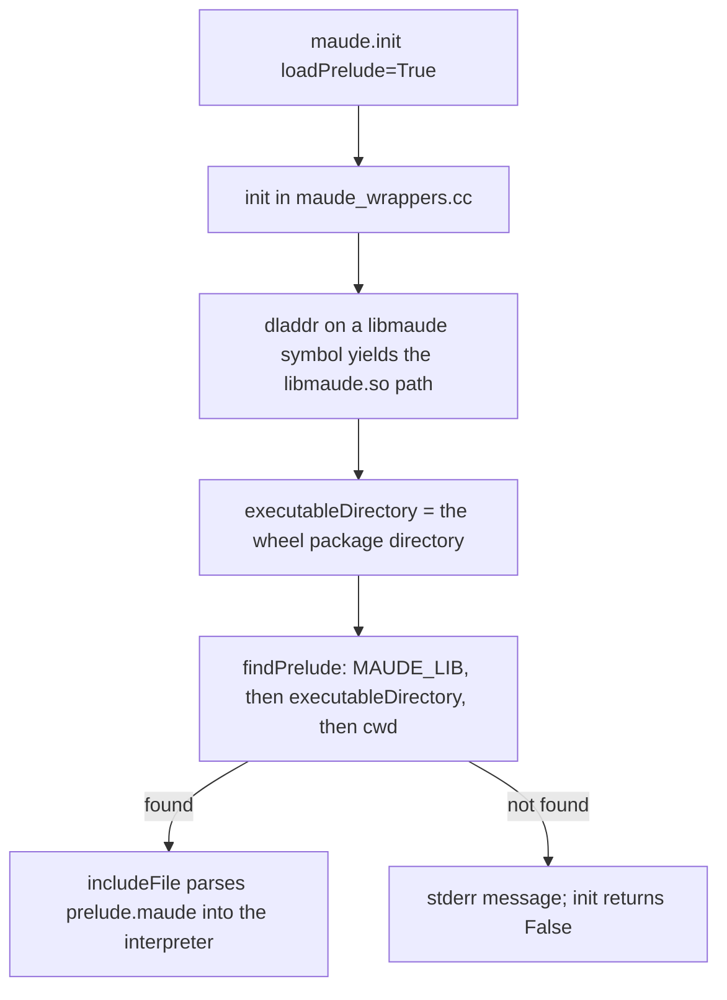

# The `maude` library: wheel layout, prelude discovery, and availability in Harold

<!-- tags: maude, bindings, prelude, interpreter, maude-lib -->

This file documents internals of the third-party `maude` Python package (the SWIG bindings
around the Maude C++ interpreter) that `harold-mcp` depends on but does not vendor. It is a
**manually maintained** addition to this knowledge base: the code lives in the sibling
`maude-bindings` checkout and its `subprojects/maudesmc` submodule, so codebase-summary
cannot derive it from `src/harold_mcp`. For Harold's side of the story see `components.md`
(`harold_mcp.maude.worker`, `harold_mcp.maude.executor`, `harold_mcp.maude.provider`,
`harold_mcp.maude.session`) and `architecture.md`; for the dependency pin and its drift
constraints see `dependencies.md`.

## What the wheel contains

`harold-mcp` depends on the pinned `maude==1.6.0` wheel: SWIG bindings built from
`fadoss/maude-bindings`, which vendors the Maude C++ sources as the `maudesmc` submodule
(`branching` branch) and compiles them into `libmaude.so`. The wheel bundles both the
compiled interpreter and the standard Maude library files *inside the Python package*:

```text
site-packages/maude/
├── __init__.py          # the Python module (SWIG-generated wrapper)
├── _maude.so            # SWIG extension module
├── libmaude.so          # the Maude C++ library: the interpreter itself
├── prelude.maude        # the standard prelude
└── file.maude  linear.maude  machine-int.maude  metaInterpreter.maude
    model-checker.maude  process.maude  smt.maude  socket.maude
    term-order.maude  time.maude
```

This layout is the key to prelude discovery: the prelude sits next to `libmaude.so`, not
next to the Python interpreter and not in the current working directory.

## How `maude.init` finds the prelude

`maude.init(loadPrelude=True)` reaches `init()` in
`maude-bindings/src/maude_wrappers.cc`, which:

1. Takes the path of the binary as a search directory: `dladdr((void*) &tokenizeRope, ...)`
   (a symbol inside libmaude) yields `libmaude.so`'s path on Linux/macOS; on Windows,
   `GetModuleFileName(GetModuleHandle("libmaude.dll"), ...)` is used instead.
   `findExecutableDirectory` stores the directory of `libmaude.so` in the global
   `executableDirectory` — for a wheel install, `site-packages/maude/`.
2. Calls `findPrelude(directory, "prelude.maude")` — defined in the vendored Maude source at
   `src/Main/main.cc` and declared in `src/Mixfix/global.hh` (which also defines
   `PRELUDE_NAME = "prelude.maude"` and `MAUDE_LIB = "MAUDE_LIB"`). It searches, in order:
   1. the directories in the `MAUDE_LIB` environment variable (colon-separated, resolved via
      `DirectoryManager::searchPath`);
   2. `executableDirectory`, i.e. the directory containing `libmaude.so` — the default hit,
      because the wheel places `prelude.maude` there;
   3. `.` (the current working directory).
   `findPrelude` uses the no-extension `checkAccess` overload, so the file must be named
   exactly `prelude.maude` (unlike `maude.load`, which probes `.maude`/`.fm`/`.obj` through
   `findFile` in `src/Mixfix/global.cc`).
3. If found, parses it into the interpreter with
   `includeFile(directory, fileName, silent=true, FileTable::AUTOMATIC)` — an implicit
   `in`-style load. If not found, it prints
   `Cannot find Maude prelude (setting MAUDE_LIB environment variable could help)` to stderr
   and `init` returns `false`.

The same `findPrelude`/`includeFile` path serves the standalone `maude` CLI (whose `main()`
also accepts `-no-prelude` to skip the load). The bindings can call `findPrelude` and
`findExecutableDirectory` because the meson build compiles `src/Main/main.cc` into a `main`
static library that is linked into `libmaude.so`.



## Is the prelude available with `InterpreterDiagnosticProvider` and `maude_run`?

Yes, always. `harold_mcp.maude.worker.init_maude` is the worker-pool initializer
(`initializer=worker.init_maude` in `harold_mcp.maude.executor`) and calls
`maude.init(loadPrelude=True, advise=False)` before any task runs, then disables Maude IO
(`setAllowDir`/`setAllowFiles`/`setAllowProcesses(False)`). Consequently:

- Every worker process has the full prelude loaded before `InterpreterDiagnosticProvider`
  (via `MaudeExecutor.diagnostics` → `worker.load_diagnostics`) runs `maude.load(path)`,
  and before `maude_run` (via `MaudeExecutor.run_session` → `session.run_session`) loads
  its file and parses terms. Diagnosed and evaluated programs may rely on prelude modules
  and sorts exactly as they would under the `maude` CLI.
- Freshness: the pool uses `max_tasks_per_child=1`, so each diagnostics or interpreter
  call gets a fresh process and the initializer (hence the prelude load) runs again per
  call; crash/timeout pool replacement re-runs it too.
- Fail-fast: a broken install (prelude not found) makes `init_maude` raise `WorkerInitError`,
  which surfaces as `MaudeInitError` during the lifespan's initialization check — the
  server refuses to start rather than silently running without a prelude.
- Capture scope: the fd capture in `load_diagnostics` and in `session.run_session` wraps
  only the `maude.load`/term work, through the shared `maude/capture.py` helper (both fds);
  anything the prelude prints while loading at init is outside the tool results. The
  diagnostics tool parses the captured stderr and discards the captured stdout; `maude_run`
  returns both streams per phase.

## `MAUDE_LIB` and version matching

`MAUDE_LIB` is not a Harold setting: it is read by the Maude library itself (`findPrelude`
and `findFile` both search it) and the worker inherits it from the MCP server's environment.
When set, it takes precedence over the wheel's bundled files, so:

- the prelude (and library files for `in`/`load`) come from `MAUDE_LIB`; and
- that prelude must match the Maude version the `maude` bindings were built against
  (currently Maude 3.5.1 for `maude==1.6.0`; see `README.md` and `dependencies.md`), or the
  interpreter may fail to parse it or behave inconsistently.

The variable is documented for users in the `README.md` configuration table.

## Relationship to the linter's prelude snapshot

The heuristic linter never imports `maude`; it consumes a generated snapshot of prelude
sorts (`harold_mcp.heuristic.prelude_sorts`) to flag user sorts that shadow prelude ones.
That snapshot is a separate mechanism from the interpreter prelude — regenerate it with
`harold-update-prelude-sorts` after a Maude upgrade (see `workflows.md` → Prelude snapshot
maintenance and `dependencies.md` → Notable constraints).

## Sources

- `maude-bindings` checkout (sibling repo): `src/maude_wrappers.cc` (`init`, `load`),
  `src/maude_wrappers.hh`, `swig/maude.i`, `CMakeLists.txt` (wheel install rules).
  `subprojects/maudesmc` is the vendored Maude source (git submodule, not checked out in
  the current worktree).
- maudesmc at commit `5d3d8b2cd8cb7a8cb0286f1d04e1ff4d8838a8b1`: `src/Main/main.cc`
  (`findPrelude`, `findExecutableDirectory`), `src/Mixfix/global.hh` (`PRELUDE_NAME`,
  `MAUDE_LIB`), `src/Mixfix/global.cc` (`findFile`), `src/IO_Stuff/directoryManager.cc`
  (`searchPath`, `checkAccess`), `meson.build` (the `main` static library linked into
  `libmaude`).
- Installed wheel layout: `site-packages/maude/` in the development venv.
