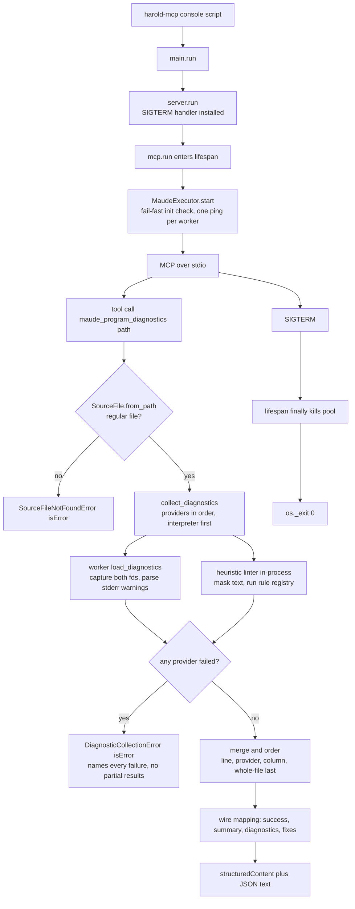
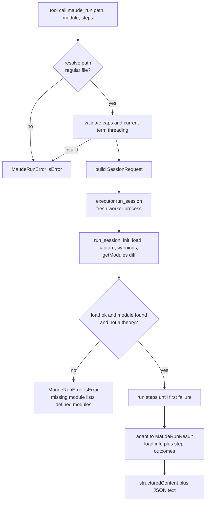
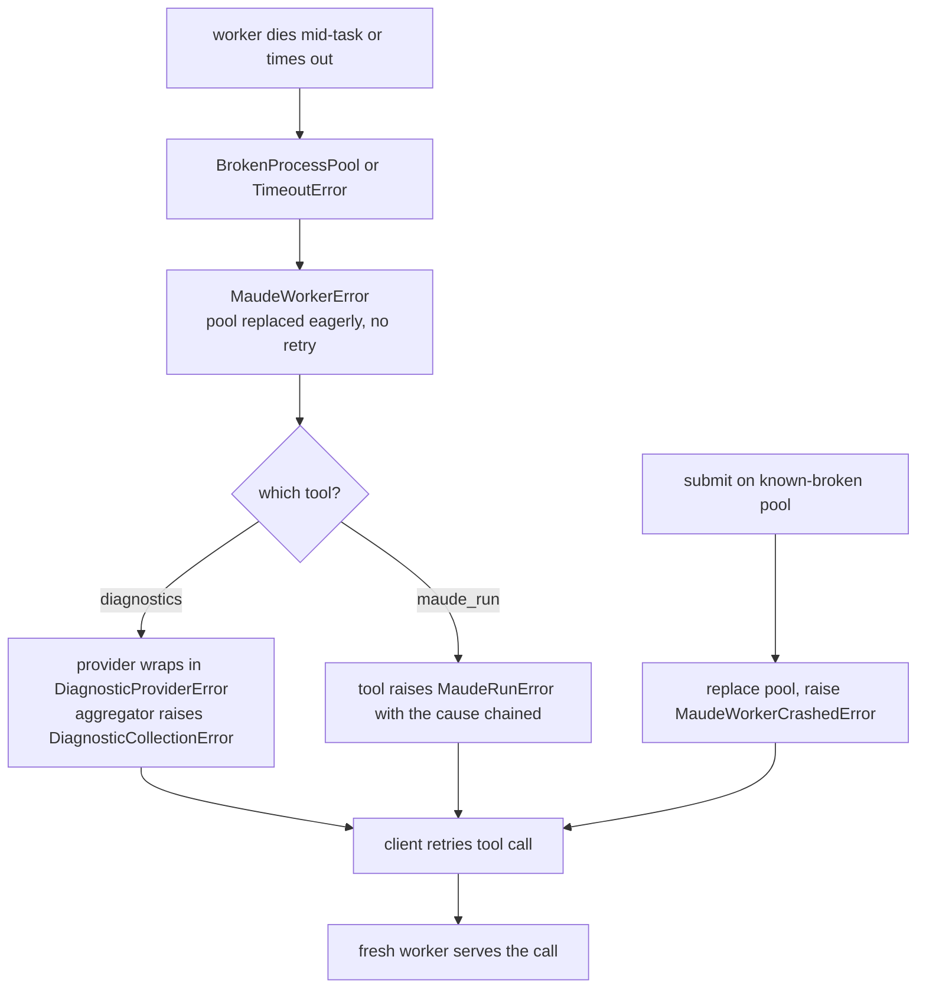

# Workflows

<!-- tags: workflows, dev-loop, ci -->

## Development loop

1. `make install` — `uv sync`, creates the environment and refreshes `uv.lock`.
   (Dev-environment details, IDE recommendations, and the release process live in
   `DEVELOPER_GUIDE.md`.)
2. Edit code under `src/harold_mcp` (tests under `tests/`).
3. `make check` — lockfile consistency (`uv lock --locked`), ruff (lint fails if any
   auto-fix is applied) + ruff format, mypy, **basedpyright** (unused call results), deptry.
4. `make test` — pytest with coverage (`--cov --cov-config=pyproject.toml`). For iteration,
   `make test-unit` (fast, hermetic, no Maude interpreter) and `make test-integration`
   (parallel via pytest-xdist, `-n auto`; every call pays a process spawn + prelude init
   because workers are recycled per call) run the splits; `make test` stays the
   authoritative sequential run for CI and releases.
5. `make release` — full CI pass (`install check test docs-test`), then prints a success
   message.

## Running the server

- Development: `make run` (or `uv run harold-mcp`) — serves MCP over stdio.
- Entry points: `uv run harold-mcp --help` lists the cyclopts CLI (default command and
  `serve`).
- Startup: lifespan fail-fast init check — one `init_maude` ping per worker (the pinged
  processes are recycled immediately; there is no warm pool).
- Shutdown: SIGTERM/SIGINT → graceful pool teardown → exit 0 (a hard `kill -9` skips the
  lifespan; workers then exit on their own via the queue pipe).
- Connect an MCP-compatible client (Zed and opencode are the configurations we test; other
  MCP clients work too) to the `harold-mcp` command; configuration examples and the
  `HAROLD_*` env-var table live in `README.md`.

## Tool execution flow

### `maude_program_diagnostics`



### `maude_run`



### Failure semantics

- Diagnostics: a missing or unreadable input fails **before** any provider runs
  (`SourceFileNotFoundError`, raised by the tool's pre-check/read). Any provider failure
  fails the whole call with `DiagnosticCollectionError`: the message names every failing
  provider and its reason, the first failure is chained (`__cause__`), and the successful
  providers' findings are discarded (MCP cannot express "error + content", so there are
  no partial results). A worker crash or timeout appears as the interpreter provider's
  chained cause.
- `maude_run`: per-step failures are **data**, not errors. A `parse-error` or `too-large`
  outcome is returned with the outcomes of the steps that ran, `completed` is false, and
  later steps are skipped. Whole-call conditions raise `MaudeRunError`: missing path, load
  failure, module not defined (the message lists the modules the load defined), theory
  module, or worker crash/timeout (chained).
- A provider bug that is not a `DiagnosticProviderError` is reported with its exception
  type, so the message says what actually broke.

### Heuristic linter flow

1. `SourceFile.from_path` reads the text once (lossy UTF-8, newline-normalizing).
2. `SourceView.from_text` builds the masked code view (comments, string literals, quoted
   identifiers and statement labels blanked to spaces, length-preserving) plus the
   file-wide declaration index and sort-declaration list.
3. The rule registry runs **in order** (that order is also the tie-break for findings that
   share a position); each rule returns findings with exact 1-based spans.
4. `HeuristicLinterProvider` stamps each finding with the rule's `code`/`severity` and
   hands them to the aggregator; fixes are report-only, the file is never modified.

### Hermetic calls (per-call interpreter isolation)

- The pool recycles each worker after a single task (`max_tasks_per_child=1`), so every
  `maude_program_diagnostics` **and** `maude_run` call loads its file into a **fresh
  interpreter process**: loaded modules and parser state never carry over between calls.
  This fixed the deferred `q .` parser-residue contamination (a file with a top-level
  `q .`/`quit .` used to leave the parser half-parsed and contaminate the *next* call; see
  `.agents/planning/no_new_module_quirk/`).
- Consequences: there is no session state ("last load wins" and cross-call current terms
  are gone); each call pays spawn + prelude init (≈1 s); `HAROLD_MAUDE_WORKERS` bounds
  concurrency (~100 MB per running interpreter), not standing workers.
  `MaudeExecutor.start()` pings are a fail-fast initialization check, not a warm-up. To
  carry state across `maude_run` calls, re-submit a saved result term or write a wrapper
  module.
- Relative input paths are absolutized before the worker sees them, because a fresh
  worker's working directory is not the client's: `SourceFile.from_path` does it for
  diagnostics and `_resolve_path` for `maude_run`; both results echo the absolute path.
- Interpreter warnings are attributed honestly: own-file (and `<standard input>`) warnings
  keep their line; a warning Maude attributed to a `load`/`in` dependency becomes a
  whole-file diagnostic naming the dependency and suggesting `maude_program_diagnostics`
  on it. `maude_run` reports load warnings as data (with the file and line Maude printed)
  and proceeds.
- Output capture: `maude/capture.py` redirects both fds around the load and every step
  (temp files, not pipes), strips ANSI codes, decodes lossily and truncates each stream at
  the output cap. Diagnostics parses warnings from the full stderr and discards stdout; a
  session returns both streams per phase.
- Regression coverage: the isolation tests (each `q .` fixture followed by a clean
  diagnosis), the dependency tests,
  `test_parallel_diagnostics_do_not_share_interpreter_state` (4 concurrent workers, every
  interpreter-clean fixture swept), the relative-path test, and the session hermeticity
  test (`test_sessions_are_hermetic`).

## Worker crash recovery



## Prelude snapshot maintenance

- `harold_mcp.heuristic.prelude_sorts` is a **generated** module (first line of the
  docstring and the header say `do not edit`); `harold-update-prelude-sorts` regenerates it.
- Regenerate after upgrading the Maude interpreter the project is built against (see the
  `maude` pin in `pyproject.toml`) or whenever `prelude.maude` changes:

  ```bash
  uv run harold-update-prelude-sorts /path/to/Maude-3.5.1-linux-x86_64/prelude.maude
  uv run harold-update-prelude-sorts /path/to/Maude-3.5.1-linux-x86_64/prelude.maude --check
  ```

- The CLI refuses extractions with fewer than 50 sort names (the realistic failure is the
  reader breaking), writes byte-stable output, and records provenance (source path,
  SHA-256, Maude version, date) in the module header. `--check` compares the **data**
  only, so a different machine's header does not fail it.
- CI does not ship a Maude installation: the tests assert snapshot invariants (not byte
  equality with an installation). `DEVELOPER_GUIDE.md` documents the procedure.

## Documentation workflow

- `make docs-test` — strict MkDocs build (`-s`, fails on warnings).
- `make docs` — serve docs locally with MkDocs.
- Docs are generated from docstrings via mkdocstrings; add new modules to `docs/modules.md`.

## Planning workflow

- Feature ideas start in `.agents/planning/<feature>/` (e.g. `maude-diagnostics-tool-v1/`,
  `port-linter.py/` and `port-maude_eval.py/` with `rough-idea.md`, `idea-honing.md`,
  `research/`, `design/`, `implementation/`, `summary.md`). Design rationale for existing
  code is recorded there too (e.g. `sigsegv-under-load/issue.md`). `maude_run` followed
  its PDD cycle (`port-maude_eval.py/`); `port-repair.py/` is an early record for a future
  repair tool.

## Packaging and release

- `make build` — build the wheel with `pyproject-build`.
- `make publish` — upload to PyPI with twine (requires `PYPI_TOKEN`).
- Release process (per `DEVELOPER_GUIDE.md`): first update `CHANGELOG.md` for the release
  (the `update-changelog-for-release` skill helps; add a one-sentence release summary at
  the top of the section) and bump `pyproject.toml` to the next WIP version with a new
  `CHANGELOG.md` section. Then create a GitHub release with a `*.*.*` tag matching the
  released version (without `.dev0`); the `release-main` workflow patches the version,
  publishes to PyPI, and deploys the docs. PyPI versions are immutable — a failed publish
  means bumping to the next version.

## Cross-environment testing

- `tox` — runs the test suite on Python 3.14 (single env `py314` in `tox.ini`). The CI
  workflows themselves live at the Git repository root (`../.github/workflows/` relative
  to this package directory).
- `pytest-xdist` (dev group) powers `make test-integration`; the sequential `make test`
  remains what CI and `make release` run. `-n auto` is affinity-aware on Python 3.13+, so
  the same target fits workstations and small CI runners; cap it with
  `PYTEST_XDIST_AUTO_NUM_WORKERS=<n>` on shared machines. The integration split includes
  the interpreter-session suites (`test_maude_session_integration.py`,
  `test_maude_run_integration.py`) in addition to the diagnostics suites.

## Related documents

- `architecture.md` — where each step happens in the code
- `review_notes.md` — known gaps in the current workflows
