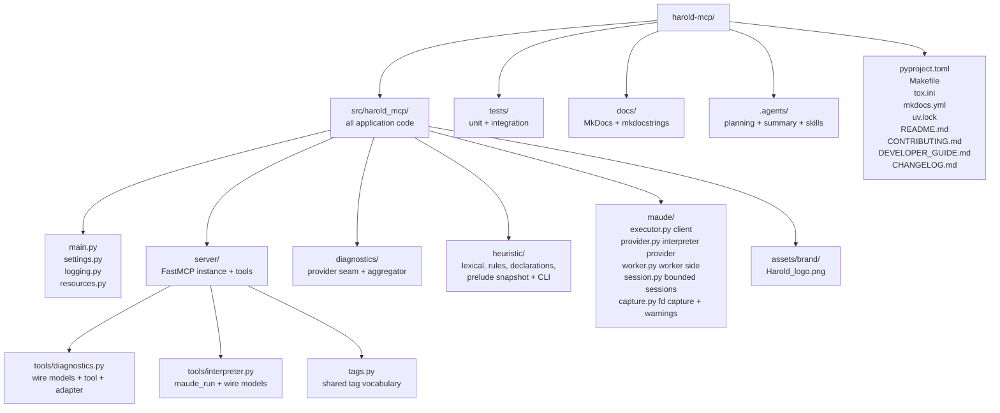

# harold-mcp — AGENTS.md

<!-- auto-generated by codebase-summary; full knowledge base in .agents/summary/index.md -->

This file is the agent-oriented entry point to the repository. It covers navigation, entry points, and repo-specific conventions. If the answer to a question is not on this page — module internals, data models, full workflow details — open [`.agents/summary/index.md`](.agents/summary/index.md) first; it routes to the detailed knowledge base files. The **Custom Instructions** section at the end is human-maintained and authoritative for project context and conventions.

## Table of Contents

- [Knowledge base](#knowledge-base) — where to go when this page doesn't have the answer
- [Codebase at a glance](#codebase-at-a-glance) — what this repo is and the stack it uses
- [Directory organization](#directory-organization) — where code, tests, docs, and config live
- [Key entry points](#key-entry-points) — how the app starts and where tools are registered
- [Repo-specific conventions and gotchas](#repo-specific-conventions-and-gotchas) — behavior-changing details agents must know
- [Repo-specific commands](#repo-specific-commands) — the Makefile-driven workflow
- [Config files agents might miss](#config-files-agents-might-miss) — where tooling configuration lives
- [Custom Instructions](#custom-instructions) — human-maintained project context (preserved across refreshes)

## Knowledge base

<!-- tags: knowledge-base, routing -->

If AGENTS.md doesn't answer your question, open [`.agents/summary/index.md`](.agents/summary/index.md) — it's the routing table for everything else.

## Codebase at a glance

<!-- tags: overview, stack -->

- **What**: `harold-mcp` is a Python package implementing an MCP (Model Context Protocol) server for AI-assisted Maude programming. It exposes two tools:
  - `maude_program_diagnostics` diagnoses one Maude source file with two providers — the Maude interpreter load (worker process, fresh interpreter per call) and Harold's heuristic linter (server process) — and returns merged, attributed diagnostics as a structured LSP-style result (severity `info`/`warning`/`error`, `source` + `code` provenance, exact columns for linter findings, report-only fixes). Problems Maude attributes to a `load`/`in` dependency are whole-file diagnostics naming that dependency.
  - `maude_run` runs a bounded interpreter session: one file, one module, an ordered list of `reduce`/`rewrite`/`frewrite`/`erewrite`/`match`/`search` steps with REPL-style current-term threading. It returns load warnings/output and per-step outcomes (`ok`, `parse-error`, `too-large`; the run stops at the first failure).
- **Architecture**: two processes plus a provider seam. The **MCP server** (FastMCP, threaded) runs both tools, the heuristic linter and the diagnostics aggregation, and never imports the `maude` SWIG bindings; the **Maude worker** (spawned via `ProcessPoolExecutor`, single-threaded, `initializer=init_maude`, **one task per process** — `max_tasks_per_child=1`) owns the interpreter, captures stdout/stderr around loads and steps, parses warnings, and runs the session engine (`maude/session.py`). The split gives stream isolation for the capture, SIGSEGV containment, and hermetic calls (no interpreter state survives across calls). `harold_mcp.diagnostics` defines the provider contract, values and all-or-nothing aggregator; concrete providers live in `maude/provider.py` and `heuristic/provider.py`.
- **Stack**: Python 3.14.x (`requires-python = ">=3.14,<3.15"`, capped by the cp314-only `maude` wheels), built with **FastMCP**, the official **MCP SDK** (`mcp`), the **Maude bindings** (`maude`), **pydantic** + **pydantic-settings**, and **cyclopts** (both CLIs). The linter, the seam and the session engine are stdlib-only. Dependencies are managed with **uv** (`uv.lock` is committed). Build backend: hatchling.
- **Configuration**: `HAROLD_MAUDE_WORKERS` (default: half the logical CPUs, capped at 3 — it bounds concurrent fresh interpreters, not warm workers), `HAROLD_DIAGNOSTICS_TIMEOUT_SECS` (default `60`; renamed from `HAROLD_MAUDE_WORKER_TIMEOUT_SECS`), `HAROLD_INTERPRETER_TIMEOUT_SECS` (default `60`) and the `HAROLD_INTERPRETER_MAX_*` caps for `maude_run`, read once at import via `pydantic-settings` (`harold_mcp.settings`).

See: [`.agents/summary/codebase_info.md`](.agents/summary/codebase_info.md), [`.agents/summary/dependencies.md`](.agents/summary/dependencies.md).

## Directory organization

<!-- tags: navigation, layout -->



- New application code goes in `src/harold_mcp`; MCP tools go in `harold_mcp/server/tools/`, registered with `@mcp.tool` on the instance from `harold_mcp.server.server` (registration happens as a side effect of importing the `harold_mcp.server` package). A new diagnostics source implements the `DiagnosticProvider` protocol (`diagnostics/provider.py`), lives with its capability package, and is wired into `get_diagnostic_providers` in `server/tools/diagnostics.py`; a new lint rule is appended to `RULES` in `heuristic/rules.py`; a new interpreter command belongs in `maude/session.py` plus the step union in `server/tools/interpreter.py`.
- New tests go in `tests/unit/` (mocked, hermetic) or `tests/integration/` (real Maude interpreter; give test files distinct basenames — pytest treats same-named files in both trees as one module). Prefer per-`code` assertions over diagnostic counts for linter fixtures.
- Feature plans and design rationale live in `.agents/planning/` (see below).

## Key entry points

<!-- tags: entry-points -->

- Console scripts:
  - **`harold-mcp`** → `harold_mcp.main:app` (`src/harold_mcp/main.py`), a **cyclopts** CLI: the default command and the `serve` subcommand both start the MCP server over stdio (`--help`/`--version` from cyclopts). `main.py`'s `__main__` guard is required (the `spawn`-context worker re-imports the main module).
  - **`harold-update-prelude-sorts`** → `harold_mcp.heuristic.prelude_extract:app` — regenerates the bundled prelude sort snapshot (`--check` verifies freshness; exit 1 when stale).
- **`src/harold_mcp/server/server.py`** — the `mcp = FastMCP(..., lifespan=app_lifespan)` instance; the `@lifespan`-decorated `app_lifespan` runs a fail-fast worker initialization check (one `init_maude` ping per worker; fail-fast on `MaudeInitError`) and tears the pool down in `finally`; `run()` installs a SIGTERM→`KeyboardInterrupt` handler and calls `os._exit(0)` after cleanup (FastMCP's stdio transport leaves a non-daemon stdin-reader thread that would hang interpreter shutdown).
- **`src/harold_mcp/server/tools/diagnostics.py`** — the tool (annotated with the full read-only profile — `readOnlyHint=True`, `destructiveHint=False`, `idempotentHint=True`, `openWorldHint=False` — and `tags=harold_tags(DIAGNOSTICS)`), its pydantic wire models, the adapter from the provider seam, and `get_diagnostic_providers` (the module-level FastMCP dependency that builds the provider registry in merge/tie-break order, nesting `get_maude_executor`): `SourceFile.from_path` pre-check/read (the path is resolved to absolute; the result reports it) → `collect_diagnostics(providers, source)` → mapping (`success` = no `warning`/`error`, summary counts `info`/`warning`/`error`, `range=None` for whole-file problems, fixes with exclusive `end`). The description documents the hermetic per-call semantics and the whole-load/dependency behavior.
- **`src/harold_mcp/server/tools/interpreter.py`** — `maude_run` (same read-only profile, `tags=harold_tags(INTERPRETER)`) and its pydantic input/output models. Inputs are a discriminated union (`reduce`/`rewrite`/`frewrite`/`erewrite`/`match`/`search`) with optional `bound`/`gas`/`depth`/`subject`; the tool validates caps and current-term threading, builds a flat `SessionRequest` and calls `executor.run_session`. Whole-call failures raise `MaudeRunError` (missing path, load failure, undefined module listing the modules the load defined, theory module, worker crash/timeout); per-step failures are outcomes. The description documents commands, threading, limits and timeout semantics.
- **`src/harold_mcp/diagnostics/`** — the provider seam: `DiagnosticProvider` protocol, `SourceFile`/`ProviderDiagnostic`/`FixSuggestion` values (`provider.py`), error vocabulary (`DiagnosticsError`, `SourceFileNotFoundError`, `DiagnosticProviderError`), and `collect_diagnostics` (`aggregate.py`, all-or-nothing: any failure raises `DiagnosticCollectionError` naming every failing provider). Stdlib-only, no interpreter, no framework types.
- **`src/harold_mcp/heuristic/`** — the linter: `lexical.py` (length-preserving masking layer: comments, strings, quoted identifiers, labels; declaration index), `rules.py` (`RULES` registry — 7 rules with `code`/`severity`/`detect`), `declarations.py` (shared sort-declaration reader), `prelude_sorts.py` (generated snapshot — do not edit), `prelude_extract.py` (extractor + CLI). Never imports `maude`.
- **`src/harold_mcp/server/tags.py`** — the shared tool-tag vocabulary: `harold_tags(*tags)` always adds the domain tags `maude` + `programming`; each tool adds one functional-category tag (`diagnostics` for `maude_program_diagnostics`, `interpreter` for `maude_run`; `docs` is reserved for the planned RAG tool). Effect/safety metadata belongs in `ToolAnnotations`, not in tags.
- **`src/harold_mcp/maude/executor.py`** — the client: error hierarchy, `MaudeExecutor` (pool lifecycle, fail-fast init pings, `max_tasks_per_child=1` — fresh interpreter per call, generic `_run_task` with crash/timeout recovery via `kill_workers`, typed `diagnostics` and `run_session` ops), `get_maude_executor(settings=Depends(get_settings))` lazy singleton.
- **`src/harold_mcp/maude/provider.py`** — `InterpreterDiagnosticProvider`: maps own-file and `<standard input>` warnings to line-only `warning` diagnostics, a warning Maude attributed to a dependency to a whole-file diagnostic naming it (with a suggestion to run this tool), and appends a synthesized whole-file `error` when the load failed; wraps a `MaudeWorkerError` as `DiagnosticProviderError` with the cause chained.
- **`src/harold_mcp/maude/capture.py`** — worker-side capture helpers shared by diagnostics and sessions: fd-1/fd-2 redirect via temp files, ANSI stripping, lossy decoding, `parse_warnings`/`WarningDict`, and `truncate_output`.
- **`src/harold_mcp/maude/session.py`** — the worker-side bounded session engine: loads one file, reports defined modules and warnings, selects a module, executes the step list until the first failure, threads the current term, caps solutions/results, and returns `SessionResult` TypedDicts. `maude` is imported lazily inside `run_session`.
- **`src/harold_mcp/maude/worker.py`** — worker-side ops (`init_maude`, `ping`, `sleep`/`rendezvous_pid` test helpers, `load_diagnostics` using the shared capture and parsing warnings from stderr only, `_crash`). `init_maude` runs `maude.init(loadPrelude=True, advise=False)` and then disables Maude IO (`setAllowDir/File/Processes(False)`). Imports `maude` **lazily inside functions** so the server process never touches the bindings.
- **`src/harold_mcp/settings.py`** — `Settings` (pydantic-settings, `HAROLD_` prefix; workers default via `default_factory`; diagnostics/interpreter timeouts and the interpreter caps) + `get_settings()`.

See: [`.agents/summary/interfaces.md`](.agents/summary/interfaces.md), [`.agents/summary/components.md`](.agents/summary/components.md).

## Repo-specific conventions and gotchas

<!-- tags: conventions, gotchas -->

1. **The server process never imports `maude`.** Only the worker touches the interpreter. `worker.py` and `session.py` keep the import lazy; keep it that way (the absolute `import maude` is the third-party package, not `harold_mcp.maude`). The heuristic linter must stay `maude`-free too.
2. **Worker lifecycle and hermetic calls.** The pool starts in `app_lifespan` (fail-fast `init_maude` pings — a startup check, not a warm-up: each pinged process is recycled immediately) and is killed in its `finally` (`ProcessPoolExecutor.kill_workers()`, Python 3.14); `start()` is not called at import time. Every task runs in a **fresh process** (`max_tasks_per_child=1`), so nothing survives across calls; `HAROLD_MAUDE_WORKERS` bounds concurrent interpreters, not standing workers, and relative input paths are absolutized (`SourceFile.from_path` for diagnostics, `_resolve_path` for `maude_run`) because a fresh worker's working directory is not the client's. To carry state across `maude_run` calls, re-submit a result term or write a wrapper module.
3. **Crash/timeout recovery semantics.** `MaudeExecutor._run_task` maps `BrokenProcessPool`/`TimeoutError` to `MaudeWorkerCrashedError`/`MaudeWorkerTimeoutError`, replaces the pool exactly once (identity check under `_executor_lock`, an RLock), and never auto-retries the failed call — diagnostics is idempotent and sessions are client-driven, so the MCP client retries. A timed-out worker must be killed (`kill_workers`); `shutdown()` cannot stop a hung `maude.load` or reduction. At the tool boundary these Maude errors surface as `DiagnosticCollectionError` (diagnostics) or `MaudeRunError` (`maude_run`), with the Maude error as the chained cause.
4. **Diagnostics pipeline conventions.** The seam (`diagnostics/`) stays stdlib-only and provider-agnostic; providers live with their capability package and raise `DiagnosticProviderError` chaining the cause; the tool module is the only place that wires providers — via the `get_diagnostic_providers` FastMCP dependency (registry order = merge order = same-line tie-break) — and adapts seam values to wire models. Aggregation is all-or-nothing (no partial results — MCP cannot express "error + content"), and the merge order is file position → provider registry order → column, whole-file problems last. A warning Maude attributed to another file (`load`/`in` dependency, or a file it cannot position) becomes a whole-file diagnostic naming that file — never a fabricated position in the diagnosed file.
5. **Heuristic linter conventions.** Rules run over the masked, length-preserving code view (`lexical.py`), so columns are exact; the `RULES` registry order is the evaluation order and the position tie-break. Severities are `info`/`warning` only (`error` is reserved for findings that cannot be false positives — parse errors come from the interpreter), and `fix` is report-only: the tool never writes to the file. When adding a rule, preserve the false-positive hardening (comments, strings, quoted identifiers, labels, declaration lines) and document known limitations (see `port-linter.py` design Appendix D); rules 2–3 intentionally keep the "any `when`/`--` on a code line" detection.
6. **The prelude snapshot is generated — do not hand-edit `heuristic/prelude_sorts.py`.** Regenerate it with `uv run harold-update-prelude-sorts /path/to/Maude-3.5.1-linux-x86_64/prelude.maude` after a Maude upgrade; `--check` verifies the committed data (data-only comparison; the provenance header may differ). Theory sorts are intentionally excluded, so `sort Elt .` is not reported. Rule 7 and rule 6's allow-list consume the snapshot via the shared `iter_sort_declarations` reader.
7. **Tool and model text conventions.** Only the free-form text above `Args:` in a tool docstring becomes the MCP description (FastMCP excludes `Returns`/`Raises`/`Example`). Result-model field docstrings become output-schema descriptions (the private `_ResultModel` base enables `use_attribute_docstrings`), so new fields need a docstring on the following line.
8. **FastMCP DI and lint**: `Depends(...)` defaults need `# noqa: B008` — except when the parameter is annotated with an immutable generic (e.g. `tuple[...]`), which ruff exempts, so the tool's injected `providers` parameter carries none; the `@lifespan` decorator replaces the deprecated `@asynccontextmanager` + `AsyncIterator` annotation (yield `None`, annotate `AsyncGenerator[dict[str, Any] | None]`).
9. **Strict typing is enforced**: mypy runs with `disallow_untyped_defs = true` — annotate everything. The `maude` package has no type stubs (mypy override `ignore_missing_imports`), so Maude values are `Any`; narrow boundaries explicitly (`bool(...)`, `cast`). basedpyright additionally enforces **unused call results** (`reportUnusedCallResult`) — mark intentional discards with `_ = ...`.
10. **Ruff auto-fix fails CI**: `make check` runs `ruff check --exit-non-zero-on-fix`; any lint issue ruff could auto-fix fails the check. Run `uv run ruff check` and `uv run ruff format` before committing.
11. **Style floor**: Python 3.14 (`target-version = "py314"`), line length 120 (`E501` ignored), `ruff format` with preview enabled (PEP 758 `except A, B:` is valid).
12. **Use `uv`, not raw pip**: all commands go through `uv run` / `uv sync`. After changing dependencies, run `uv lock` and commit `uv.lock`; `make check` verifies sync via `uv lock --locked`.
13. **Tests run with coverage flags**: `make test` invokes pytest with `--cov --cov-config=pyproject.toml --cov-report=xml`; tox adds `--doctest-modules tests`. Unit tests live in `tests/unit/` (mocked, hermetic — `make test-unit`); integration tests live in `tests/integration/` (real interpreter, parallelizable with `make test-integration`; fixtures in `tests/integration/fixtures/`).
14. **Docs are generated from docstrings**: MkDocs + mkdocstrings render `src/harold_mcp`. When adding a module, add a `::: harold_mcp.<module>` entry to `docs/modules.md` and keep `make docs-test` green (strict build, fails on warnings).
15. **The knowledge base is committed**: `.agents/summary/` is version-controlled and trusted by agents. Keep it in sync when architecture or conventions change (re-run codebase-summary); see [`.agents/summary/review_notes.md`](.agents/summary/review_notes.md).
16. **Tool metadata: tags vs annotations.** Build tag sets with `harold_tags(<category>)` from `harold_mcp.server.tags` (the two domain tags are added automatically); put effect/safety hints in `ToolAnnotations` — never duplicate them as tags. Both tools use the full read-only profile. Gotcha: with mcp SDK 1.29 (spec 2025-06-18) tags are **not serialized to clients**; they only drive server-side visibility control (`mcp.enable`/`mcp.disable` by tag). Annotations do reach clients, and `destructiveHint` defaults to `True` — negate it explicitly on read-only tools. The smoke test asserts the annotation profile but not the tags.
17. **Empirical Maude facts** (see `.agents/planning/maude-diagnostics-tool-v1/research/maude-bindings.md`, `.agents/planning/no_new_module_quirk/` and `.agents/planning/port-maude_eval.py/research/term-api.md`): `maude.load` returns `True` for every parseable input (even 12-warning garbage and binary files) — the synthesized `error` path only fires for missing files, which the tool pre-checks away, and `maude_run` relies on `getModule(name)` (plus the `getModules()` diff) to detect a missing module; a top-level `q .`/`quit .` leaves pending executable residue that used to contaminate the *next* load (the reason calls are hermetic); warnings appear in several spellings (`(fmod X):` and `(fmod X) :`) and some first-line warnings are attributed to `<standard input>` (the provider maps those back to the diagnosed file); warnings are colorized with ANSI escapes when stderr is a TTY at init time; capture in binary mode and decode lossily. For sessions: `reduce`/`rewrite`/`frewrite` mutate the parsed term, `erewrite` returns a new term, the rewrite counter includes equational rewrites, and `match`/`search` iterators are lazy (so the solution cap can stop them).
18. **Maude IO is disabled in the worker.** `init_maude` calls `setAllowDir(False)` / `setAllowFiles(False)` / `setAllowProcesses(False)` after a successful init — a program loaded by `maude_program_diagnostics` or `maude_run` cannot read/write files or spawn processes inside the worker.
19. **Error vocabulary is split by layer.** The diagnostics tool raises `harold_mcp.diagnostics` errors (`SourceFileNotFoundError` for input, `DiagnosticCollectionError` for provider failures); `maude_run` raises `MaudeRunError` for whole-call failures. `MaudeError` types stay inside the Maude subsystem and appear only as chained causes. `MaudeFileNotFoundError` was removed in 0.0.4 (pre-1.0 API churn).
20. **`maude_run` session conventions.** Per-step failures are **data** (`parse-error`, `too-large`), not exceptions: the run stops at the first non-`ok` outcome, `completed` is false, and the result keeps the outcomes that ran. Whole-call failures are `MaudeRunError` (missing path, load failure, undefined module listing the load's modules, theory module, worker crash/timeout). Steps thread a current term: rewriting commands replace it, `match`/`search` leave it unchanged; the first step must provide a term/subject. Inputs are validated server-side against the settings caps before the worker is called, and `_to_step_request` sends every command-specific field (with `None` for inapplicable ones) because the worker protocol is flat.
21. **Shared capture is the only way to touch fds 1/2.** `maude/capture.py` redirects both streams to temp files (never pipes — the worker is single-threaded and a full pipe would block), restores them in `finally`, strips ANSI, decodes lossily, and truncates each stream at the cap. Nothing may log or print while both fds are redirected (the output would be swallowed). Diagnostics parses warnings from the **full** stderr before truncation and discards stdout; sessions return both streams per phase. Warning parsing lives here, not in `worker.py`.

## Repo-specific commands

<!-- tags: commands -->

All commands are `Makefile` targets that wrap `uv` (repo-specific wrappers, not raw tool invocations):

| Command | Purpose |
| --- | --- |
| `make install` | `uv sync` — create/refresh the environment |
| `make check` | lockfile sync, ruff (lint + format), mypy, basedpyright (unused call results), deptry |
| `make test` | pytest with coverage (full suite, sequential — the authoritative run) |
| `make test-unit` | fast unit split: hermetic, no Maude interpreter (~2 s) |
| `make test-integration` | integration split: real interpreter, parallel via pytest-xdist (`-n auto`) |
| `make release` | full CI pass: `install check test docs-test` |
| `make run` | start the MCP server over stdio |
| `make docs` / `make docs-test` | serve docs / strict docs build |
| `make build` / `make publish` | build wheel / upload to PyPI |

The one non-Makefile command is the prelude snapshot maintenance CLI:
`uv run harold-update-prelude-sorts <prelude.maude> [--check]` (after a Maude upgrade).

Setup and IDE-configuration details (Zed and opencode examples; any MCP-compatible client works) and the `HAROLD_*` env-var table live in `README.md`; the contribution and PR workflow lives in `CONTRIBUTING.md`; dev-environment setup, the prelude-snapshot procedure, and the release process live in `DEVELOPER_GUIDE.md`.

## Config files agents might miss

<!-- tags: config -->

- **`pyproject.toml`** — single source of tool config: ruff, mypy, **basedpyright** (`reportUnusedCallResult` only, everything else off), pytest, coverage, deptry inputs, the two console scripts (`harold_mcp.main:app`, `harold_mcp.heuristic.prelude_extract:app`), dependencies (incl. `maude==1.6.0`, pinned; `pytest-xdist` in the dev group).
- **`DEVELOPER_GUIDE.md`** — dev-environment setup, recommended agent skills, the prelude-snapshot maintenance procedure, and the GitHub-release/PyPI release process.
- **`tox.ini`** — single-version test env (`py314`). The GitHub Actions workflows themselves live at the repository root (`../.github/workflows/` relative to this package directory).
- **`mkdocs.yml`** — docs site config; nav lists `docs/index.md` and `docs/modules.md`.
- **`uv.lock`** — committed lockfile; regenerate after dependency changes.
- **`Makefile`** — the canonical dev command surface (see commands above).
- **`.agents/summary/`** — committed knowledge base (routing index plus detailed docs). Trust it as an index into the codebase; refresh it after significant changes.
- **`.agents/planning/`** — committed design/planning docs: `maude-diagnostics-tool-v1/` (PDD cycle for `maude_program_diagnostics`), `port-linter.py/` (PDD cycle for the heuristic-linter port — seam, rules, snapshot, error layering; Appendix D lists the linter's known limitations), `port-maude_eval.py/` (implemented PDD cycle for `maude_run` — design, plan and step reviews; its `summary.md` status banner still says "implementation not started"), `no_new_module_quirk/` (implemented fix for the deferred `q .` parser residue via per-call interpreter isolation; includes the maude-bindings bug report, filed upstream), `port-repair.py/` (early planning record for a future repair tool; no code), and `sigsegv-under-load/` (SIGSEGV history that motivated the worker architecture: `issue.md` for the Python bindings, `scala-issue.md` for a related Scala/Java bindings analysis). Consult before implementing planned features.
- **`.agents/skills/`** — committed agent skills; `update-changelog-for-release/` documents the changelog step of the release process.

## Custom Instructions

<!-- This section is maintained by developers and agents during day-to-day work.
     It is NOT auto-generated by codebase-summary and MUST be preserved during refreshes.
     Add project-specific conventions, gotchas, and workflow requirements here. -->

You must ignore files with extension `.md.html` that appear next to a `.md` file with the same basename. Those are just renders of the original markdown file, with the same content.

You must always favor read-only tools like `grep` or `find_path` over shell commands that require user approval.

You MUST NEVER try to use `git` to add files or make commits. You can suggest the user to commit a file, but do NOT try to do it yourself. You SHOULD only use read-only `git` commands.

### Project goals

Harold is an MCP (Model Context Protocol) server with tools for programming with the Maude specification and verification language.

Specifically, we want to develop the following tools:

- Diagnose Maude programs (linters, etc.)
- Run Maude programs
- Expose a vector index of the Maude documentation to enable RAG (Retrieval-Augmented Generation)

The use case for Harold is to use it with AI-assisted programming tools such as opencode or Cline, together with LLM models that are not sufficiently trained in the Maude language.

> **Note:** The project is in progress. Some of the MCP tools described above might not be implemented yet.

### Recommendations

1. Add more tests as tools are implemented.
2. After significant architecture or functionality changes:
    1. Suggest the user to re-run the codebase-summary agent skill, so the knowledge base at `.agents/summary/` does not drift from the code. Document new modules in `docs/modules.md`
    2. Record a summary of the new functionality on `CHANGELOG.md`
    3. Review the user documentation on `README.md` is up to date. In particular check the list of tools and their description is accurate.
    4. Suggest the user a minor increase on the project `version` on `pyproject.toml`. Also add a new section for the new version to `CHANGELOG.md`

### Running `make` commands from agent sandboxes

Agents running in sandboxed environments may lack write access to the user's
`uv` cache (`~/.cache/uv`), making `uv` fail with errors like
`Could not acquire lock ... Read-only file system`. In that case, prepend
`UV_CACHE_DIR=/tmp/uv-cache` to any `make` command:

```sh
UV_CACHE_DIR=/tmp/uv-cache make check
UV_CACHE_DIR=/tmp/uv-cache make test             # full suite, sequential (what CI and `make release` run)
UV_CACHE_DIR=/tmp/uv-cache make test-unit        # fast unit tests only: no Maude interpreter (~2s)
UV_CACHE_DIR=/tmp/uv-cache make test-integration # integration tests in parallel (pytest-xdist, -n auto)
UV_CACHE_DIR=/tmp/uv-cache make release
```

`make test-unit` and `make test-integration` exist for quick iteration and targeted
debugging: use them while developing (the unit split is hermetic and takes ~2 s; the
integration split spawns the real Maude interpreter, where every diagnostics call pays
~1 s of process spawn + prelude init because workers are recycled per call, hence the
parallel default). `-n auto` detects the machine's CPUs, so the same target works on
development workstations and on smaller CI runners; cap it on shared machines with
`PYTEST_XDIST_AUTO_NUM_WORKERS=<n>`. `make test` stays sequential and complete — it is
the authoritative run (coverage, CI, releases) — so run it before finishing a task,
not only the split targets.

(This is harmless in normal environments too, but there it is not needed.)

To run a single test or a filtered subset, there is no Makefile target: call pytest
through `uv` and include a path under `tests/`. These invocations are pre-approved by
the Zed terminal permission rules documented in `DEVELOPER_GUIDE.md`:

```sh
UV_CACHE_DIR=/tmp/uv-cache uv run python -m pytest tests/unit/test_lexical.py::test_mask
UV_CACHE_DIR=/tmp/uv-cache uv run python -m pytest tests/integration -k diagnostics
```

A bare `pytest`, or a path outside `tests/unit/` and `tests/integration/`, is not
auto-approved and will require confirmation.

### References

- [FastMCP](https://gofastmcp.com/llms.txt)
  - [Tools](https://gofastmcp.com/v3/servers/tools.md): Expose functions as executable capabilities for your MCP client.
- Maude programming language:
  - Overview: [wikipedia page on Maude](https://en.wikipedia.org/wiki/Maude_system)
  - Reference. [Maude manual](https://maude.lcc.uma.es/maude-manual/)
  - [Maude bindings for Python](https://fadoss.github.io/maude-bindings/)
  - In case a folder `maude-bindings` is available: that is the source code of the `maude` Python package. Those are SWIG bindings for the Maude language, that is exposed as a C++ library.
